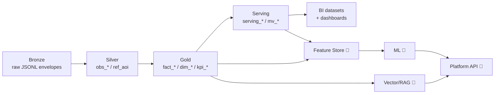

# Data Inventory — Operational Reference (Data Engineer View)

A single, consolidated inventory of every physical/logical data object across the platform's
medallion layers and serving surfaces — Bronze → Silver → Gold → Serving → BI, plus Feature Store,
ML, Vector/RAG, and orchestration run-logging metadata. Use this as the day-to-day map of
"what tables/products/reports exist and what each contains."

For operator commands (start/stop, querying Postgres/MinIO), see [OPERATIONS.md](OPERATIONS.md).
For phase status, see [README.md](README.md).

---

## Legend

| Marker | Meaning |
| --- | --- |
| ✅ Built | Implemented (code + offline tests) |
| 📐 Design | Specified in design docs, not yet implemented |
| 🔄 Sim | Simulation track — synthetic data, post-MVP demonstrator (ADR-09) |
| ⭐ MVP | Core MVP (real open data) |

Grain = one row per … . All facts/products conform to `dim_date` (UTC) and, where spatial, `dim_aoi`/`dim_geo`.

### Analysis regions and AOIs

Every AOI belongs to one analysis region, carried as `region` on `ref_aoi`, `dim_aoi`, every
AOI-grained serving product, and both rollups. Regions are never summed together.

| Region | AOIs | AQI standard | Notes |
| --- | --- | --- | --- |
| `UAE-GULF` | `AOI-UAE-NAT`, `AOI-AUH`, `AOI-DXB`, `AOI-COAST`, `AOI-DESERT`, `AOI-ARABIA`, `AOI-IRAQ`, `AOI-IRAN`, `AOI-GULF`, `EMSR-AE-FLOOD-2024` | `US_EPA_PRE2024` | Primary programme region + upwind dust corridors |
| `INDIA` | `IN-DEL-NCR`, `IN-MUM`, `IN-PB-HR`, `IN-THAR`, `IN-GUJ-COAST`, `IN-ASSAM` | `IN_CPCB_NAQI_2014` | Regional tier (2026-11-14); 30-day backfill from 2026-10-15 |
| `US-LEGACY` | `EMSR-CA-FIRE-2025` | — | Legacy reference; FIRMS no longer requested |

Definitions and per-source budgets: [docs/source-data-analysis/climate/02-aoi-strategy.md](docs/source-data-analysis/climate/02-aoi-strategy.md#analysis-regions).

---

## 1. Bronze — Raw Landing (schema-on-read)

Bronze has **no per-source table names**; every raw record is wrapped in a standard envelope and
partitioned by `_source` + `ingest_date`. Object layout: `s3://bronze/<source>/ingest_date=YYYY-MM-DD/<batch_id>/part-*.jsonl`.

**Envelope columns (all sources):** `_ingest_id`, `_source`, `_ingest_ts`, `_event_ts`, `_batch_id`, `_format`, `_checksum`, `_source_uri`, `payload`.

| Source code | Contains | Status |
| --- | --- | --- |
| `FIRMS` / `VIIRS` | Near-real-time active-fire alerts (lat/lon, brightness, FRP, confidence). VIIRS S-NPP through 2026-11-02, VIIRS NOAA-20 from 2026-11-03 (`FIRMS_SOURCE`); requested for the MENA box and per INDIA AOI box | ✅ ⭐ |
| `S2` / `SENTINELHUB` / `EARTHDATA` / `LANDSAT` | Imagery scene metadata (tile/scene id, acquisition, cloud cover, bands) | ✅ ⭐ |
| `SENTINELHUB_STATS` | Per-AOI spectral-index statistics (NDVI/NDWI/NBR buckets) | ✅ ⭐ |
| `GFW` | Global Fishing Watch vessel **identity** search results (name/flag/IMO/type; no positions). Fixed name query, so `serving_vessel_activity` is a **demonstrator** (SG-05) | ✅ (demonstrator) |
| `GFW_4WINGS` | GFW 4Wings area reports per maritime AOI (`AOI-GULF`, `AOI-COAST`, `IN-GUJ-COAST`, `IN-MUM`): apparent fishing effort, AIS presence, Sentinel-1 SAR detections, spatially aggregated to AOI × day × flag. Non-commercial use only | ✅ ⭐ |
| `POWER` | NASA POWER daily weather (T2M, RH2M, WS2M, WD2M, precipitation) per AOI representative point; UTC days since 2026-11-15 (legacy rows `time_standard = LST`) | ✅ ⭐ |
| `SWPC` | NOAA space-weather indices (Kp, Dst, solar wind) | ✅ 🔄 |
| `CELESTRAK` | Orbital TLE/GP elements (landed every 6 h; not consumed yet — Phase 26 `orbit_object`, SG-07) | ✅ 🔄 |
| `EMS` | Copernicus EMS activation footprints (file upload). **Upload path does not reach Silver** (SG-08); `ref_aoi` comes from the in-repo seed | 📐 |
| `TELEMETRY` | Synthetic spacecraft telemetry stream | 📐 🔄 |

---

## 2. Silver — Conformed / Cleaned Entities

Cleaned, deduplicated, unit-standardized, AOI-tagged. Source: `docs/data-modeling/03-silver-layer.md`.

### Earth Observation & Maritime ⭐

| Entity | Grain | Contains |
| --- | --- | --- |
| `obs_fire` | 1 / fire detection | Normalized FIRMS/VIIRS detections, canonical units + confidence |
| `obs_flood` | 1 / scene / AOI | Cleaned flood-scene metadata (NDWI context) |
| `obs_vessel` | 1 / vessel identity | Normalized maritime registry (MMSI/IMO/flag) - demonstrator sample (SG-05) |
| `silver_maritime_activity` | 1 / dataset / AOI / day / flag | GFW 4Wings spatially aggregated fishing hours, AIS presence hours, SAR detections; `ais_matched = false` for unmatched SAR |
| `obs_scene` | 1 / scene granule | Normalized imagery metadata (Sentinel/Landsat/Earthdata) |
| `obs_index` | 1 / AOI / index / date | Spectral-index stats (NDVI, NDWI, NBR) + valid-pixel fraction |
| `ref_aoi` | 1 / EMS footprint | Copernicus EMS activation areas (reference dimension) |

### Simulation Track 🔄

| Entity | Grain | Contains |
| --- | --- | --- |
| `dim_satellite` | 1 / satellite | Normalized spacecraft identity |
| `dim_sensor` | 1 / sensor | Standardized sensor registry |
| `dim_mission` | 1 / mission | Mission metadata |
| `fact_launch_event` | 1 / launch | Launch event facts |
| `orbit_trajectory` | 1 / sat / timestamp | Orbital position time series |
| `dim_ground_station` | 1 / station | Ground-station registry |

---

## 3. Gold — Star Schema (facts, dimensions, KPI aggregates)

Source: `docs/data-modeling/04-gold-layer.md`, `05-star-schemas.md`.

### Facts

| Fact | Grain | Contains | Status |
| --- | --- | --- | --- |
| `fact_fire_detection` | 1 / detection / AOI / day | FRP + confidence (UC-15) | ✅ ⭐ |
| `fact_flood_extent` | 1 / AOI / scene | Open-water (NDWI) aggregates (UC-16) | ✅ ⭐ |
| `fact_vessel_activity` | 1 / vessel / day | Identity sample + suspicious flag (UC-18 demonstrator) | ✅ |
| `fact_maritime_activity_daily` | 1 / maritime AOI / day | Fishing hours/vessels, presence hours/vessels, SAR detections + unmatched share; `not_published` when GFW has not released a day | ✅ ⭐ |
| `fact_scene_catalog` | 1 / scene | Imagery metadata + searchability score (UC-25) | ✅ ⭐ |
| `fact_launch` | 1 / launch | Launch success/delay metrics | 🔄 |
| `fact_sat_health` | 1 / sat / day | Health score + anomaly count | 🔄 |
| `fact_weather_impact` | 1 / sat / storm window | Geomagnetic-to-anomaly correlation | 🔄 |

### Dimensions

| Dimension | Grain | Contains |
| --- | --- | --- |
| `dim_date` | 1 / calendar day (UTC) | Conformed date key |
| `dim_geo` | 1 / grid cell | Quantized lat/lon tile for spatial joins |
| `dim_aoi` | 1 / AOI | Curated AOI footprint + analysis `region` (UAE-GULF / INDIA / US-LEGACY) |
| `dim_vessel` | 1 / vessel identity | Maritime vessel registry |
| `dim_provider` | 1 / provider | Data/launch provider registry |
| `dim_satellite` 🔄 | 1 / spacecraft | Satellite/mission identity |
| `dim_mission` 🔄 | 1 / mission | Mission metadata |

### KPI / Aggregate tables

| Table | Contains | Status |
| --- | --- | --- |
| `kpi_eo_daily` | Daily EO KPIs per grid cell (fires, burned area, flood km², revisit gap) | ✅ ⭐ |
| `kpi_wildfire_aoi_daily` | Daily wildfire detections + FRP stats per AOI | ✅ ⭐ |
| `kpi_flood_aoi_daily` | Daily NDWI statistics per AOI | ✅ ⭐ |
| `kpi_fishing_daily` | Daily maritime KPIs (vessels, suspicious events, fishing hours) | ✅ ⭐ |
| `kpi_catalog_quality` | Scene metadata completeness % + searchable count per collection | ✅ ⭐ |
| `kpi_aoi_validation` | EMS ground-truth corroboration + evidence days per AOI | ✅ ⭐ |
| `kpi_launch_monthly` | Monthly launch performance per provider | 🔄 |
| `kpi_mission` | Mission success metrics (objective %, uptime) | 🔄 |

---

## 4. Serving — Data Products, Aggregates, Semantic

Pre-denormalized, contract-tested (dbt schema tests + Python unit tests). Source: `serving/serving-models.md`, `serving/products/`.

### MVP data products ⭐

| Product | Grain | Contains |
| --- | --- | --- |
| `serving_wildfire_daily` | 1 / AOI / day | Wildfire detections + intensity + EMS corroboration + region freshness gate (UC-15) |
| `serving_wildfire_freshness` | 1 / region | FIRMS event-time freshness + publication status per analysis region |
| `serving_flood_daily` | 1 / AOI / day | Open-water extent (NDWI) + valid-pixel fraction (UC-16) |
| `serving_vessel_activity` | 1 / vessel / day | DEMONSTRATOR: identity-search sample + suspicious-identity triage (UC-18, RLS) |
| `serving_maritime_activity_daily` | 1 / maritime AOI / day | Area-based maritime activity (GFW 4Wings) with region (UC-18) |
| `serving_scene_catalog` | 1 / scene | Searchable imagery catalog + metadata-quality band (UC-25) |
| `serving_aoi_validation` | 1 / EMS AOI | EMS ground-truth corroboration for damage prioritization (UC-27) |

### Materialized aggregates

| Object | Grain | Contains |
| --- | --- | --- |
| `mv_kpi_platform_daily` | 1 / day / region | Executive rollup across all EO products per analysis region (detections, peak FRP, flood AOI-days); vessels under `GLOBAL` |
| `mv_catalog_quality` | 1 / collection | Catalog quality rollup (searchable rate, mean completeness, mean cloud cover) |

### Semantic layer

| Object | Contains |
| --- | --- |
| `dim_aoi` | Business-named AOI dimension (aoi_key, aoi_name, event_type, area_km2, geo_key) |
| `dim_vessel` | Business-named vessel dimension (registry attributes) |
| Metric registry (`semantic.METRICS`) | Canonical KPI definitions shared by BI, API, RAG |

### Simulation track products 🔄

| Product | Grain | Contains |
| --- | --- | --- |
| `serving_sat_health` | 1 / satellite / day | Daily health score + status band (nominal/degraded/critical) |
| `stream_sat_health_1m` | 1 / satellite / minute | Near-real-time telemetry aggregates + anomaly rate (1-min window) |
| `serving_launch_monthly` | 1 / provider / month | Monthly launch performance (success rate, delays) |
| `serving_weather_impact` | 1 / day | Geomagnetic activity (Kp, storms) + telemetry anomaly correlation |

---

## 5. BI — Dashboards & Certified Datasets

Apache Superset. Source: `bi/dashboards/`, `bi/datasets/certified-datasets.md`.

### Dashboards / reports

| Dashboard | Audience | Primary datasets | Status |
| --- | --- | --- | --- |
| Executive | Leadership | `platform_daily`, `aoi_validation` | ✅ ⭐ |
| Earth Observation | EO / Maritime ops (RLS) | `wildfire_daily`, `flood_daily`, `scene_catalog`, `vessel_activity` | ✅ ⭐ |
| Platform Operations | Engineers / Stewards | `catalog_quality` + observability metrics | ✅ ⭐ |
| Satellite Operations | Demo | `sat_health` | 🔄 |
| Launch Operations | Demo | `launch_monthly` | 🔄 |
| Space Weather | Demo | `weather_impact` | 🔄 |

### Certified datasets (BI semantic datasets)

| Dataset | Source | Grain | TTL | Status |
| --- | --- | --- | --- | --- |
| `wildfire_daily` | `serving.serving_wildfire_daily` | AOI/day | 1h | ✅ ⭐ |
| `flood_daily` | `serving.serving_flood_daily` | AOI/day | 1h | ✅ ⭐ |
| `vessel_activity` | `serving.serving_vessel_activity` | vessel/day | 1h | ✅ (demonstrator) |
| `maritime_activity_daily` | `serving.serving_maritime_activity_daily` | AOI/day | 1h | ✅ ⭐ |
| `scene_catalog` | `serving.serving_scene_catalog` | scene | 1h | ✅ ⭐ |
| `aoi_validation` | `serving.serving_aoi_validation` | AOI | 1h | ✅ ⭐ |
| `platform_daily` | `serving_agg.mv_kpi_platform_daily` | day | 15m | ✅ ⭐ |
| `catalog_quality` | `serving.serving_scene_catalog` | collection | 1h | ✅ ⭐ |
| `sat_health` | `gold.fact_sat_health` (DuckDB httpfs) | sat/day | — | 🔄 |
| `launch_monthly` | `gold.kpi_launch_monthly` (DuckDB httpfs) | provider/month | — | 🔄 |
| `weather_impact` | `gold.fact_weather_impact` (DuckDB httpfs) | day | — | 🔄 |

---

## 6. Feature Store — Feast and Readiness-Gated Views

Implemented in [`feature_store/`](feature_store/) and documented in
[`docs/feature-store/`](docs/feature-store/README.md). PostgreSQL provides the
offline source, online store, and SQL registry in the existing `feast` schema.
Feast PIT retrieval enforces event-time correctness; the readiness manifest
gates materialization and online access.

| Feature group | Example features | Source / grain | Status |
| --- | --- | --- | --- |
| Satellite health | health score, anomaly density, voltage drift | Gold `fact_sat_health`, satellite/day | Demo-only; seed is synthetic |
| Mission operations | uptime fraction, anomaly count | Mission Gold source, mission/time | Blocked: WP0 |
| Orbit stability | altitude drift, velocity variance, decay rate | Orbit Gold source, satellite/time | Blocked: WP0 source inventory |
| Launch performance | launch count, success rate, cadence | Gold `kpi_launch_monthly`, provider/month | Blocked: WP0 source/freshness evidence |
| Space weather | max/mean Kp, storm count | Gold `fact_weather_impact`, scope/day | Blocked: WP0 lineage/source nature |
| Wildfire AOI | detections, FRP, EMS corroboration | Gold `kpi_wildfire_aoi_daily`, AOI/day | Blocked: WP1 45/98 reconciliation |
| Spectral index | NDVI/NDWI/NBR, valid-pixel fraction | Silver `silver_index`, AOI/day | Blocked: WP2; no validated rows |
| Scene catalog | cloud cover, completeness, searchable | Gold `fact_scene_catalog`, scene | Restricted to catalog discovery; stale dates flagged |
| Vessel activity | transmission count, screening flag | Gold `fact_vessel_activity`, vessel/day | Blocked: WP5 event grain/heuristic semantics |
| Air quality | PM2.5/PM10/O3, station count | Gold `fact_air_quality_daily`, AOI/day | Blocked: WP3 units and missingness |
| Dust | AOD, valid fraction, wind context | Gold `fact_dust_event_daily`, AOI/day | Blocked: WP4 null wind measures |

Feature registration does not mean data is populated or analysis-ready. The
offline store is PostgreSQL-backed rather than Parquet snapshots; the source
bridge copies selected Gold data into a Feast-readable table without replacing
Gold as the source of truth. Full blocker evidence and permitted uses are in the
[readiness log](docs/feature-store/03-readiness-and-blockers.md).

---

## 7. ML — Datasets & Artifacts 📐

Design-only (Phase 14). Source: `serving/ai-data-serving.md`, `architecture/07-ai-ml-architecture.md`.

| Artifact | Type | Contains |
| --- | --- | --- |
| Wildfire escalation training set | Training | Labeled from `serving_wildfire_daily` + `serving_aoi_validation` (EMS labels) |
| Vessel-anomaly training set | Training | Labeled from `serving_vessel_activity` |
| Daily flood-risk scoring input | Inference | Feature vectors from `serving_flood_daily` |
| AOI feature vector | Inference | Quality-checked offline features promoted to online KV |
| MLflow model registry | Registry | Experiments, params, metrics, versions, stage transitions |
| Model serving API | Serving | FastAPI exposing prediction endpoints from approved MLflow version |

Monitoring hooks: prediction latency/throughput, input feature drift, output distribution, feature data quality.

---

## 8. Vector / RAG — Collections 📐

Design-only (Qdrant + Ollama, Phase 15). Source: `docs/data-modeling/09-vector-model.md`.
Chunk schema: `chunk_id`, `embedding`, `source_ref` (grounding key), `text`, `metadata`.

| Collection | Embedding source | Use | Status |
| --- | --- | --- | --- |
| Mission knowledge base | Mission docs, ADRs, reports, specs | Analyst Q&A RAG | 📐 ⭐ |
| Geo-event cards | Fire/flood/change-detection event cards | Situational Q&A over events | 📐 ⭐ |
| Telemetry anomaly summaries | Anomaly descriptions + context | Semantic search on telemetry events | 📐 🔄 |

---

## 9. Orchestration — Run-Logging Metadata (`metadata` schema)

Airflow-orchestrated pipeline runs (see [OPERATIONS.md §14](OPERATIONS.md#14-airflow-orchestrated-pipelines--run-logging-pipelines))
log run/row-level metrics to PostgreSQL — **not** part of the medallion data flow itself,
but the operational record of it. Lives in the `metadata` schema (ADR-007), reserved for
exactly this purpose. Every stage gets a header table (one row per `run_id`, Airflow's own
`dag_run_id`) and, except the two roll-ups, a detail table (one row per source / Silver
entity / Gold mart / serving model / BI dataset processed in that run). All writes are
idempotent upserts (`INSERT ... ON CONFLICT DO UPDATE`). Source:
`infrastructure/configs/postgres/init/02-pipeline-run-logging.sql`, `pipelines/common/run_logger.py`.

| Table | Grain | Contains | Status |
| --- | --- | --- | --- |
| `master_run` | 1 / `platform_master_pipeline` run | Rollup: status, timing, the `batch_run_id`/`streaming_run_id` it triggered | ✅ Built |
| `batch_run` | 1 / `platform_batch_pipeline` run | Rollup: status, timing, `total_rows` summed across its 4 stage headers | ✅ Built |
| `ingestion_run` / `ingestion_run_detail` | 1 / run; 1 / API source per run | Batch-ingestion stage header + per-source status/rows/error (`SWPC`, `FIRMS`, `OPENAQ:AOI-DXB`, `TROPOMI:AOI-UAE-NAT:NO2`, …) | ✅ Built |
| `transformation_run` / `transformation_run_detail` | 1 / run; 1 / Silver entity or Gold mart per run | Bronze→Silver→Gold stage header + per-unit row counts (`silver_fire`, `gold_kpi_wildfire_aoi_daily`, `gold_dbt_demonstrator`, …) | ✅ Built |
| `serving_run` / `serving_run_detail` | 1 / run; 1 / serving dbt model per run | Gold→serving stage header + per-model row counts (`serving_wildfire_daily`, `mv_kpi_platform_daily`, …) | ✅ Built |
| `bi_run` / `bi_run_detail` | 1 / run; 1 / Superset dataset per run | BI-refresh stage header + per-dataset refresh status | ✅ Built |
| `streaming_run` / `streaming_run_detail` | 1 / run; 1 / streaming unit per run | Streaming-pipeline header + per-unit status/rows (`telemetry_produce`, `raw_ingest_consumer`, `validation_consumer`, `stream_sat_health_1m`) | ✅ Built |

---

## Lineage (end-to-end)

---

## Planned Additions — Climate / Dust / Air-Quality (authored, not built)

Delivered via extension prompts `05b`–`16b` (see [README.md](README.md#planned-expansion--climate-dust--air-quality-monitoring)). New objects will follow the same patterns and AOI-date grain. Design contracts are authored in [docs/source-data-analysis/climate/](docs/source-data-analysis/climate/README.md) (05b) and [docs/data-modeling/climate/](docs/data-modeling/climate/README.md) (06b); implementation (08b+) is pending.

> **Bronze source codes:** `OPENAQ`, `TROPOMI` (Sentinel-5P via Google Earth Engine), `MODIS_AOD` (MODIS MAIAC AOD via Google Earth Engine).

| Layer | Planned objects |
| --- | --- |
| Bronze | `OPENAQ`, `TROPOMI`, `MODIS_AOD` source classes (JSONL) |
| Silver | `obs_air_quality`, `obs_aerosol`, `obs_atmos_column`, `obs_wind` |
| Gold | `fact_air_quality_daily`, `fact_dust_event_daily`, `fact_climate_indicator_daily`, `fact_vegetation_health_daily`; dims `dim_pollutant`, `dim_climate_indicator` |
| Serving | `serving_air_quality_daily`, `serving_dust_event_daily`, `serving_climate_indicator_daily`, `serving_vegetation_health_daily` |
| BI | Air-Quality/Dust dashboard, Climate-Indicators dashboard, Weather dashboard (sim → real) |
| Feature/ML | AQ/dust/climate feature views; AOD→PM regression, dust & heatwave forecast models |
| RAG | Environmental-report / climate-summary corpus over new Gold products |
