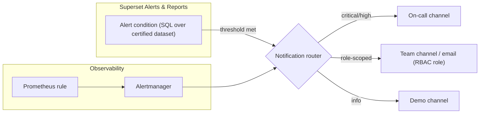

# BI Alerting Strategy

> Phase 12 · Task 8 — Alerting Strategy

Defines threshold- and event-driven alerts raised from the BI / serving layer.
BI alerts are **decision alerts** (a KPI crossed a business threshold); they
complement — and never replace — the infrastructure alerts owned by
Prometheus/Alertmanager in the observability stack
([`architecture/08-observability-architecture.md`](../../architecture/08-observability-architecture.md)).

## Alert Catalog

| Alert | Trigger | Source | Severity | Owner | Notify |
| --- | --- | --- | --- | --- | --- |
| Pipeline failure | Airflow task-run failed | Prometheus / Airflow | critical | Platform Eng | on-call channel |
| SLA breach | serving p95 latency > SLA | serving metrics | high | Platform Lead | channel + email |
| Data freshness breach | Gold lag > 60 min | serving refresh metric | high | Platform Eng | channel |
| Resource utilization | container mem > 90% limit | Prometheus/cAdvisor | medium | Platform Eng | channel |
| New suspicious vessel | `vessel_activity.suspicious_flag` new high-priority row | Superset alert on `vessel_activity` | high | Maritime Lead | `ops_maritime` |
| Wildfire severity spike | new `wildfire_daily` row severity ∈ {high, extreme} | Superset alert | high | EO Ops Lead | `ops_eo` + EM |
| New flood-day | new `flood_daily.flood_flag = true` | Superset alert | high | EO Ops Lead | `ops_eo` + EM |
| Corroboration drop | EMS corroboration rate < 0.6 (7-day) | Superset alert on `aoi_validation` | medium | EO Ops Lead | governance |
| Catalog quality drop | `catalog_quality.searchable_rate` < 0.75 | Superset alert | medium | Data Steward | `steward` |
| AQI exceedance | new `air_quality_daily.exceedance_flag = true` | Superset alert on `air_quality_daily` | high | Air-Quality Lead | `ops_airquality` + EM |
| High-AOD dust event | new `dust_event_daily.aod_max` in heavy-dust band (≥ 1.0) or `dust_severity_band ≥ 3` | Superset alert on `dust_event_daily` | high | Air-Quality Lead | `ops_airquality` + aviation/ports |
| Extreme LST anomaly | `climate_indicator_daily.lst_anomaly_c` in extreme band (≥ +2 °C, 7-day) or `warming_flag` sustained | Superset alert on `climate_indicator_daily` | medium | Climate Analytics Lead | `ops_climate` |
| Desertification onset | new `climate_indicator_daily.desertification_flag = true` | Superset alert | medium | Climate Analytics Lead | `ops_climate` + governance |
| Crop-stress spike | new `vegetation_health_daily.crop_stress_flag = true` | Superset alert | medium | Climate Analytics Lead | `ops_climate` |
| Space-weather storm `sim` | `weather_impact.max_kp_index ≥ 5` | Superset alert | info (demo) | Platform Lead | `demo` |

## Notification Flow

- **Business/KPI alerts** are Superset "Alerts" evaluating a SQL condition over a
  certified dataset on a schedule (aligned to the serving refresh).
- **Infrastructure alerts** (pipeline, SLA, freshness, resources) originate in
  Prometheus/Alertmanager and are surfaced in the Platform Operations dashboard.
- Recipients are mapped to **RBAC roles** so a maritime alert never reaches EO-only
  users (and RLS scopes any embedded data).

## Alert Governance

| Rule | Rationale |
| --- | --- |
| Every alert has a single owner | clear accountability |
| Alerts fire only after serving refresh | avoid alerting on half-built data |
| Thresholds match the KPI catalog bands | one definition of "bad" |
| Alert fatigue guard: dedupe + cooldown | avoid repeated same-condition alerts |
| Alert definitions exported to `bi/superset/` | version control |

## Escalation

| Severity | First response | Escalation (unacknowledged) |
| --- | --- | --- |
| Critical | on-call, immediate | +15 min → Platform Lead |
| High | owning team, same shift | +1 h → on-call |
| Medium | owning team, next business day | weekly review |
| Info (`sim`) | none required | — |

## Cross References

- Serving incidents: [../../serving/incidents.md](../../serving/incidents.md).
- Quality incidents: [../../quality/incidents/production-incidents.md](../../quality/incidents/production-incidents.md).
- Observability: [../../architecture/08-observability-architecture.md](../../architecture/08-observability-architecture.md).
