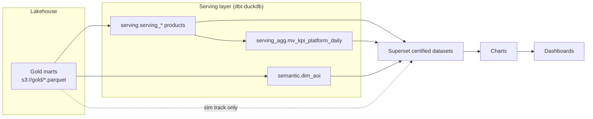
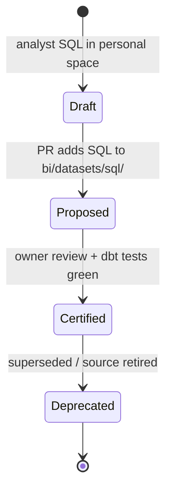

# BI Certified Datasets

> Phase 12 — Business Intelligence & Analytics · Task 6 (Dataset Strategy)

Every Superset dataset in this platform is a **certified virtual dataset** whose
SQL is version-controlled in [`sql/`](./sql/). Charts select columns from these
datasets — **no ad-hoc SQL is permitted inside charts** (Superset calculated
columns for KPIs are forbidden). This guarantees that a KPI shown in BI is byte-
for-byte identical to the same KPI returned by the serving API and the RAG layer,
because all three read the same certified serving product.

## Consumption Contract (ADR-SV-01 alignment)

- **MVP datasets** read the **serving products** (never Silver/Gold directly).
- **Sim-track datasets** (`sat_health`, `launch_monthly`, `weather_impact`) have
  no dbt serving product, so their certified SQL reads the Gold Parquet via
  DuckDB `httpfs` and re-applies the semantic status band. They are always
  labelled `sim` and gated to the `demo` role.

## Certified Dataset Catalog

### MVP — Earth Observation & Maritime (primary)

| Dataset | Certified SQL | Source table | Grain | Type | Refresh | Owner | Roles |
| --- | --- | --- | --- | --- | --- | --- | --- |
| `wildfire_daily` | [wildfire_daily.sql](./sql/wildfire_daily.sql) | `serving.serving_wildfire_daily` | AOI/day | Certified | 1h TTL | EO Ops Lead | `ops_eo`, `exec` |
| `flood_daily` | [flood_daily.sql](./sql/flood_daily.sql) | `serving.serving_flood_daily` | AOI/day | Certified | 1h TTL | EO Ops Lead | `ops_eo`, `exec` |
| `vessel_activity` | [vessel_activity.sql](./sql/vessel_activity.sql) | `serving.serving_vessel_activity` | vessel/day | Certified | 1h TTL | Maritime Lead | `ops_maritime`, `exec` |
| `scene_catalog` | [scene_catalog.sql](./sql/scene_catalog.sql) | `serving.serving_scene_catalog` | scene | Certified | 1h TTL | Data Steward | `steward` |
| `aoi_validation` | [aoi_validation.sql](./sql/aoi_validation.sql) | `serving.serving_aoi_validation` | AOI | Certified | 1h TTL | EO Ops Lead | `exec`, `ops_eo` |
| `platform_daily` | [platform_daily.sql](./sql/platform_daily.sql) | `serving_agg.mv_kpi_platform_daily` | day | Materialized | 15min TTL | Platform Lead | `exec` |
| `catalog_quality` | [catalog_quality.sql](./sql/catalog_quality.sql) | `serving.serving_scene_catalog` | collection | Certified (BI aggregate) | 1h TTL | Data Steward | `steward` |

### Climate / Dust / Air-Quality — real data (Phase 12b, primary)

| Dataset | Certified SQL | Source table | Grain | Type | Refresh | Owner | Roles |
| --- | --- | --- | --- | --- | --- | --- | --- |
| `air_quality_daily` | [air_quality_daily.sql](./sql/air_quality_daily.sql) | `serving.serving_air_quality_daily` | AOI/day | Certified | 1h TTL | Air-Quality Lead | `ops_airquality`, `exec` |
| `dust_event_daily` | [dust_event_daily.sql](./sql/dust_event_daily.sql) | `serving.serving_dust_event_daily` | AOI/day | Certified | 1h TTL | Air-Quality Lead | `ops_airquality`, `exec` |
| `climate_indicator_daily` | [climate_indicator_daily.sql](./sql/climate_indicator_daily.sql) | `serving.serving_climate_indicator_daily` | AOI/day | Certified | 1h TTL | Climate Analytics Lead | `ops_climate`, `exec` |
| `vegetation_health_daily` | [vegetation_health_daily.sql](./sql/vegetation_health_daily.sql) | `serving.serving_vegetation_health_daily` | AOI/day | Certified | 1h TTL | Climate Analytics Lead | `ops_climate`, `exec` |
| `climate_daily` | [climate_daily.sql](./sql/climate_daily.sql) | `serving_agg.mv_kpi_climate_daily` | day | Materialized | 15min TTL | Platform Lead | `exec`, `ops_climate`, `ops_airquality` |

### Simulation-Track — post-MVP demonstrator (ADR-09)

| Dataset | Certified SQL | Source table | Grain | Type | Owner | Roles |
| --- | --- | --- | --- | --- | --- | --- |
| `sat_health` | [sat_health.sql](./sql/sat_health.sql) | `gold.fact_sat_health` | sat/day | Certified (`sim`) | Platform Lead | `demo` |
| `launch_monthly` | [launch_monthly.sql](./sql/launch_monthly.sql) | `gold.kpi_launch_monthly` | provider/month | Certified (`sim`) | Platform Lead | `demo` |
| `weather_impact` | [weather_impact.sql](./sql/weather_impact.sql) | `gold.fact_weather_impact` | day | Certified (`sim`) | Platform Lead | `demo` |

## Dataset Tiers (Task 6)

| Tier | Definition | In this platform |
| --- | --- | --- |
| **Certified** | Governed, tested, single-owner, safe for exec reporting | All 15 datasets above |
| **Shared** | Reusable across teams, certified upstream | All MVP + climate serving products |
| **Materialized** | Pre-computed rollup for latency-critical charts | `platform_daily`, `climate_daily` |
| **Virtual** | SQL-defined view (not physically stored in Superset) | Every dataset here (SQL in `sql/`) |
| **Personal** | Analyst-owned exploration, **not** promoted to dashboards | Allowed only in a personal Superset folder; excluded from version control and RBAC dashboards |

## Lifecycle

- A dataset becomes **Certified** only when its source serving product passes the
  dbt contract tests in `serving/dbt/models/**/_*.yml`.
- **Deprecation** requires a 1-release notice; the dataset is tagged `deprecated`
  in Superset and removed from role defaults before deletion.

## Ownership

Dataset owner = the owning serving **data product** owner (see
[`serving/products/`](../../serving/products/) and
[`quality/governance/ownership-matrix.md`](../../quality/governance/ownership-matrix.md)).
BI does not introduce new ownership — it inherits the serving contract.
