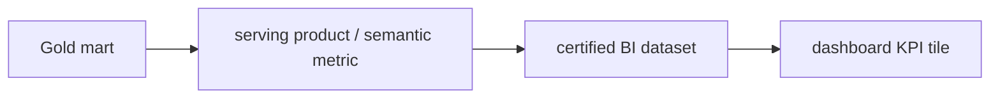

# BI KPI Catalog

> Phase 12 · Task 3 — KPI Catalog

Every KPI shown in a Superset dashboard is defined here **once**. The formula
lives upstream in the serving semantic layer
([`serving/marts/semantic.py`](../../serving/marts/semantic.py) `METRICS` and
[`serving/semantic/kpi-catalog.md`](../../serving/semantic/kpi-catalog.md)); this
catalog binds each KPI to its BI dataset, refresh, owner, thresholds, and business
impact. BI never re-implements a formula — it displays the certified value.

## KPI Lineage

## MVP KPIs (real data — primary)

### 1. Total Fire Detections
- **Business definition:** Number of satellite fire detections attributed to
  monitored AOIs — the wildfire monitoring workload signal.
- **Formula:** `Σ detections` over `wildfire_daily` rows.
- **Source tables:** `gold.kpi_wildfire_aoi_daily` → `serving_wildfire_daily` →
  dataset `wildfire_daily`; aggregate `platform_daily.fire_detections`.
- **Refresh:** hourly (serving refresh); executive tile 15-min cache.
- **Owner:** EO Operations Lead.
- **Thresholds:** informational; day-over-day spike >3× 7-day mean → amber.
- **Business impact:** drives wildfire mean-time-to-detect and monitored coverage.

### 2. Mean Fire Radiative Power
- **Definition:** Average fire intensity across AOI-days.
- **Formula:** `avg(mean_frp)`; severity band from `max_frp`.
- **Source:** `wildfire_daily.mean_frp` / `.severity`.
- **Refresh:** hourly. **Owner:** EO Ops Lead.
- **Thresholds:** severity extreme (`max_frp≥100`) / high (`≥30`) / moderate (`≥10`).
- **Impact:** prioritises response to the most intense fires.

### 3. Flood Day Rate
- **Definition:** Share of AOI-days classified as flooded (NDWI threshold).
- **Formula:** `avg(flood_flag::int)`.
- **Source:** `gold.kpi_flood_aoi_daily` → `flood_daily.flood_flag`;
  `platform_daily.flood_aoi_days`.
- **Refresh:** hourly. **Owner:** EO Ops Lead.
- **Thresholds:** informational; rising rate → emergency-management attention.
- **Impact:** impact-assessment turnaround for flood response.

### 4. Suspicious Vessel Rate
- **Definition:** Share of vessel-days flagged suspicious (illegal-fishing heuristic).
- **Formula:** `avg(suspicious_flag::int)`; `review_priority = high` when suspicious.
- **Source:** `gold.fact_vessel_activity` → `vessel_activity`;
  `platform_daily.suspicious_vessels`.
- **Refresh:** hourly. **Owner:** Maritime Intelligence Lead.
- **Thresholds:** any high-priority vessel → triage queue; spike → amber.
- **Impact:** triage coverage and response cycle time for maritime enforcement.

### 5. Searchable Scene Rate
- **Definition:** Share of catalogued scenes that are searchable/discoverable.
- **Formula:** `avg(is_searchable::int)`; `catalog_quality.searchable_rate`.
- **Source:** `gold.fact_scene_catalog` → `scene_catalog` / `catalog_quality`.
- **Refresh:** hourly. **Owner:** Data Steward.
- **Thresholds:** ≥0.9 green / 0.75–0.9 amber / <0.75 red.
- **Impact:** analyst search-success rate and retrieval time (UC-25).

### 6. EMS Corroboration Rate  *(executive "Mission Success" proxy)*
- **Definition:** Share of Copernicus-EMS AOIs whose detections are corroborated
  by ground truth — the platform's trust signal.
- **Formula:** `avg(corroborated::int)`.
- **Source:** `gold.kpi_aoi_validation` → `aoi_validation.corroborated`.
- **Refresh:** hourly. **Owner:** EO Operations Lead.
- **Thresholds:** ≥0.8 green / 0.6–0.8 amber / <0.6 red.
- **Impact:** false-positive/negative trust; the headline executive quality KPI.

## Climate / Dust / Air-Quality KPIs (real data — Phase 12b)

### 11. AQI Exceedance Days
- **Business definition:** AOI-days on which a pollutant daily mean breached its
  WHO 2021 guideline — the air-quality alert workload signal.
- **Formula:** `Σ (exceedance_flag)` over `air_quality_daily`; rollup
  `climate_daily.aqi_exceedance_days`.
- **Source:** `serving_air_quality_daily.exceedance_flag` →
  `mv_kpi_climate_daily`. AQI band is US-EPA piecewise, pre-computed upstream.
- **Refresh:** hourly (exec tile 15-min cache). **Owner:** Air-Quality Lead.
- **Thresholds:** 0 green / 1–5 amber / >5 red.
- **Impact:** smart-city / aviation / ports public-health notifications.

### 12. Mean AQI (PM2.5)
- **Definition:** Window mean US-EPA AQI from PM2.5.
- **Formula:** `avg(aqi_pm25)`; band ≤50 good / 51–100 moderate / >100 unhealthy.
- **Source:** `air_quality_daily.aqi_pm25`; `climate_daily.mean_aqi_pm25`.
- **Refresh:** hourly. **Owner:** Air-Quality Lead.
- **Impact:** headline air-quality index for operations and executives.

### 13. Active Dust Days
- **Definition:** AOI-days flagged as a dust event (AOD / dust-index band).
- **Formula:** `Σ (dust_flag)`; `climate_daily.dust_event_days`.
- **Source:** `serving_dust_event_daily.dust_flag`; peak `aod_max`.
- **Refresh:** hourly. **Owner:** Air-Quality Lead.
- **Thresholds:** 0 green / 1–4 amber / ≥5 red.
- **Impact:** aviation visibility, port operations, health advisories.

### 14. Mean LST Anomaly
- **Definition:** Window mean land-surface-temperature anomaly vs same-day-of-year
  baseline (°C) — the climate-warming signal.
- **Formula:** `avg(lst_anomaly_c)`; `climate_daily.mean_lst_anomaly`.
- **Source:** `serving_climate_indicator_daily.lst_anomaly_c` / `warming_flag`.
- **Refresh:** hourly. **Owner:** Climate Analytics Lead.
- **Thresholds:** <+1 green / +1–+2 amber / ≥+2 red.
- **Impact:** heatwave and desertification early warning.

### 15. Mean NDVI (Vegetation Health)
- **Definition:** Window mean NDVI greenness; crop-stress proxy when NDVI low and
  declining.
- **Formula:** `avg(ndvi_mean)`; `Σ (crop_stress_flag)`.
- **Source:** `serving_vegetation_health_daily.ndvi_mean` / `crop_stress_flag`.
- **Refresh:** hourly. **Owner:** Climate Analytics Lead.
- **Thresholds:** health band pre-computed (Bare/Sparse/Moderate/Healthy/Dense).
- **Impact:** agriculture, food-security, and desertification monitoring.

## Platform / Engineering KPIs

### 7. Searchable Rate (collection) — `catalog_quality.searchable_rate`
- Owner: Data Steward · hourly · ≥0.9 green · discoverability of imagery.

### 8. Pipeline Success Rate — observability metric (Airflow/Prometheus)
- Owner: Platform Eng · 5-min scrape · ≥0.98 green · pipeline reliability.

### 9. Data Freshness — serving refresh lag metric
- Owner: Platform Eng · per-run · ≤60 min green · timeliness of insight.

### 10. SLA Compliance — serving latency metric (see `serving/slas.md`)
- Owner: Platform Lead · 5-min scrape · ≥0.99 green · service commitment.

## Simulation-Track KPIs (`sim`, post-MVP)

| KPI | Formula | Source · dataset | Owner | Threshold | Impact |
| --- | --- | --- | --- | --- | --- |
| Mean Satellite Health | `avg(health_score)` | `gold.fact_sat_health` · `sat_health` | Platform Lead | ≥0.8 nominal | asset uptime (demo) |
| Launch Success Rate | `avg(success_rate)` | `gold.kpi_launch_monthly` · `launch_monthly` | Platform Lead | ≥0.9 | mission reliability (demo) |
| Storm Days | `count(max_kp_index≥5)` | `gold.fact_weather_impact` · `weather_impact` | Platform Lead | ≥5 alert | space-weather risk (demo) |

## Consistency Guarantees

- KPI banding (severity, quality band, trust, status, storm-day) is **pre-computed
  upstream** so BI, API, and RAG show identical values.
- Requesting an unregistered KPI fails fast in the semantic layer (no silent
  empties). Empty input returns `None`, never a misleading `0`.

## Cross References

- Business KPI framework: [../../docs/business/08-kpis.md](../../docs/business/08-kpis.md).
- Semantic single source: [../../serving/semantic/kpi-catalog.md](../../serving/semantic/kpi-catalog.md).
- SLAs: [../../serving/slas.md](../../serving/slas.md).
