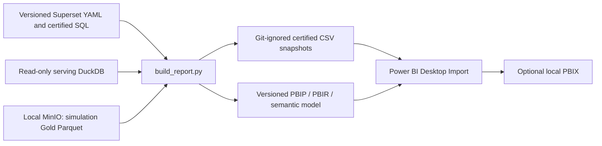

# Power BI Desktop Reporting Client

## Scope and Architecture

An explicitly approved **proprietary Desktop-client exception** alongside the
existing open-source platform. Superset remains available and unchanged. This
is a translation of implemented Superset assets, not an expansion into another
platform phase and not a migration of the hosted BI service.

The [project entry point](./SpaceMission.pbip) opens one local report with
**15 dashboard/tab pages**, plus **one data-status page**. It represents all
**7 implemented dashboards**, **46 unique source charts**, and **48 chart
placements**; two source charts are reused on other pages.



Certified dataset SQL is executed unchanged. DuckDB is attached as
`serving_products` to avoid the existing `serving.duckdb` catalog/schema name
collision. Existing SQL aggregate expressions are translated into equivalent
DAX aggregations; their original SQL is retained in measure descriptions and
annotations. No new business KPI definitions are introduced.

## Coverage

| Superset dashboard | Power BI report pages |
| --- | --- |
| Executive | Overview; Details |
| Earth Observation | Overview; Details |
| Imagery & Catalog Quality | Overview |
| Air Quality & Dust | Air Quality; Dust; Details |
| Climate Indicators | Temperature & Water; Vegetation & Land; Details |
| Simulation Track | Satellite; Launch; Weather, retaining source `sim` chart labels |
| Weather, real climate data | Overview |
| Additional operational information | Data status: row counts, availability, date coverage, export timestamp |

[coverage.json](./coverage.json) maps every chart placement to its source YAML,
dataset, report page, visual type, and any visual substitution.

## Open in Power BI Desktop

1. Open [SpaceMission.pbip](./SpaceMission.pbip) in the installed Power BI Desktop.
   If Desktop requests it, enable **Power BI Project (.pbip) save option** under
   **File > Options and settings > Options > Preview features**, then restart.
2. Select **Home > Refresh** to import the local snapshots. The source project
   does not include a pre-populated Power BI engine cache.
3. If prompted, configure the local file source's privacy level appropriately
   (normally **Private**). Do not disable privacy safeguards.
4. Inspect **Data status - local snapshot** before interpreting empty visuals.
5. Use date/AOI slicers and the Filters pane to explore the dashboard pages.

`SnapshotFolder` is a Power Query text parameter pointing to this checkout's
absolute `data` folder. If the checkout moves, change it through **Transform
data > Manage Parameters**, or rebuild the project at the new location.

## Refresh Data Without Overwriting Report Edits

Run from the repository root in PowerShell:

```powershell
# First-time dependency setup only
.\.venv\Scripts\python.exe -m pip install -r bi\powerbi\requirements.txt

# After the existing serving build has completed and local MinIO is available
.\.venv\Scripts\python.exe bi\powerbi\build_report.py --refresh-only
```

Then select **Home > Refresh** in Desktop. Do not run a Power BI refresh while
the exporter is replacing the CSV files.

- The exporter reads the existing serving database; it does not build or modify it.
- Simulation datasets use the existing MinIO Gold paths. The default host endpoint
  is `localhost:9000`, not the Docker-internal `minio:9000`.
- Credentials are read from environment variables or the existing local
  infrastructure env file, never copied into report definitions.
- `--minio-endpoint`, `--database`, and `--env-file` override these locations.
- A failed query aborts export; unavailable datasets are not silently replaced
  with empty data. A successfully queried zero-row source is explicitly marked
  **EMPTY SOURCE**, with a console warning.
- All datasets are extracted into a staging directory before publication.
  Individual files are replaced after successful extraction; this is not a
  cross-file transaction, so Desktop refresh must be coordinated.
- Schema or Superset-definition changes require a rebuild, preventing an old
  semantic model from silently consuming a new contract.

## Rebuild From Superset

Close the project in Desktop before rebuilding:

```powershell
.\.venv\Scripts\python.exe bi\powerbi\build_report.py
```

**A rebuild overwrites generated report and semantic-model definitions.** Save
intentional Desktop edits separately before running it. A rebuild is appropriate
when Superset assets change; `--refresh-only` is appropriate when only data changes.
If dashboards or charts have been removed upstream, generate to a fresh
`--output` directory rather than retaining obsolete generated pages.

## Save as PBIX

After a successful Desktop refresh:

1. Select **File > Save As**.
2. Choose **Power BI file (*.pbix)**.
3. Save locally, for example as `SpaceMission.pbix` in this folder.

PBIX files and Desktop's `.pbi` cache are ignored by Git because they may contain
imported data. Keep the PBIP, report definitions, semantic model, and source
manifests under version control. Saving a PBIX is a Desktop operation; renaming
a PBIP or JSON file does not produce a valid PBIX.

## Behavioral Differences and Risks

| Area | Behavior and trade-off |
| --- | --- |
| Calendar heatmaps | Native month/day matrices replace both heatmap placements. Values are preserved; custom heatmap colouring is not implemented. |
| Time defaults | Source last-30/90-day windows become explicit UTC bounds fixed when the report is built. They do not slide on snapshot-only refresh. Edit/remove the page filter to widen the window or roll it forward. |
| Date controls | The common date table filters date-bearing products. Monthly launch data has no day-date relationship, matching its source month-key grain. |
| AOI controls | Slicers target the dataset declared in the source native filter. They are not automatically propagated to unrelated products. |
| Detail tables | Native Power BI table interaction replaces Superset-specific pagination and row limits; full certified snapshots are available. Identical duplicate raw rows can be grouped by native tables. |
| Multi-table interaction | A shared date table is provided; no speculative cross-product joins or new business relationships are added. |
| Metrics | Existing means, ratios, and counts retain source aggregation semantics, including source averaging of daily means. Do not substitute different weighted formulas locally. |
| Empty launch data | Zero rows are legitimate source availability, not fabricated launch results. Its visuals stay empty until the existing source is populated. |
| Security | Local snapshots and report files expose the included datasets to anyone with file access. Superset roles, RLS, and audit enforcement are **not** carried over. This is not a role-restricted sharing artifact. |
| Scheduling | Manual snapshot export plus Desktop refresh; no cloud gateway, automated subscriptions, or alert migration is configured. |
| Laptop memory | Power BI imports another copy of selected data. Current snapshots are small; large future products require bounded/aggregated serving contracts. |
| Public sharing | No publication is configured. Do not upload raw snapshots or report files without reviewing data access and licensing requirements. |

## Decisions and Alternatives

| Decision | Rationale | Alternative and trade-off |
| --- | --- | --- |
| Local CSV Import | Uses Desktop's built-in file connector; no new ODBC driver; Desktop does not hold the serving file open | DuckDB ODBC avoids export files but adds driver setup and write/read locking coordination |
| PBIP with PBIR and TMSL model | Text-based assets support Git review; Desktop can open and save to PBIX | PBIX alone is convenient but binary and may embed data |
| Native visuals | No custom-visual installation or external map service | Custom visuals could improve fidelity but add dependencies and review requirements |
| Superset remains authoritative | Reuses certified SQL, metric definitions, and dashboard structure | Independently authored reports may diverge and need separate governance |
| Desktop-only delivery | No paid hosted-service or gateway assumption | Hosted collaboration requires licensing, identity, RLS, gateway, and operations design |

## Validation and Acceptance

```powershell
.\.venv\Scripts\python.exe -m pytest bi\powerbi\tests -q
.\.venv\Scripts\python.exe bi\powerbi\validate_report.py
```

The validator fetches **public Microsoft schemas only**; it does not upload
project definitions or data. `--offline` validates references and coverage
without schema downloads.

| Acceptance measure | Target |
| --- | --- |
| Implemented dashboard coverage | 7 / 7 |
| Unique chart coverage | 46 / 46 |
| Chart placements | 48 |
| Certified datasets represented | 15 / 15 |
| Report pages | 15 translated pages + 1 data-status page |
| Silent missing-data substitutions | 0 |
| Source SQL mutation | 0 |
| Runtime acceptance | Desktop opens project, refreshes successfully, and renders all pages without errors |

Schema validation and unit tests do not alone prove Desktop rendering or DAX
engine parity. Inspect the refreshed report before sharing or relying on it.

### Verified in the installed Desktop

- **14 focused tests passed** and **94 project files passed Microsoft schema validation**.
- The project opened after correcting model-wide measure-name uniqueness.
- Desktop imported the snapshots; all **49 generated measures** matched the
  original Superset SQL evaluated on the same snapshots, with numeric tolerance
  of `1e-10`.
- All **16 page tabs** were selected in Desktop; accessibility checks detected
  no data-loading or visual-rendering error messages. The Executive canvas was
  also inspected visually.
- Null-valued KPIs and zero-row launch data were retained rather than substituted
  with invented values. These are not indications that every upstream data
  product is complete.
- A PBIX has not been generated; use the Desktop save instructions above.

## Glossary

| Term | Meaning |
| --- | --- |
| PBIP | Power BI project entry point referencing text-based report/model definitions |
| PBIR | Power BI report definition format |
| TMSL | Tabular Model Scripting Language; JSON semantic-model definition |
| PBIX | Desktop report file that can embed imported data |
| Snapshot | Point-in-time local export of a certified dataset |
| DAX | Power BI's expression language; used here to preserve source aggregate semantics |
| RLS | Row-level security; not inherited by this local report |
| AOI | Area of interest |
