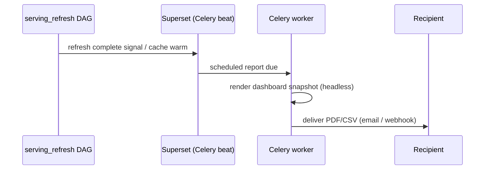

# BI Reporting Strategy

> Phase 12 · Task 7 — Reporting Strategy

Defines the scheduled and real-time reporting cadence layered on top of the
certified Superset dashboards. Reports are generated by **Superset Alerts &
Reports** (Celery worker + Redis) and delivered as dashboard snapshots / CSV
exports. All reports read certified datasets only.

## Report Cadence

| Report | Cadence | Audience | Dashboard / dataset | Format | Delivery |
| --- | --- | --- | --- | --- | --- |
| Executive Daily Brief | Daily 06:00 | Program leadership | Executive (`platform_daily`) | PDF snapshot | email / channel |
| EO Operations Digest | Daily 07:00 | EO analysts, EM teams | Earth Observation (wildfire+flood) | PDF + CSV | email |
| Maritime Watch List | Daily 07:00 | Maritime analysts | EO dash Maritime tab (`vessel_activity`) | CSV | email (`ops_maritime`) |
| Catalog Quality Report | Weekly Mon 08:00 | Data stewards | Platform (`catalog_quality`) | PDF | email |
| Platform Health Report | Weekly Mon 08:00 | Platform eng | Platform Operations | PDF | channel |
| Executive Monthly Review | Monthly 1st | Leadership | Executive + validation | PDF deck | email |
| Sim-Track Demo Report | On demand | Demo / interview | Satellite/Launch/Weather `sim` | PDF | manual export |

## Real-Time Monitoring

- **Live dashboards** (Executive, Platform Ops) auto-refresh on the cache TTL
  (15 min for `platform_daily`, 1h for daily products).
- Real-time **event alerts** (new suspicious vessel, new flood-day) are handled by
  the [alerting strategy](../alerts/alert-strategy.md), not by scheduled reports.
- True streaming freshness (Kafka → serving) is observed via Grafana; Superset
  reflects it at the serving-refresh cadence.

## Scheduled Export Pipeline

- Reports are scheduled to fire **after** the `serving_refresh` DAG completes so
  they never capture a half-built product.
- Failed report runs raise a Superset alert (see incident BI-06).

## Report Governance

| Rule | Rationale |
| --- | --- |
| Reports use certified datasets only | consistency with dashboards/API |
| Recipient lists mapped to RBAC roles | no data leakage across audiences |
| RLS applies to CSV exports | maritime CSV excludes non-maritime rows |
| Every report links back to its dashboard | traceability |
| Report definitions are exported to `bi/superset/` | version control |

## Retention

| Artifact | Retention |
| --- | --- |
| Report run history | 90 days (Superset metadata) |
| Delivered PDF/CSV | recipient-managed (not stored on platform) |
| Executive monthly decks | archived indefinitely (portfolio) |

## Cross References

- Alerting (event-driven): [../alerts/alert-strategy.md](../alerts/alert-strategy.md).
- SLAs: [../../serving/slas.md](../../serving/slas.md).
- Refresh DAG: serving refresh (see [../../serving/monitoring.md](../../serving/monitoring.md)).
