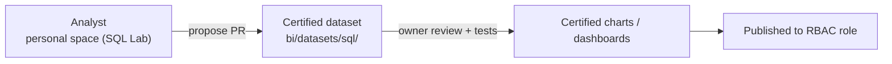
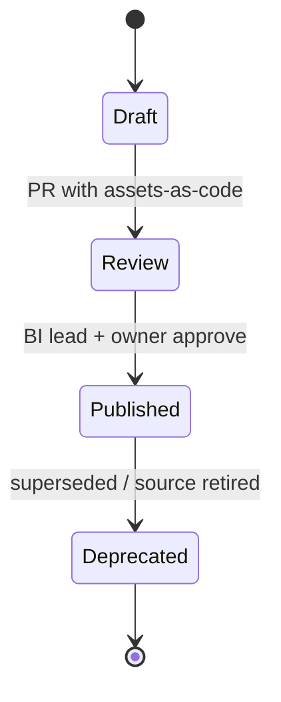

# 01 — BI Strategy

> Phase 12 · Task 1 — BI Strategy

## BI Vision

Deliver a **single, trusted analytics surface** where mission operators,
analysts, engineers, and executives make decisions from the *same* certified
numbers that the platform's APIs and AI layer use. BI is not a separate truth —
it is the human-facing projection of the serving layer.

> **Why BI is critical for space operations.** Space missions generate high-
> volume, high-velocity, safety-relevant data. The value is realised only when a
> human can *see* an anomaly, a fire, a flood, or an SLA breach in time to act.
> BI converts trusted Gold data into **time-to-decision** — the metric that
> ultimately differentiates an operational platform from a data lake.

## Strategic Pillars

| Pillar | Commitment |
| --- | --- |
| One source of truth | KPIs come from the serving semantic layer, never re-derived in BI |
| Governed self-service | Analysts explore in personal space; only certified assets reach dashboards |
| Audience-first design | Dashboards are organised by persona/role, not by data source |
| Operational latency | Executive views read pre-computed aggregates within the cache SLA |
| Reproducibility | All Superset assets are version-controlled (assets-as-code) |
| Trust by corroboration | EMS ground-truth corroboration is a first-class, visible KPI |

## Self-Service Analytics Model

- **Explore** freely against certified datasets in SQL Lab (read-only).
- **Promote** by adding SQL to `bi/datasets/sql/` via PR — never by publishing an
  ad-hoc chart with embedded SQL.
- **Govern** at the promotion gate: owner approval + serving dbt tests green.

## Enterprise Reporting Strategy

Scheduled PDFs/CSVs and real-time monitoring are layered on the same certified
datasets — see [07-reporting.md](./07-reporting.md). No report may use ad-hoc SQL.

## KPI Governance

- Every dashboard KPI is registered in [03-kpis.md](./03-kpis.md) and single-
  sourced in the serving semantic layer.
- Banding (severity, quality, trust, status) is pre-computed upstream so BI, API,
  and RAG agree — a governance council owns any formula change.

## Dashboard Lifecycle

## MVP Alignment

The BI layer is scoped to the **Earth Observation Operations Intelligence MVP**
(wildfire, flood, maritime, imagery catalog, detection validation). Spacecraft
satellite/launch/weather dashboards are delivered as clearly-labelled
**simulation-track demonstrators** (ADR-09), never presented as real-data KPIs.

See [../../docs/business/05-mvp-definition.md](../../docs/business/05-mvp-definition.md).

## Technology

Apache Superset (open-source, laptop-viable) on Docker Desktop, reading the
serving DuckDB. Rationale in [13-adr.md](./13-adr.md) and
[../../docs/infrastructure/12-trade-offs.md](../../docs/infrastructure/12-trade-offs.md).
