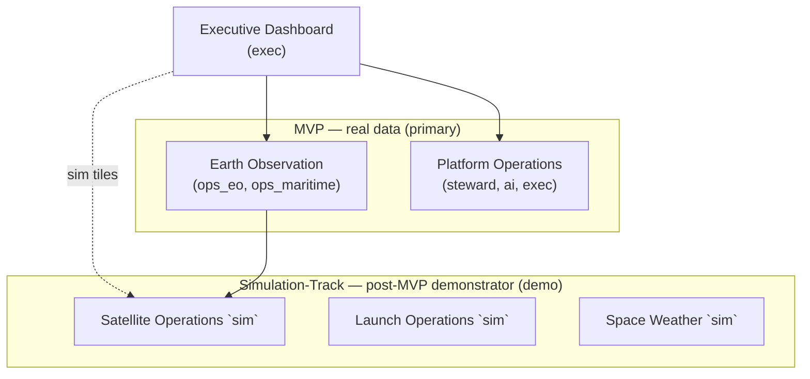

# 02 — Dashboard Catalog

> Phase 12 · Task 2 — Dashboard Catalog

Full per-dashboard specs live in [`bi/dashboards/`](../../bi/dashboards/). This
catalog is the index and hierarchy.

## Dashboard Hierarchy

## Catalog

| Dashboard | Track | Audience / role | Primary datasets | Spec |
| --- | --- | --- | --- | --- |
| Executive | MVP + platform | Leadership · `exec` | `platform_daily`, `aoi_validation` | [executive-dashboard.md](../../bi/dashboards/executive-dashboard.md) |
| Earth Observation | MVP | EO/Maritime · `ops_eo`,`ops_maritime` | `wildfire_daily`,`flood_daily`,`scene_catalog`,`vessel_activity` | [earth-observation-dashboard.md](../../bi/dashboards/earth-observation-dashboard.md) |
| Platform Operations | MVP | Engineers · `steward`,`ai` | `catalog_quality` + observability | [platform-dashboard.md](../../bi/dashboards/platform-dashboard.md) |
| Satellite Operations `sim` | Sim | Demo · `demo` | `sat_health` | [satellite-dashboard.md](../../bi/dashboards/satellite-dashboard.md) |
| Launch Operations `sim` | Sim | Demo · `demo` | `launch_monthly` | [launch-dashboard.md](../../bi/dashboards/launch-dashboard.md) |
| Space Weather `sim` | Sim | Demo · `demo` | `weather_impact` | [weather-dashboard.md](../../bi/dashboards/weather-dashboard.md) |

## Design Principle

Dashboards are organised by **audience**, each mapped 1:1 to an RBAC role. The
prompt's six named dashboards are all delivered; the MVP-primary trio (Executive,
Earth Observation, Platform) carries the real business value, and the sim trio is
retained as a technical demonstrator per ADR-09.

## Maritime Placement

Maritime vessel monitoring (UC-18, an MVP use case) is delivered as **Tab 4 of the
Earth Observation dashboard** with row-level security so `ops_maritime` sees only
maritime data. This keeps the six-dashboard structure while honouring the MVP
maritime scope.

## Assets-as-Code

Every dashboard here has (or follows the pattern for) an importable export under
[`bi/superset/dashboards/`](../../bi/superset/dashboards/).
