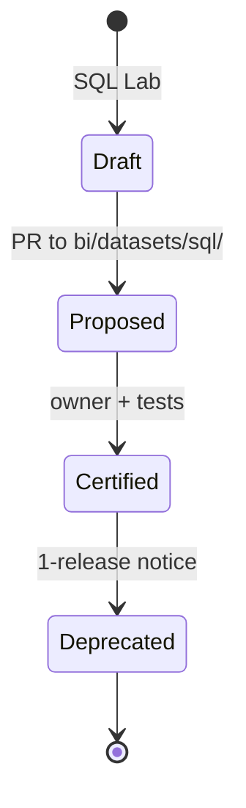

# 06 — Datasets

> Phase 12 · Task 6 — Dataset Strategy

The authoritative dataset catalog and governance are in
[`bi/datasets/certified-datasets.md`](../../bi/datasets/certified-datasets.md) and
[`bi/datasets/dataset-governance.md`](../../bi/datasets/dataset-governance.md).
This document explains the dataset **tiers** and their lifecycle/ownership.

## Dataset Tiers

| Tier | Purpose | Example | Ownership | Lifecycle |
| --- | --- | --- | --- | --- |
| **Certified** | Governed, tested, exec-safe | all 10 BI datasets | serving product owner | promote via PR + tests |
| **Shared** | Reused across teams | MVP serving products | product owner | same as certified |
| **Personal** | Analyst exploration | SQL Lab saved queries | analyst | not promoted; excluded from RBAC dashboards |
| **Virtual** | SQL-defined view | every BI dataset (`sql/`) | product owner | versioned in git |
| **Materialized** | Pre-computed rollup | `platform_daily` | Platform Lead | rebuilt by refresh DAG |

## Certified Datasets (summary)

| Dataset | Source | Track |
| --- | --- | --- |
| `wildfire_daily` | `serving.serving_wildfire_daily` | MVP |
| `flood_daily` | `serving.serving_flood_daily` | MVP |
| `vessel_activity` | `serving.serving_vessel_activity` | MVP |
| `scene_catalog` | `serving.serving_scene_catalog` | MVP |
| `aoi_validation` | `serving.serving_aoi_validation` | MVP |
| `platform_daily` | `serving_agg.mv_kpi_platform_daily` | MVP (materialized) |
| `catalog_quality` | `serving.serving_scene_catalog` (aggregate) | MVP |
| `sat_health` | `gold.fact_sat_health` | Sim |
| `launch_monthly` | `gold.kpi_launch_monthly` | Sim |
| `weather_impact` | `gold.fact_weather_impact` | Sim |

## Lifecycle

## Ownership

Dataset owner = serving **data product** owner, single-sourced in
[`quality/governance/ownership-matrix.md`](../../quality/governance/ownership-matrix.md).
BI introduces no new owners.

## Key Rule

**No ad-hoc SQL datasets in charts.** Every dataset is defined by version-
controlled SQL and mapped 1:1 to a serving product (or a certified BI aggregate,
in the single `catalog_quality` case).
