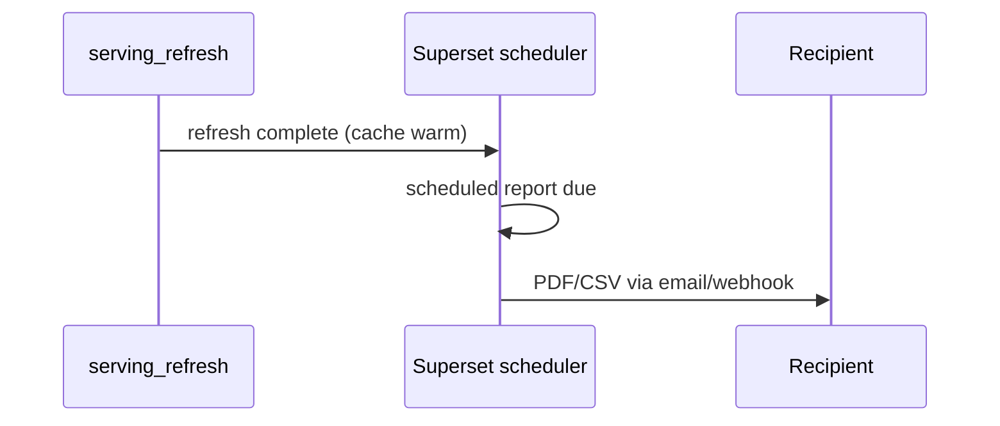

# 07 — Reporting

> Phase 12 · Task 7 — Reporting Strategy

The full report cadence, delivery, and governance are in
[`bi/reports/reporting-strategy.md`](../../bi/reports/reporting-strategy.md). This
document is the governance summary.

## Report Classes

| Class | Cadence | Mechanism | Example |
| --- | --- | --- | --- |
| Executive brief | daily / monthly | Superset scheduled report (PDF) | Executive Daily Brief |
| Operational digest | daily | Superset report (PDF + CSV) | EO Operations Digest |
| Watch list | daily | Superset report (CSV, RLS) | Maritime Watch List |
| Quality/health | weekly | Superset report (PDF) | Catalog Quality, Platform Health |
| Real-time monitoring | continuous | dashboard auto-refresh + alerts | Executive / Platform live |
| Ad-hoc export | on demand | manual export | Sim-Track demo |

## Delivery Timing

Reports fire **after** the serving refresh so they never capture a half-built
product. Recipients are RBAC-role-mapped; RLS applies to CSV exports.

## Governance

- Certified datasets only.
- Report definitions exported to `bi/superset/` (version control).
- Retention: run history 90 days; delivered files recipient-managed; executive
  monthly decks archived.

## Real-Time vs Scheduled

- **Real-time**: live dashboards on cache TTL + event alerts (new suspicious
  vessel, new flood-day) — see [08-alerting.md](./08-alerting.md).
- **Scheduled**: periodic snapshots for stakeholders who don't watch dashboards.
