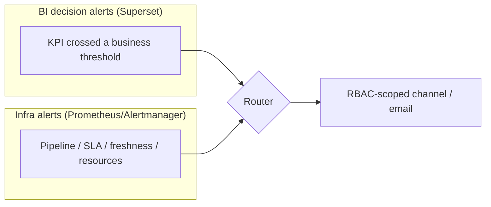

# 08 — Alerting

> Phase 12 · Task 8 — Alerting Strategy

The full alert catalog, notification flow, and escalation are in
[`bi/alerts/alert-strategy.md`](../../bi/alerts/alert-strategy.md). This is the
governance summary.

## Two Alert Planes

- **Business alerts** = Superset "Alerts" evaluating a SQL condition over a
  certified dataset (new suspicious vessel, wildfire severity spike, new flood-day,
  corroboration drop, catalog-quality drop, storm-day `sim`).
- **Infrastructure alerts** = Prometheus/Alertmanager rules (pipeline failure, SLA
  breach, freshness breach, resource utilization), surfaced on Platform Ops.

## Alert Governance Rules

| Rule | Rationale |
| --- | --- |
| Single owner per alert | accountability |
| Fire only after serving refresh | no alerting on half-built data |
| Thresholds match KPI catalog bands | one definition of "bad" |
| Dedupe + cooldown | avoid alert fatigue |
| Recipients = RBAC roles + RLS | no cross-audience leakage |
| Definitions exported to `bi/superset/` | version control |

## Escalation

| Severity | First response | Escalation |
| --- | --- | --- |
| Critical | on-call immediate | +15 min → Platform Lead |
| High | owning team, same shift | +1 h → on-call |
| Medium | next business day | weekly review |
| Info (`sim`) | none | — |

## Alignment

Feeds the same incident register format as
[../../quality/incidents/production-incidents.md](../../quality/incidents/production-incidents.md)
and complements the serving incident runbook
[../../serving/incidents.md](../../serving/incidents.md).
