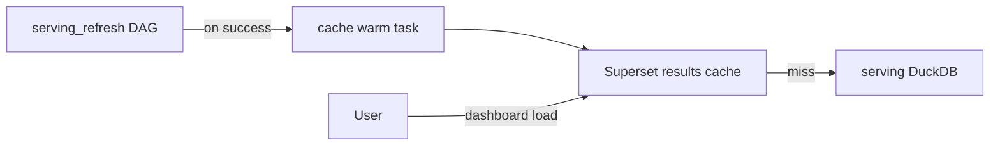

# 09 — Performance Optimization

> Phase 12 · Task 9 — Performance Optimization

BI performance is engineered for the 16 GB laptop target. The strategy is to push
heavy work upstream (materialized aggregates) and keep Superset thin.

## Techniques

| Technique | Applied where | Effect |
| --- | --- | --- |
| **Materialized aggregate** | `platform_daily` (`mv_kpi_platform_daily`) | Executive dashboard scans one small table, not every wide product |
| **Dashboard caching** | all dashboards | Cache TTL 15 min (aggregates) / 1 h (daily products) |
| **Query optimization** | certified SQL | Thin `SELECT`s; no runtime joins (pre-joined upstream) |
| **Columnar source** | Gold Parquet + DuckDB | Column pruning + predicate pushdown |
| **Refresh scheduling** | `serving_refresh` DAG | Cache warms after refresh; users never trigger cold builds |
| **Dataset optimization** | 1 dataset : 1 product | No fan-out joins in BI |
| **Async queries** | Superset `allow_run_async` | Long queries don't block the UI |

## Caching Model

- Cache is warmed **after** refresh, never before — prevents serving a half-built
  product (incident BI-04).
- TTLs are set per dataset in the dataset YAML (`cache_timeout`).

## Cost / Resource Discipline

| Constraint | Design choice |
| --- | --- |
| 16 GB RAM | Superset `mem_limit: 1g`; DuckDB in-process, no separate DB server |
| No Spark+Ollama peak | BI reads pre-built Gold/serving; no live compute |
| Laptop I/O | Materialized aggregate keeps executive scans tiny |

## Query Guidelines

- Prefer a metric on a certified dataset over a computed column.
- Always bind a time filter (bounded scans).
- For heavy exec charts, back them with a materialized aggregate, not the raw
  product.

## Alignment

Consistent with serving performance
([../../serving/performance.md](../../serving/performance.md)) and infra
scalability ([../../docs/infrastructure/17-scalability.md](../../docs/infrastructure/17-scalability.md)):
Superset scales to Gunicorn workers + Celery + Redis cache in production without
model changes.
