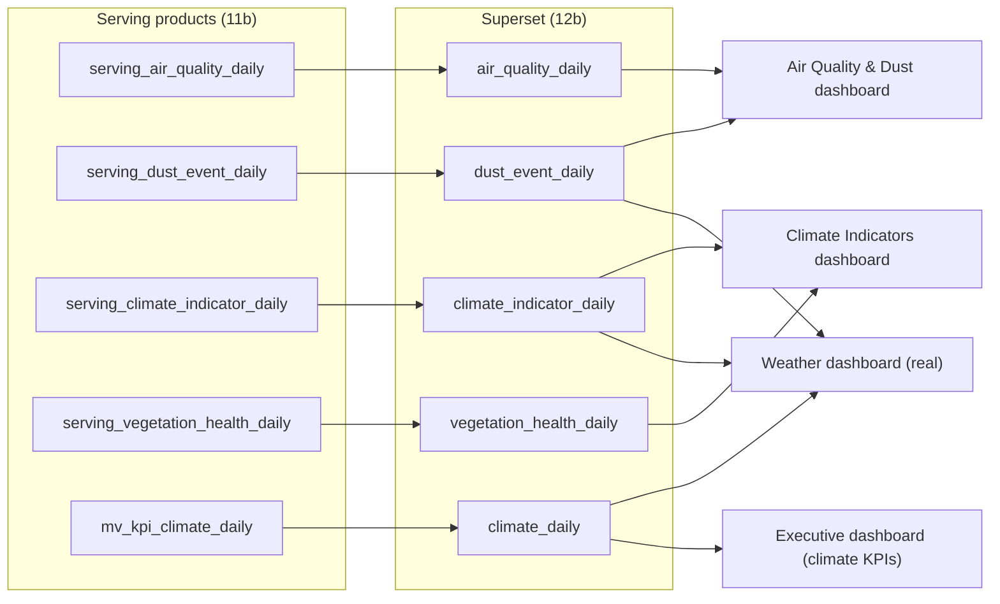

# Climate, Dust & Air-Quality BI (Phase 12b)

> Extends [Phase 12 BI](../../bi/README.md). Delivers Superset dashboards for
> climate, dust, and air-quality monitoring on the certified Phase 11b serving
> products, reusing the existing BI stack, certification model, and conventions.

## Objective

Give analysts and executives certified Superset dashboards to monitor **air
quality**, **dust events**, and **climate indicators**, and promote the legacy
`sim` Weather dashboard to real data — without introducing any new BI tooling.

## What Shipped

| Deliverable | Path |
| --- | --- |
| Air Quality & Dust dashboard (spec) | [`bi/dashboards/air-quality-dust-dashboard.md`](../../bi/dashboards/air-quality-dust-dashboard.md) |
| Climate Indicators dashboard (spec) | [`bi/dashboards/climate-indicators-dashboard.md`](../../bi/dashboards/climate-indicators-dashboard.md) |
| Weather dashboard promoted sim → real | [`bi/dashboards/weather-dashboard.md`](../../bi/dashboards/weather-dashboard.md) |
| Executive dashboard climate KPIs | [`bi/dashboards/executive-dashboard.md`](../../bi/dashboards/executive-dashboard.md) |
| Certified dataset SQL (5) | [`bi/datasets/sql/`](../../bi/datasets/sql/) |
| Superset dataset exports (5) | [`bi/superset/datasets/serving_duckdb/`](../../bi/superset/datasets/serving_duckdb/) |
| Superset chart exports (21) | [`bi/superset/charts/`](../../bi/superset/charts/) |
| Superset dashboard exports (3 new/updated) | [`bi/superset/dashboards/`](../../bi/superset/dashboards/) |
| KPI catalog (extended) | [`bi/kpis/kpi-catalog.md`](../../bi/kpis/kpi-catalog.md) |
| Alert strategy (extended) | [`bi/alerts/alert-strategy.md`](../../bi/alerts/alert-strategy.md) |
| Certified-datasets + governance | [`bi/datasets/`](../../bi/datasets/) |

## Certified Datasets (12b)

| Dataset | UUID | Source product | Grain | Track |
| --- | --- | --- | --- | --- |
| `air_quality_daily` | d1…000b | `serving.serving_air_quality_daily` | AOI/day | real |
| `dust_event_daily` | d1…000c | `serving.serving_dust_event_daily` | AOI/day | real |
| `climate_indicator_daily` | d1…000d | `serving.serving_climate_indicator_daily` | AOI/day | real |
| `vegetation_health_daily` | d1…000e | `serving.serving_vegetation_health_daily` | AOI/day | real |
| `climate_daily` | d1…000f | `serving_agg.mv_kpi_climate_daily` | day | real (materialized) |

All five read certified 11b products — no Silver/Gold access, no ad-hoc chart SQL
(ADR-BI-03). Bands (AQI, dust severity, LST anomaly, vegetation health) are
pre-computed upstream so BI, API, and RAG show identical values.

## Data Flow

## Dashboards

| Dashboard | Slug | Audience | Tabs |
| --- | --- | --- | --- |
| Air Quality & Dust | `air-quality-dust` | air-quality / smart-city / aviation / ports | Air Quality · Dust · Details |
| Climate Indicators | `climate-indicators` | climate analysts / environment / agriculture | Temperature & Water · Vegetation & Land · Details |
| Weather & Climate (promoted) | `weather` | climate / air-quality / ops | Overview |
| Executive (updated) | `executive` | executives | Overview (+ climate KPIs) · Details |

Deck.gl AOI maps and AQI/AOD heat layers are described in the dashboard specs and
follow the Earth-Observation map pattern; as with the existing exports, the
map slices are configured in Superset while the exportable YAML covers the
KPI / trend / distribution / table / calendar charts (deck.gl slices need a
runtime map token and are added post-import).

## KPIs Added

AQI Exceedance Days · Mean AQI (PM2.5) · Active Dust Days · Mean LST Anomaly ·
Mean NDVI (Vegetation Health) — see the
[KPI catalog](../../bi/kpis/kpi-catalog.md#climate--dust--air-quality-kpis-real-data--phase-12b).

## Alerts Added

AQI exceedance · high-AOD dust event · extreme LST anomaly · desertification
onset · crop-stress spike — see the
[alert strategy](../../bi/alerts/alert-strategy.md).

## Design Decisions

| Decision | Chosen | Alternatives | Trade-off |
| --- | --- | --- | --- |
| Reuse the certified-dataset model | Thin datasets over 11b products | Ad-hoc chart SQL / new BI DB | Zero-join reads; one definition of truth |
| Executive climate tiles | Read `climate_daily` rollup | Scan the four wide products | Stays within 15-min caching SLA |
| Promote Weather in place | Repoint slug `weather` to real data | New dashboard + retire old | Preserves layout/links; keeps sim demo on Simulation-Track |
| Deck.gl maps | Spec + post-import config | Export map slices | Map slices need a runtime token; matches existing EO export policy |

## Acceptance

- Air-Quality/Dust and Climate-Indicators dashboards delivered (specs + Superset
  assets).
- Weather dashboard promoted to real certified data; Executive KPIs updated.
- Five new datasets certified; KPIs and alerts documented.

## Glossary

| Term | Definition |
| --- | --- |
| AQI | US-EPA Air Quality Index from PM2.5/PM10 breakpoints |
| AOD | Aerosol Optical Depth — unitless dust-loading proxy |
| Exceedance | Daily pollutant mean above its WHO 2021 guideline |
| LST anomaly | Land-surface temperature vs same-day-of-year baseline (°C) |
| Desertification proxy | Composite of declining NDVI + positive LST anomaly, [0, 1] |
| Crop stress | NDVI low and declining 30-day trend |
