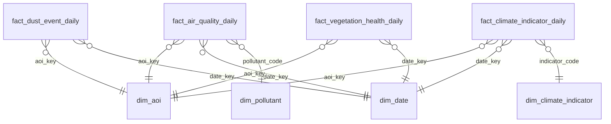

# 03 - Gold Marts (Climate / Dust / Air-Quality)

> **Phase 6b - Data Modeling (Climate Extension)** · Document 03 of 07
>
> Extends Phase 6 [`../04-gold-layer.md`](../04-gold-layer.md). New fact marts at **AOI-date grain**, aligned to the existing `*_daily` fact pattern (`kpi_wildfire_aoi_daily`, `kpi_flood_aoi_daily`) and shared `dim_aoi` / `dim_date` so cross-domain joins are trivial.

## Purpose

Define business-ready, dashboard-shaped Gold marts for climate, dust, and air-quality analytics. Every mart is at **1 row per AOI per day**, keyed by `aoi_key` + `date_key`, so fire + smoke + air quality + climate indicators align on a single grain.

## Fact Inventory

| Fact | Grain | Keys | Track |
| --- | --- | --- | --- |
| `fact_air_quality_daily` | 1 row/AOI/day | `aoi_key`, `date_key` | Climate |
| `fact_dust_event_daily` | 1 row/AOI/day | `aoi_key`, `date_key` | Climate |
| `fact_climate_indicator_daily` | 1 row/AOI/day | `aoi_key`, `date_key` | Climate |
| `fact_vegetation_health_daily` | 1 row/AOI/day | `aoi_key`, `date_key` | Climate |

---

## `fact_air_quality_daily`

- **Grain:** 1 row per AOI per day.
- **Dimensions:** `dim_aoi` (`aoi_key`), `dim_date` (`date_key`), `dim_pollutant` (degenerate/pivoted per pollutant).
- **Source lineage:** `obs_air_quality` (surface) + `obs_atmos_column` (TROPOMI columns), joined on `aoi_id` + `stat_date`.

| Measure | Type | Definition |
| --- | --- | --- |
| `pm25_mean` / `pm25_max` | double | Surface PM2.5 (µg/m³) from OpenAQ |
| `pm10_mean` / `pm10_max` | double | Surface PM10 (µg/m³) |
| `no2_column_mean` | double | TROPOMI NO₂ column (mol/m²) |
| `so2_column_mean` | double | TROPOMI SO₂ column (mol/m²) |
| `co_column_mean` | double | TROPOMI CO column (mol/m²) |
| `o3_column_mean` | double | TROPOMI O₃ column (mol/m²) |
| `station_count` | int | Contributing OpenAQ stations (coverage) |
| `column_valid_fraction` | double | Mean TROPOMI valid-pixel fraction |

| Derived KPI | Definition |
| --- | --- |
| `aqi_pm25` / `aqi_pm10` | AQI band from breakpoints ([`05-kpi-thresholds.md`](./05-kpi-thresholds.md)) |
| `aqi_band` | Overall AQI category (Good…Hazardous) |
| `exceedance_flag` | 1 if any pollutant exceeds WHO/local threshold |

---

## `fact_dust_event_daily`

- **Grain:** 1 row per AOI per day.
- **Dimensions:** `dim_aoi`, `dim_date`.
- **Source lineage:** `obs_aerosol` (AOD + UV aerosol index) + NASA POWER wind (existing weather) + secondary-corridor AOIs, joined on `aoi_id` + `stat_date`.

| Measure | Type | Definition |
| --- | --- | --- |
| `aod_mean` / `aod_max` | double | AOD 550 nm (unitless) |
| `uv_aerosol_index_mean` | double | TROPOMI AER_AI (unitless) |
| `wind_speed_mean` | double | From NASA POWER (m/s); transport context |
| `wind_dir_dominant` | double | Dominant wind bearing (°); transport direction |
| `corridor_aod_max` | double | Max AOD over upwind corridor AOIs (source signal) |
| `valid_fraction` | double | Retrieval completeness |

| Derived KPI | Definition |
| --- | --- |
| `dust_severity_band` | AOD severity band ([`05-kpi-thresholds.md`](./05-kpi-thresholds.md)) |
| `dust_flag` | 1 if AOD + AER_AI exceed dust thresholds |
| `transport_flag` | 1 if corridor AOD elevated + wind toward AOI |

---

## `fact_climate_indicator_daily`

- **Grain:** 1 row per AOI per day (indicators forward-filled to daily from native cadence).
- **Dimensions:** `dim_aoi`, `dim_date`, `dim_climate_indicator`.
- **Source lineage:** derived from **already-ingested** sources (Phase 5b [`03-derived-indicators.md`](../../source-data-analysis/climate/03-derived-indicators.md)) — MODIS/Landsat LST, NOAA OISST SST, Sentinel-2 NDWI, Global Forest Watch. **Zero new connectors.**

| Measure | Type | Definition |
| --- | --- | --- |
| `lst_c` | double | Land surface temperature (°C) |
| `lst_anomaly_c` | double | LST − same-DOY baseline (°C) |
| `sst_c` | double | Sea surface temperature (°C); coastal AOIs |
| `sst_anomaly_c` | double | SST anomaly (°C) |
| `ndwi_mean` | double | Water index; water availability |
| `tree_cover_loss_ha` | double | GFW tree-cover loss (annual, allocated) |
| `desertification_proxy` | double | Composite (NDVI trend + LST); 0–1 |

| Derived KPI | Definition |
| --- | --- |
| `lst_anomaly_band` | Warming band (°C above baseline) |
| `warming_flag` | 1 if LST/SST anomaly exceeds band threshold |
| `desertification_flag` | 1 if proxy above threshold in desert-margin AOI |

---

## `fact_vegetation_health_daily`

- **Grain:** 1 row per AOI per day.
- **Dimensions:** `dim_aoi`, `dim_date`, `dim_climate_indicator`.
- **Source lineage:** `obs_index` (existing NDVI/EVI Silver, Sentinel-2/MODIS) — reuses the EO index mart pattern. **Zero new connectors.**

| Measure | Type | Definition |
| --- | --- | --- |
| `ndvi_mean` / `ndvi_max` | double | NDVI over valid pixels |
| `evi_mean` | double | Enhanced Vegetation Index; nullable |
| `ndvi_trend_30d` | double | 30-day NDVI slope |
| `valid_pixel_fraction` | double | Cloud-free coverage |

| Derived KPI | Definition |
| --- | --- |
| `ndvi_health_band` | Vegetation-health band ([`05-kpi-thresholds.md`](./05-kpi-thresholds.md)) |
| `crop_stress_flag` | 1 if NDVI below band + negative trend |

---

## Star-Schema Alignment

## Cross-Domain Fusion (why AOI-date grain matters)

Because every climate mart shares `aoi_key` + `date_key` with the existing `kpi_wildfire_aoi_daily` / `kpi_flood_aoi_daily`, a single AOI-day join yields the **smoke signal** (`fire + AOD/AER_AI + wind`) and combined environmental dashboards without runtime spatial scans.

## Cross References

- Silver entities: [`02-silver-entities.md`](./02-silver-entities.md)
- Dimensions: [`04-dimensions-conformance.md`](./04-dimensions-conformance.md)
- KPI thresholds: [`05-kpi-thresholds.md`](./05-kpi-thresholds.md)
- Phase 6 Gold baseline: [`../04-gold-layer.md`](../04-gold-layer.md)
