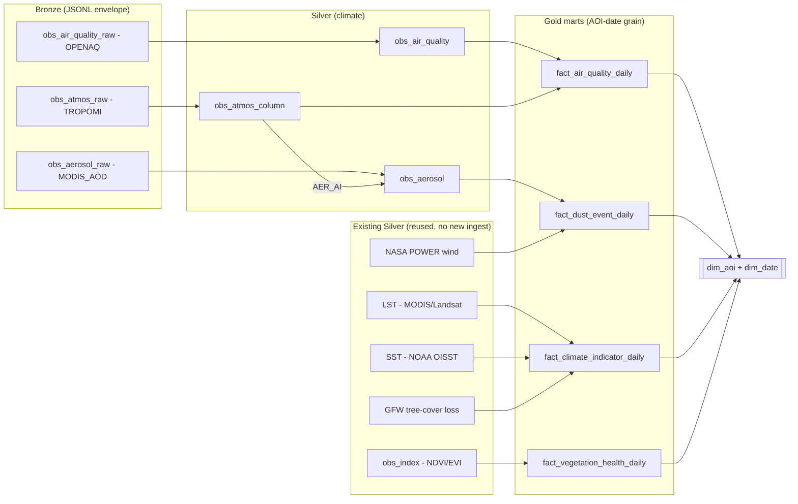

# 06 - Lineage & Schema Evolution (Climate / Dust / Air-Quality)

> **Phase 6b - Data Modeling (Climate Extension)** · Document 06 of 07
>
> Extends Phase 6 [`../13-data-lifecycle.md`](../13-data-lifecycle.md). Bronze → Silver → Gold lineage, schema-evolution strategy, and reproducibility notes.

## Purpose

Document how the atmospheric marts trace back to raw records, how new pollutants/indicators are added without breaking history, and how every mart rebuilds deterministically from Bronze.

## Bronze → Silver → Gold Lineage

## Lineage Notes

- **Air quality** fuses surface (`obs_air_quality`) and column (`obs_atmos_column`) on `aoi_id` + `stat_date` — kept in separate Silver entities (semantic guard: column ≠ surface).
- **Dust** joins `obs_aerosol` with existing NASA POWER wind for transport context; no new ingest for wind.
- **Climate indicators** and **vegetation health** derive entirely from **already-ingested** Silver (`obs_index`, LST, SST, GFW) — the derived marts add **zero connectors** (Phase 5b [`03-derived-indicators.md`](../../source-data-analysis/climate/03-derived-indicators.md)).

## Schema-Evolution Strategy

| Change type | Strategy | Impact |
| --- | --- | --- |
| New pollutant (e.g. `NH3`) | Add `dim_pollutant` row + new `pollutant_code` value | Additive; no entity schema change |
| New trace gas | Add `gas_code` value + `dim_pollutant` row | Additive; `obs_atmos_column` unchanged |
| New climate indicator | Add `dim_climate_indicator` row + nullable measure column on mart | Additive nullable column only |
| New AOI | Insert `dim_aoi` row (versioned seed) | Additive; historical marts unaffected |
| Unit convention change | Bump `conversion_version` in `dim_pollutant`; keep `value_raw` | History preserved; no in-place mutation |
| AQI breakpoint revision | New band-set version in `dim_pollutant`; re-derive KPI columns | Marts rebuildable from Silver |

**Rules:** additive, nullable columns only; never rename/retype existing fields; new dimension members are data (rows/seeds), not schema changes; Bronze payloads are immutable (corrections = new records).

## Reproducibility

- **Full replay:** Silver and Gold rebuild from Bronze because every Bronze record carries `_checksum` + `_batch_id` + `_source_uri` (envelope provenance). Re-running Silver cleaners then the Gold builder reproduces byte-identical marts for a fixed Bronze snapshot.
- **Derived marts:** `fact_climate_indicator_daily` / `fact_vegetation_health_daily` rebuild from existing Silver (`obs_index`, LST, SST, GFW) — no re-ingest needed; only recompute.
- **Empty-partition safety:** marts with no rows for an AOI-day write a schema-only Parquet part (existing convention) so serving httpfs globs always resolve.
- **AOI seed versioning:** `dim_aoi` is a single versioned seed; a mart rebuild pins the AOI seed version used, keeping point-in-polygon assignments deterministic.
- **Baseline stability:** LST/SST anomaly baselines are computed from a fixed climatology window recorded alongside the mart, so anomalies are reproducible.

## Cross References

- Bronze contracts: [`01-bronze-contracts.md`](./01-bronze-contracts.md)
- Silver entities: [`02-silver-entities.md`](./02-silver-entities.md)
- Gold marts: [`03-gold-marts.md`](./03-gold-marts.md)
- Phase 6 lifecycle: [`../13-data-lifecycle.md`](../13-data-lifecycle.md)
