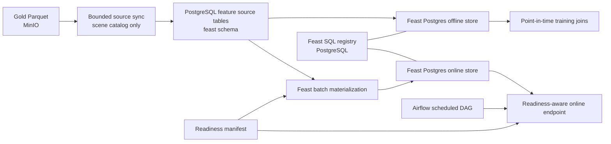

# 01 — Feature Store Strategy

## Purpose and decision

The Feature Store provides reusable, versioned feature contracts over existing
Gold products. Feast owns feature metadata, point-in-time retrieval, online
materialization, and online lookup. Gold remains the analytical source of
truth; no ingestion connector or new source of record is introduced here.

The Phase 13 release is a working platform capability, not a declaration that
all upstream products are analysis-ready. The readiness gates in [03](./03-readiness-and-blockers.md)
control what can be materialized and served.

## Topology

The source sync copies a bounded, selected Gold feature source into a PostgreSQL
table because Feast's PostgreSQL offline store reads SQL sources. It preserves
lineage and quality metadata. It does not replace Bronze/Silver/Gold ingestion
or perform a second domain transformation.

## Operating model

| Concern | Contract |
|---|---|
| Owner | Data product owner owns meaning, grain, units, and approved use; platform owner owns Feast definitions and runtime. |
| Offline | PostgreSQL source tables support PIT joins and bounded backfills. Snapshot rows retain event and creation timestamps. |
| Online | PostgreSQL serves latest materialized values; a small process-local cache reduces repeated lookups. |
| Registry | Feast SQL registry in the existing `feast` PostgreSQL schema. |
| Freshness | Each feature view declares TTL and a consumer freshness SLA. API responses label unknown/stale data explicitly. |
| Reuse | Feature views are model-independent. Feature services group reviewed sets for a specific consumer contract. |
| Compute | One 1-GB / 1-CPU service, one existing PostgreSQL instance, and the existing MinIO service. |
| Data nature | Real/open, derived, synthetic-demo, and reference data are distinct labels. Synthetic rows never certify operational use. |

## Service objectives

Targets are local-development objectives, not measured production guarantees.
The host is a 16-GB laptop and concurrent Spark/Ollama workloads should be
avoided.

| Measure | Target | Gate |
|---|---:|---|
| Online endpoint response | p95 below 250 ms for a warm local lookup | Measure at representative laptop load before operational use. |
| Cache TTL | 2 seconds by default | Keep short to bound staleness. |
| Stale-cache fallback | Up to 60 seconds, visibly marked degraded | No success-shaped fallback when no cached value exists. |
| Scheduled materialization | Every 6 hours | Only demo/restricted views are currently eligible. |
| PIT correctness | No feature event later than the entity event time | Integration test uses two feature timestamps and two query cutoffs. |
| Required source lineage | 100% of rows include source reference, nature, status, and event date | Null lineage fails validation. |

## Scope boundary

The Feature Store consumes existing curated products. It does not repair
brightness mappings, AOI attribution, source entitlements, mixed pollutant
units, wind joins, or vessel event grain. Those remain tracked in the
source-analysis work packages and gate their dependent features.
