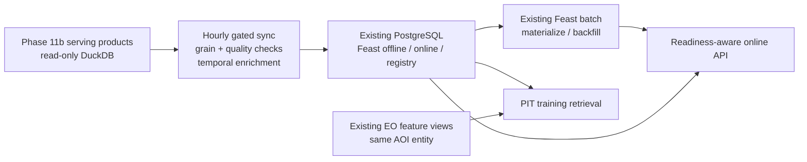

# Phase 13b — Climate, Dust, and Air-Quality Feature Store

## Objective and release boundary

Extend Phase 13 Feast definitions using only the Phase 11b AOI/day serving
products. Reuse its PostgreSQL offline store, online store, SQL registry, Feast
project, and materialization service. The existing serving DuckDB file is
mounted read-only; no new service or source-of-truth is introduced.

Feature registration is not certification. The bounded 2026-11-14 refresh
repopulated the climate products, but all four remain blocked by measured
freshness or completeness failures. The readiness API rejects online requests
until source validation and owner approval are complete. Do not enable blocked
features by setting a materialization environment flag.

## Data flow



The sync preserves the 11b product output without recomputing measurements.
`event_timestamp` is the product's `date_key` at UTC midnight; `created_timestamp`
is the event time because the serving contract has no row-level ingestion
timestamp. This keeps historical snapshots available for event-time PIT joins;
late-arriving corrections are not separately time-travelable until 11b exposes
an authoritative creation timestamp. `source_published_at` is the serving
DuckDB file's last-modified time, used as a database-build publication proxy;
it is not a per-table source watermark.
`source_reference` identifies the read-only DuckDB product table. Grain
duplicates, null keys, invalid value ranges, and configured null-rate
violations fail the sync explicitly.

## Refresh evidence — 2026-11-14

The settled ingestion batch was transformed through climate Silver and Gold,
then all 15 serving dbt models were rebuilt in the persistent DuckDB. All 83
serving dbt tests passed. The refreshed Silver outputs contained 10,033 air
quality, 173 aerosol, 520 atmospheric-column, and 468 wind rows.

| Serving product | Rows / latest date | Measured gap | Sync outcome |
|---|---|---|---|
| Air quality | 181; 2026-11-13 | PM2.5 null 65.2%, PM10 null 77.4%; only 25 rows have both | `quality_failed` |
| Dust | 173; 2026-11-11 | Wind speed and direction null 20.2%, above the 10% limit | `quality_failed` |
| Climate indicators | 55; 2026-11-08 | LST and SST are null for all rows; NDVI and NDWI are present | `quality_failed` |
| Vegetation health | 55; 2026-11-08 | NDVI and valid-pixel coverage are present; EVI is unavailable | `blocked` |

Every product's latest date is older than its 24-hour observation-age limit at
the time of this validation. The feature-store sync withheld air-quality,
dust, and climate-indicator rows after quality checks. It synchronized the
vegetation rows with blocked readiness metadata; the materialization gate
skipped all four climate views. The Feast/PostgreSQL integration test verified
PIT and online retrieval using isolated test fixtures, not production
measurements. These results do not authorize feature promotion.

## Feature catalog

All views reuse the Phase 13 `aoi` entity (`aoi_key`). The feature date is the
event timestamp, not a second join entity: this prevents accidental AOI-only
joins across different dates and preserves Feast PIT semantics.

| Feature view | Serving source | Representative features | TTL | Target freshness |
|---|---|---|---:|---:|
| `air_quality_aoi_daily` | `serving_air_quality_daily` | PM2.5/PM10 mean/max, NO₂/SO₂/CO/O₃ column means, AQI per pollutant, AQI band, exceedance flag, 7/30-day PM means and daily change | 2 days | 24-hour observation age; 60 minutes after serving database build |
| `dust_aoi_daily` | `serving_dust_event_daily` | AOD mean/max, aerosol index, dust band/flag, NASA POWER wind speed/direction, transport flag, 7-day AOD mean and change | 7 days | 24 hours |
| `climate_indicator_aoi_daily` | `serving_climate_indicator_daily` | LST/SST and anomalies, NDVI/EVI/NDWI, desertification indicators, 7-day LST-anomaly mean, 30-day NDVI mean, daily changes | 45 days | 24 hours |
| `vegetation_health_aoi_daily` | `serving_vegetation_health_daily` | NDVI/EVI, 30-day NDVI trend, pixel validity, health band, crop-stress flag, 30-day NDVI mean and daily change | 45 days | 24 hours |

Feast uses `Float32`, `Int64`, `Bool`, and `String` field types according to the
serving product contract. Feature views also expose `feature_date`,
`source_published_at`, `data_nature`, and `readiness_status` for lineage and
release transparency.
CH₄ is represented as a nullable field because the current 11b air-quality
product does not provide it; no value is inferred or fabricated. AQI bands
remain their serving-product strings.

### Derived and temporal features

- Rolling means use calendar-day windows ending on the current observation
  date, excluding null measurements. They use only the rows available in the
  source serving product; no missing dates are filled.
- Change-per-day compares the current measurement with the previous available,
  non-null measurement and divides by elapsed calendar days. The companion
  `days_since_previous_observation` makes sparse cadence visible.
- Dust prediction receives AOD, NASA POWER wind speed/direction, and the
  product's `transport_flag` as separate context. No unsupported transport
  score or wind value is synthesized; null wind measurements fail the
  configured completeness gate.
- The same AOI/date key preserves existing EO context, including wildfire
  features, for multi-view Feast historical retrieval.

## Materialization, training, and serving

The existing Airflow materialization DAG runs hourly and invokes the
token-protected `/internal/materialize` endpoint. The sync reads the four
serving tables from the existing DuckDB file mounted read-only at
`/opt/serving/serving_products.duckdb`; it writes idempotently to the existing
`feast.source_*` tables. Feast incremental runs use the configured view
definitions. Explicit start/end dates continue to support bounded backfills.

Hourly scheduling is the target refresh cadence for air quality, not a claim
that the upstream product is streaming or hourly. The API reports event-time
observation age separately from the publication age of the serving database.
The 60-minute publication SLA is measured from the database file's modification
time; it is a proxy because 11b does not publish per-product watermarks. The
current Phase 11b product is daily and its snapshot is stale; readiness remains
blocked, and an out-of-SLA feature remains visible as stale rather than fresh.

`climate_dust_training_service` registers the AOI-keyed climate/dust/vegetation
views alongside the existing wildfire EO view. The existing
`build_training_dataset` API accepts a list of feature references and a
timestamped AOI entity dataframe, and Feast joins each view as of each row's
event time. For example:

```python
feature_refs = [
    "wildfire_aoi_daily:max_frp",
    "air_quality_aoi_daily:pm25_mean",
    "dust_aoi_daily:aod_mean",
    "dust_aoi_daily:wind_speed_mean",
]
```

The readiness gate remains authoritative for online retrieval and
materialization. FeatureService registration and successful offline test
fixtures do not change production release status.

## Data quality and drift controls

The sync runs structural checks (non-empty AOI, event time), null-rate checks,
numeric bounds, and serving enum checks before inserting any product rows.

| Product | Null-rate thresholds | Selected bounds |
|---|---|---|
| Air quality | PM2.5/PM10 means ≤20% null | Concentrations non-negative; AQI 0–500; band from 11b accepted values |
| Dust | AOD mean ≤20% null; wind speed/direction each ≤10% null | AOD 0–5; validity 0–1; wind direction 0–360° |
| Climate indicators | LST and LST anomaly each ≤20% null | NDVI/EVI/NDWI −1 to 1; desertification proxy 0–1 |
| Vegetation health | NDVI mean ≤20% null | NDVI/EVI −1 to 1; pixel validity 0–1 |

The refreshed dust product now has wind on most rows, but its 20.2% null rate
still exceeds the 10% limit. Climate and vegetation rows are no longer empty,
but remain stale and incomplete as shown above. A schema registration is not
evidence that these products are ready. Existing quality utilities report
per-field null rates and numeric violations.
`climate_distribution_report` evaluates
population stability index (warning at PSI ≥0.2) and change in standardized
skewness (warning at absolute delta ≥1.0); expected baselines must be versioned
from an approved source batch before production use.

## Lineage, ownership, and versioning

| Stage | Contract / lineage |
|---|---|
| Source | Phase 11b `serving_*_daily` tables in the read-only serving DuckDB |
| Entity and grain | `dim_aoi` business key `aoi_key`; one product row per AOI/date |
| Feature source | `feast.source_*` Postgres table with event/created timestamps, source nature, readiness status, and source reference |
| Registry | Existing Feast SQL registry and shared feature repo |
| Owner | Climate Analytics domain owner for source approval; Feature Store maintainers for registration/materialization |
| Promotion | Update readiness only with Phase 10b quality evidence, per-measure coverage, freshness evidence, and owner approval |

Changes to fields, types, units, grain, or derivation are contract changes.
Additive fields require updated feature definitions, source-table migration,
catalog/docs, and PIT/online tests. Renames or semantic changes require a new
feature name and a deprecation window; never silently repurpose a registered
field. Feast registry versions identify applied definitions; training dataset
manifests retain feature references and content hashes.

## KPIs and operational SLAs

| KPI | Target / gate | Measurement |
|---|---|---|
| AOI/date uniqueness | 100% | Sync rejects duplicate source grain |
| Air-quality observation age | ≤24 hours | API `status` and `max_observed_age_hours` |
| Air-quality publication age | ≤60 minutes after serving DB build | API `publication_status` and `max_source_publication_age_minutes` |
| Other climate observation age | ≤24 hours | API freshness response |
| Point-in-time leakage | 0 future-dated values | Feast retrieval test with multiple feature dates |
| Source completeness | Per-field thresholds above | Sync quality report before source-table upsert |
| Drift | PSI <0.2 and absolute skew delta <1.0 | Versioned approved baseline vs. current batch |
| Blocked feature exposure | 0 successful online lookups | API readiness gate |

The time-based SLAs do not override the upstream daily cadence or readiness
gate. No numerical API latency promise is introduced without a load-test
baseline.

## Risks and trade-offs

| Risk / choice | Mitigation or trade-off |
|---|---|
| Stale or incomplete 11b products | Keep all new views blocked until source evidence and approvals exist |
| Shared DuckDB file can be replaced during sync | Mount it read-only and make source generation/refresh an upstream prerequisite |
| Hourly trigger over daily sources | Bounded local footprint and prompt refresh after publication; repeated reads are idempotent |
| Calendar windows on sparse data | Do not fill missing dates; expose recency and document that a 7-day window may contain fewer than seven observations |
| CH₄ absent in source | Keep nullable, never estimate or backfill from a different species |
| PostgreSQL shares offline/online/registry roles | Reuse infrastructure and keep storage bounded; monitor contention before increasing throughput |

## Architecture decision records

### ADR-13B-001 — Use serving products as the only climate inputs

**Decision:** Read the four Phase 11b serving tables from the existing,
read-only DuckDB product file. Do not read Gold, Silver, raw API, or imagery
sources in this phase.

**Why:** Preserves the governed-product ownership boundary and the AOI/date
conformance already established by 11b.

**Alternatives:** Read Gold Parquet directly or rebuild serving marts in Feast.
Both duplicate upstream conformance and risk diverging from the serving
contract.

**Trade-off:** Feature sync depends on the serving database being built and
mounted before the hourly job.

### ADR-13B-002 — Keep AOI as the entity and date as event time

**Decision:** Reuse `aoi_key` and represent product date as Feast
`event_timestamp` at UTC midnight.

**Why:** Matches the source grain and allows Feast's event-time-aware joins to
combine EO and climate views without a second synthetic entity.

**Alternatives:** Add a date entity or join by AOI only. A second entity
duplicates date semantics; AOI-only lookups risk leakage across dates.

**Trade-off:** Daily date semantics are represented at midnight UTC; consumers
must preserve this contract in timestamped training examples.

### ADR-13B-003 — Hourly batch refresh with explicit freshness gates

**Decision:** Reuse the existing batch/materialization endpoint and schedule
it hourly; require a one-hour age limit for air-quality features after source
publication and keep readiness blocked otherwise.

**Why:** Meets a bounded near-real-time serving target without introducing
streaming infrastructure on a 16 GB laptop.

**Alternatives:** Stream raw measurements or retain the six-hour schedule.
Streaming exceeds this phase's infrastructure and source cadence; six-hour
refresh delays online availability beyond the target after a product publish.

**Trade-off:** The refresh cadence cannot make an upstream daily product
near-real-time; data freshness is still bounded by source publication.

## Glossary

| Term | Definition |
|---|---|
| AOI | Area of interest; the shared `dim_aoi` business entity |
| AOD | Aerosol Optical Depth, a unitless aerosol measure |
| Event time | Time an observation is valid; here, the product date at UTC midnight |
| Feast PIT join | Historical feature lookup that excludes observations later than the entity event time |
| PSI | Population stability index, a binned distribution-shift measure |
| Readiness gate | Manifest-based control that blocks materialization and online retrieval until source promotion |
| Serving product | The governed Phase 11b AOI/date output consumed by downstream features |
