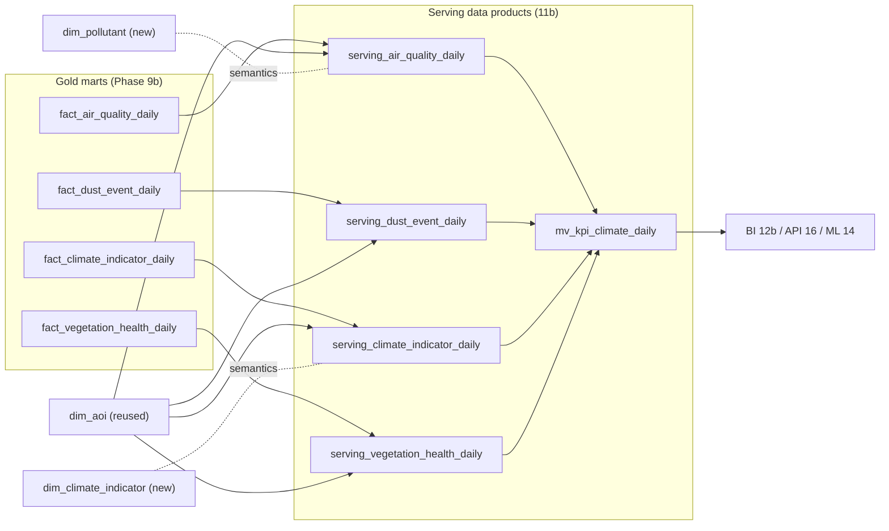

# Climate / Dust / Air-Quality Serving Layer (Phase 11b)

> Extends [Phase 11 serving](../../serving/README.md). Exposes the Phase 9b Gold
> climate marts as governed, contract-tested data products, mirroring the
> existing serving pattern exactly.

## Objective

Serve the four in-scope climate Gold marts as **pre-denormalized, AOI-date
grained data products** so BI (12b), API (16), and ML (14) consume them with no
runtime joins — reusing the existing semantic layer (`dim_aoi`, metric registry)
rather than forking it.

## Data Products

| Product | Source Gold mart | Grain | Builder / dbt |
| --- | --- | --- | --- |
| `serving_air_quality_daily` | `fact_air_quality_daily` | AOI/day | [`climate_products.serve_air_quality_daily`](../../serving/marts/climate/climate_products.py) · [dbt](../../serving/dbt/models/climate/serving_air_quality_daily.sql) |
| `serving_dust_event_daily` | `fact_dust_event_daily` | AOI/day | [`serve_dust_event_daily`](../../serving/marts/climate/climate_products.py) · [dbt](../../serving/dbt/models/climate/serving_dust_event_daily.sql) |
| `serving_climate_indicator_daily` | `fact_climate_indicator_daily` | AOI/day | [`serve_climate_indicator_daily`](../../serving/marts/climate/climate_products.py) · [dbt](../../serving/dbt/models/climate/serving_climate_indicator_daily.sql) |
| `serving_vegetation_health_daily` | `fact_vegetation_health_daily` | AOI/day | [`serve_vegetation_health_daily`](../../serving/marts/climate/climate_products.py) · [dbt](../../serving/dbt/models/climate/serving_vegetation_health_daily.sql) |

Each builder enriches the Gold row with `dim_aoi` display metadata and adds a
business-friendly display label for its numeric band, then emits a wide,
sorted, AOI-date-unique row. The dbt models and raw DDL
([`serving/sql/climate/`](../../serving/sql/climate/)) reproduce the same shape.

## Architecture

## Semantic Layer Extensions

- **Dimensions** — `dim_pollutant` (PM/gases/AOD with units, AQI scheme, WHO
  thresholds) and `dim_climate_indicator` (LST/SST/NDVI/… with unit + source
  family). Single-sourced in [`serving/marts/semantic.py`](../../serving/marts/semantic.py)
  (`POLLUTANTS`, `CLIMATE_INDICATORS`) and mirrored by the dbt models
  [`dim_pollutant.sql`](../../serving/dbt/models/semantic/dim_pollutant.sql) /
  [`dim_climate_indicator.sql`](../../serving/dbt/models/semantic/dim_climate_indicator.sql).
- **Metrics** — registered in the shared `METRICS` registry (`CLIMATE_METRICS`):

  | Metric key | Product | Aggregation |
  | --- | --- | --- |
  | `aqi_pm25_mean` | air quality | mean(`aqi_pm25`) |
  | `aqi_exceedance_days` | air quality | count where `exceedance_flag` |
  | `dust_event_days` | dust | count where `dust_flag` |
  | `aod_max` | dust | max(`aod_mean`) |
  | `lst_anomaly_mean` | climate | mean(`lst_anomaly_c`) |
  | `warming_days` | climate | count where `warming_flag` |
  | `desertification_flag_days` | climate | count where `desertification_flag` |
  | `ndvi_health_mean` | vegetation | mean(`ndvi_mean`) |
  | `crop_stress_days` | vegetation | count where `crop_stress_flag` |

## Materialized Aggregate

`mv_kpi_climate_daily` (dbt [model](../../serving/dbt/models/marts_agg/mv_kpi_climate_daily.sql)
and raw [DDL](../../serving/sql/climate/02_climate_materialized_views.sql)) rolls
the four products up to one row per calendar day for the executive/weather
dashboards, mirroring `mv_kpi_platform_daily`.

## Serving Contracts

dbt schema tests in [`_climate.yml`](../../serving/dbt/models/climate/_climate.yml)
enforce, per product:

- **grain uniqueness** — `unique_combination_of_columns(aoi_key, date_key)`
- **not-null keys** — `aoi_key`, `date_key`
- **KPI ranges** — AQI ∈ [0, 500], AOD ∈ [0, 5], NDVI ∈ [-1, 1], fractions ∈ [0, 1]
- **enum validation** — `aqi_band`, severity/anomaly/health band codes + labels,
  `ndvi_trend_dir`

No AOI is restricted, so no row-level security is required (the existing RLS
approach is reused — none needed here).

## Tests

Offline pure-Python unit tests in
[`serving/tests/test_climate_products.py`](../../serving/tests/test_climate_products.py)
assert AOI-date grain, KPI/band pass-through, denormalization, and semantic
registry integration. Run with `make test` in `serving/`.

## Design Decisions

| Decision | Chosen | Alternatives | Trade-off |
| --- | --- | --- | --- |
| Product shape | Pre-denormalized wide table, AOI/day | Star schema at read time | Slight storage duplication; zero-join reads for BI/API |
| Canonical logic | Pure-Python builders; dbt duplicates | dbt-only | Offline-testable definition + scalable SQL path |
| New dims | Static reference (VALUES / code list) | Gold ref table | No new pipeline; single-sourced with `semantic.py` |
| Rollup | New `mv_kpi_climate_daily` | Extend `mv_kpi_platform_daily` | Avoids breaking the MVP executive contract; additive |

## Glossary

| Term | Definition |
| --- | --- |
| AQI | US EPA Air Quality Index derived from PM2.5/PM10 breakpoints |
| AOD | Aerosol Optical Depth (550 nm), unitless dust proxy |
| Exceedance | Daily pollutant mean above its WHO 2021 guideline |
| LST anomaly | Land-surface temperature vs same-day-of-year baseline (°C) |
| Desertification proxy | Composite of declining NDVI + positive LST anomaly, [0, 1] |
| Crop stress | NDVI low (< 0.3) **and** declining 30-day trend |
| AOI-date grain | One row per Area-of-Interest per calendar day |
