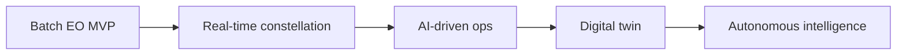

# 12 Future Dataset Expansion

## Executive Summary

The dataset ecosystem evolves from batch EO intelligence toward real-time, AI-driven, digital-twin space operations.

## Evolution Path

| Stage | New Datasets | Capability |
| --- | --- | --- |
| Real-time constellation | Live AIS, N2YO, SatNOGS, ISS stream | Live tracking and alerts |
| AI-driven operations | SWPC, DONKI, telemetry, anomaly | Forecasting + anomaly ML |
| Digital twin | TLE history, OEM, JPL Horizons | Orbit simulation |
| Autonomous intelligence | Fused multi-source + RAG | Mission decision support |

## Diagram

## Climate, Dust & Air-Quality Expansion (Authored)

A parallel environmental expansion adds **climate change, dust storm, and air-quality monitoring** without architectural change, reusing the existing tabular/statistical-API ingestion pattern.

| New Source | Provides | Strategy |
| --- | --- | --- |
| OpenAQ | Ground PM2.5/PM10, NO₂, SO₂, CO, O₃ | Tabular API |
| Sentinel-5P / TROPOMI (Sentinel Hub Statistical API) | NO₂, SO₂, CO, O₃, CH₄, UV aerosol index | Per-AOI statistics |
| MODIS / VIIRS AOD | Aerosol optical depth for dust/plume | Per-AOI / point |
| Derived (no new ingestion) | LST/anomaly, NDVI/EVI, SST/anomaly, NDWI, deforestation | From existing Silver |

**Deferred:** CAMS and ERA5 raw NetCDF (need a binary blob-landing capability) and geostationary SEVIRI/Himawari (exceeds the 16 GB budget). Delivery is via extension prompts `05b`–`16b` in [../../.github/prompts/](../../.github/prompts/).

## Cross References

- Roadmap: [../domain-research/09-roadmap-expansion.md](../domain-research/09-roadmap-expansion.md)
