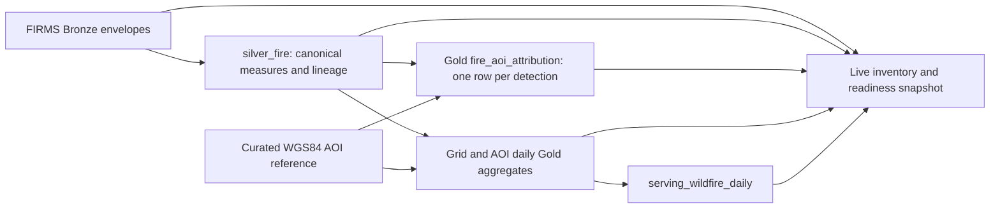

# Live Readiness Inventory and Fire Contract

## Scope and Release State

This is the authorized readiness remediation for **WP0, WP1, and the fire slice
of WP6**, not Phase 13b feature materialization or an ML release.

The [generated snapshot](./live-readiness-snapshot.json) is the machine-readable
evidence. The [implementation plan](./15-data-analysis-readiness-implementation-plan.md)
retains historical baselines and tracks remaining domain gates.

| Area | Engineering result | Release condition |
|---|---|---|
| WP0 | Repeatable inventory reconciles all 45 catalog entries, every observed Bronze/Silver/Gold family, and serving products. | Designed, implemented, populated, and prior access evidence remain distinct; unavailable/unprobed sources are explicit. |
| WP1 | Source-specific brightness mapping, per-detection attribution ledger, and grid/AOI/serving reconciliation are implemented and live-tested. | Unmatched detections are retained, not treated as failure to detect or silently discarded. |
| WP6 fire slice | Product metadata and automated technical gates are published in the accompanying snapshot and serving descriptions. | Analysis-ready remains **false** until domain review and approved completeness/coverage bounds. |

## Data Flow and Contracts



### WP0 inventory

The [snapshot command](../../transformation/scripts/readiness_snapshot.py):

- Parses the authoritative 45-entry catalog, rejecting duplicate/missing IDs.
- Uses explicit implementation/path mappings. A connector existing does not
  imply that a source is populated, currently reachable, or analysis-ready.
- Lists and profiles every observed Bronze/Silver/Gold family, including
  supplemental families absent from the original catalog. `GFW` here means
  **Global Fishing Watch**, not catalog entry 39, **Global Forest Watch**.
- Reports object counts/bytes, last object modification, row count, UTC event
  bounds, distinct dates, freshness, last successful landing, invalid/missing
  timestamps, and observed field-schema fingerprints.
- Profiles serving products separately. Unknown timestamps and unsupported
  object formats are explicit; a partial count is not an exhaustive record count.
- Sets owner to the existing platform `data-eng` default; domain ownership and
  acceptance remain unreviewed. Field-name fingerprints are observations, not
  declared schema versions or a general schema-drift certification.
- Marks refreshability only when an implemented connector has a successful
  landing within the preceding 24 hours. This is **prior access evidence**, not
  an active authentication probe or a freshness SLA. Otherwise refreshability
  is unknown. No unavailable source is silently marked healthy.

Shared source paths are deliberately non-additive: FIRMS covers both catalog
fire entries; the MODIS mapping covers the implemented AOD subset only.
The scan is a bounded observation window, not an atomic lake transaction.
Objects changing ETag during their scan cause an explicit failure; newly
arriving objects after listing are captured by the next run.

### WP1 measurement contract

Live payload inspection found `bright_ti4` and `bright_ti5`, but no generic
`brightness`, in all 6,047 FIRMS envelopes inspected. The Silver cleaner
previously read only `brightness`, losing valid VIIRS temperature values.

| Measure | Mapping / interpretation |
|---|---|
| `brightness` | Preserve native `brightness`; otherwise use VIIRS `bright_ti4`. Kelvin brightness temperature, not radiance. |
| `brightness_source_field` | Identifies the selected native field, retained with Bronze ingestion lineage. |
| `brightness_status` | `present`, `source_absent`, or `source_invalid`; non-numeric/non-finite selected values are null and explicitly invalid. |
| `bright_ti5` / `bright_t31` | Separate VIIRS I5 / MODIS channel-31 temperatures; never substituted for I4/channel-21/22. |
| `frp` | Independent fire radiative power (MW), not inferred from brightness. |
| `confidence` | Existing VIIRS categorical-to-numeric mapping retained; not a new probability estimate. |

The raw native values remain in immutable Bronze. Silver stores normalized
values, selected field names, and ingestion IDs/batch IDs for audit.
Definitions and caveats: [NASA FIRMS FAQ](https://www.earthdata.nasa.gov/data/tools/firms/faq).

### Spatial attribution contract

`gold/fire_aoi_attribution` contains one row per Silver fire detection:
`fire_key`, `event_ts`, `date_key`, `aoi_keys`, `match_count`, `match_status`,
`match_method`, `_ingest_id`, and `_batch_id`.

- Uses normalized WGS84 coordinates, GeoJSON `[longitude, latitude]` rings,
  bbox prefiltering, and the existing shared point-in-polygon helper.
- Outer-ring edges/vertices are included with a `1e-10` degree edge tolerance.
  Hole interiors and hole edges are excluded. MultiPolygon parts are supported.
- Every overlapping AOI match is retained; AOI totals can exceed the count of
  unique matched detections. These totals must not be summed as unique fires.
- Out-of-footprint detections are `unmatched`; invalid dates are separately
  flagged and block reconciliation. Silver rejects invalid source keys,
  dates, and coordinates before this boundary.
- No new AOI is invented to improve match rate. Reference footprints are
  curated rectangles, not verified EMS activation polygons or country borders.
- Antimeridian polygons, temporal activation matching, burned-area estimation,
  and independent event corroboration are not supported.

## Automated Fire Gates

| Gate | Required result |
|---|---|
| Required source | Bronze and Silver are populated. |
| Source-to-Silver | Natural keys reconcile after explicit quarantine and duplicate counts. |
| Measurement / lineage | Every Silver row matches its referenced Bronze envelope after cleaning. Any valid duplicate origin may be retained by existing deduplication. |
| Uniqueness | Exactly one Silver row per detection natural key. |
| Attribution | Persisted ledger equals recomputed matches; every detection is accounted for. |
| Grid and AOI Gold | Actual counts and FRP aggregates equal recomputed outputs. |
| Serving | AOI/date keys, counts, mean/max FRP equal actual Gold rows. |
| Source freshness | `now - max(event_ts)` is nonnegative and no greater than the existing six-hour objective. |
| Domain release | Pending review of grain, geographic coverage, completeness, severity interpretation, and a representative query. Never inferred from technical success. |

FRP means now use `math.fsum`: live reconciliation exposed a 0.001 difference
at a rounding boundary when ordinary floating-point summation consumed
Parquet rows in a different order. Order-invariant tests cover both fire marts.

## Verified Live Snapshot

**2026-10-31 19:52 UTC** observation; counts are not future freshness guarantees.

| Evidence | Result |
|---|---:|
| Catalog entries / implemented mapped entries / populated mapped entries | 45 / 12 / 11 |
| Observed lake families / serving products | 40 / 9 |
| FIRMS Bronze envelopes / rejected / duplicates removed | 6,047 / 0 / 4,361 |
| Unique Silver fire detections | 1,686 |
| Unique matched / unmatched detections | 258 / 1,428 |
| Detections in multiple AOIs | 140 |
| AOI assignments / summed Gold detections | 472 / 472 |
| Serving wildfire rows | 10 |
| Missing brightness / FRP / confidence / ingestion IDs / batch IDs | 0 for each |
| Fire event-time range | 2026-06-30 01:28 to 2026-10-31 14:20 UTC |
| Fire freshness at snapshot | Approximately 5.53 h; within six-hour objective |
| Serving dbt models / tests | 14 / 58 passed |

All fire technical gates passed. The query sample in the snapshot is available
for domain review; **quality status remains blocked and analysis-ready false**.
Historical observations coexist with current data; a recent maximum timestamp
does not make every row current or every AOI equally covered.

## Operator Procedure

Run from the repository root after refreshing fire Silver, Gold, and serving.
The CLI uses the existing ingestion MinIO settings and serving database; no
credentials or source URIs are included in the generated artifact.

```powershell
# Live snapshot dependencies are already declared in ingestion/serving manifests.
python -m transformation.scripts.readiness_snapshot --output docs\source-data-analysis\live-readiness-snapshot.json

# Optional explicit paths; never put credentials on the command line.
python -m transformation.scripts.readiness_snapshot --catalog docs\source-data-analysis\01-dataset-inventory.md --serving-db serving\dbt\serving.duckdb --output docs\source-data-analysis\live-readiness-snapshot.json

# Offline regression suites.
python -m pytest -q transformation\tests serving\tests
```

Exit zero means the snapshot's fire technical/freshness gates passed, **not**
that a product is certified. Non-zero means an explicit input/storage/format
error or failed technical/freshness gate. Failed gate reports are persisted
for diagnosis; input exceptions surface instead of returning a healthy result.
Do not scan while Silver/Gold are being overwritten or DuckDB is being rebuilt.

The existing [operations runbook](../../OPERATIONS.md) describes Spark/serving
execution. Rebuild `run_silver.py fire`, then `run_gold.py`, then the serving
dbt models/tests in the existing `spark-master` container. Source ingestion
alone does not refresh these downstream surfaces.

## Budget, Decisions, and Risks

| Decision | Alternatives | Trade-off / risk |
|---|---|---|
| One-object-at-a-time boto3 and local DuckDB Parquet scans | Spark-wide profiling; cloud catalog service | Reuses deployed libraries without another service. Maximum 64 MiB/object and 512 MiB scanned input; exceeds fail explicitly. |
| Retain only fire evidence in memory | Retain every source payload; approximate sampling | Exact fire reconciliation within 100,000 rows per retained family; larger evidence sets require a reviewed extension, not silent truncation. |
| Companion JSON readiness contract | Add readiness columns to every mart; build a new metadata service | Preserves current product schemas. Consumers must consult the snapshot and serving restrictions; WP6 is not globally complete. |
| Keep unmatched data and overlap counts | Drop unmatched detections; force national AOIs | Honest coverage accounting; current match rate is only about 15.3% of unique detections. |
| Retain source freshness objectives | Relax thresholds to force a pass | Source cadence breaches remain real blockers; domain review must approve any changed objective. |
| No automatic certification | Treat dbt success/nonzero rows as acceptance | Engineering integrity is proven independently from scientific/operational suitability. |

## Glossary

| Term | Meaning |
|---|---|
| Landing evidence | A prior successful Bronze write, not proof of current upstream authentication. |
| Matched detection | One detection intersecting at least one configured AOI. |
| AOI assignment | One detection/AOI pair; overlapping regions produce multiple assignments. |
| Technical gate | An automated lineage, count, measure, spatial, or freshness check. |
| Analysis-ready | Domain-reviewed release state; remains false here. |
