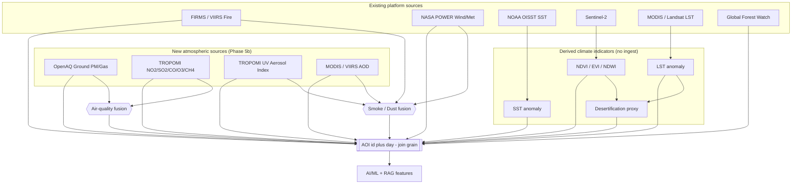

# 07 Climate / Air-Quality Data Relationships

> Extends the Phase 5 relationship graph ([`../07-data-relationships.md`](../07-data-relationships.md)) to show how the new atmospheric sources join to existing AOIs, weather (NASA POWER wind), and fire (FIRMS) data for cross-domain analysis.

## Executive Summary

The atmospheric sources are glued to the rest of the platform by a single join grain: **`aoi_id` + observation date (UTC)**. That grain lets dust (AOD/AER_AI), pollutants (TROPOMI), ground truth (OpenAQ), wind (POWER), fire (FIRMS), and derived climate indicators fuse into cross-domain features — most notably the **smoke/dust event** signal (`fire + aerosol + wind`).

## Conceptual Relationships

- **Atmospheric ↔ AOI:** every stats/point request is bound to an `aoi_id` (from [`02-aoi-strategy.md`](./02-aoi-strategy.md)) → `aoi_id` is the universal join key.
- **AOD/AER_AI ↔ wind (POWER):** dust concentration + wind vector → transport direction and arrival forecast.
- **AOD/TROPOMI ↔ fire (FIRMS):** fire detections + aerosol elevation → smoke attribution.
- **TROPOMI ↔ OpenAQ:** satellite column calibrated/validated by ground surface concentration.
- **Derived indicators ↔ AOI + time:** LST/SST/NDVI anomalies share AOI + date grain for climate rollups.
- **Secondary-corridor AOD ↔ primary-AOI:** upwind source corridors feed downwind UAE AOIs via wind.

## Extended Relationship Graph

## Join Keys

| Relationship | Key | Tolerance |
| --- | --- | --- |
| Any atmospheric ↔ AOI | `aoi_id` | polygon membership |
| Atmospheric ↔ atmospheric | `aoi_id` + day (UTC) | same day |
| AOD/AER_AI ↔ wind (POWER) | `aoi_id` + day | same day |
| AOD/TROPOMI ↔ fire (FIRMS) | bbox/AOI + day | scene/day window |
| TROPOMI ↔ OpenAQ | AOI + day | same day (column vs surface — document semantics) |
| Corridor AOD → UAE AOI | corridor `aoi_id` → UAE `aoi_id` via wind | 1–2 day advection lag |
| Derived anomaly ↔ AOI | `aoi_id` + date | source cadence |

## Cross-Domain Feature Signals

| Signal | Formula (conceptual) |
| --- | --- |
| Dust arrival | `corridor AOD(t) + wind vector(t) → UAE AOI AOD(t+lag)` |
| Smoke attribution | `FIRMS fire + AOD/AER_AI elevation + wind → source-tagged smoke` |
| Calibrated air quality | `TROPOMI column ⊕ OpenAQ surface → validated pollutant estimate` |
| Climate trend | `LST/SST/NDVI anomaly over baseline per AOI` |

## Cross References

- AOI strategy (join key source): [`02-aoi-strategy.md`](./02-aoi-strategy.md)
- Use-case mapping: [`05-climate-use-case-mapping.md`](./05-climate-use-case-mapping.md)
- Phase 5 relationship graph: [`../07-data-relationships.md`](../07-data-relationships.md)
