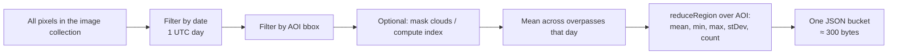

# 00 — Geospatial & Space-Data Primer (For Engineers New to the Domain)

> Read this before the individual source guides. It explains the ~15 concepts that come up in
> every source and causes most misinterpretations. Each concept ends with a **"Why it matters
> here"** note tied to this platform.

---

## 1. Coordinates: Latitude, Longitude and CRS

| Concept | Plain explanation |
| --- | --- |
| **Latitude** | North–south position, −90 (South Pole) to +90 (North Pole). Dubai ≈ 25.2 |
| **Longitude** | East–west position, −180 to +180, 0 = Greenwich. Dubai ≈ 55.3 |
| **CRS** (Coordinate Reference System) | The "ruler" used to express a position. The same point has different numbers in different CRSs |
| **EPSG:4326 / WGS 84** | The GPS CRS: plain degrees of lat/lon. **Every source on this platform uses it** |
| **Projected CRS** (e.g., UTM) | Flattens the globe into metres for accurate distance and area. Sentinel-2 tiles are natively in UTM; GEE reprojects for us |

**Axis-order trap.** Different standards list the two numbers in different orders:

| Convention | Order | Used by |
| --- | --- | --- |
| GeoJSON, STAC, our `bbox` settings | `[lon, lat]` → `[min_lon, min_lat, max_lon, max_lat]` | Settings `aois`, Sentinel-2, EMS |
| FIRMS area string | `west,south,east,north` (= lon,lat,lon,lat) | FIRMS |
| NASA CMR `boxes` | `"S W N E"` (lat first!) | Earthdata |
| Human speech, CSV columns | `latitude, longitude` | FIRMS rows, OpenAQ |

> **Why it matters here:** a swapped lat/lon puts Dubai (25.2, 55.3) in the Indian Ocean far
> south of India. Silver range-checks (`-90..90`, `-180..180`) catch only *some* swaps.

**One degree is not a fixed distance.** 1° of latitude ≈ 111 km everywhere. 1° of longitude ≈
111 km × cos(latitude): ≈ 101 km at the UAE and 0 km at the poles. This is why the code computes
areas with [`polygon_area_km2`](../../../transformation/geospatial/spatial_transform.py) (degree² area
scaled by km-per-degree at the polygon's mean latitude) rather than
multiplying degrees.

---

## 2. Vector vs Raster vs Tabular — The Three Shapes of Geodata

| Shape | What it is | Example sources here | Typical formats |
| --- | --- | --- | --- |
| **Vector: point** | A single coordinate with attributes | FIRMS fire pixel centres, OpenAQ stations | CSV, GeoJSON |
| **Vector: polygon** | A closed boundary | Copernicus EMS activation footprints, AOI bounding boxes | GeoJSON, Shapefile |
| **Raster** | A grid of pixels, each with one or more values (bands) | Sentinel-2 reflectance, TROPOMI NO₂, MODIS AOD | GeoTIFF, NetCDF, HDF, COG |
| **Tabular time series** | Rows of (place, time, value) | NASA POWER, NOAA Kp, OpenAQ measurements | JSON, CSV |

> **Why it matters here:** the platform **never lands raster pixels**. Raster sources are reduced
> to AOI statistics (§6) at the provider, so everything in Bronze is vector or tabular.

---

## 3. Resolution — Three Different Kinds

| Kind | Question it answers | Examples |
| --- | --- | --- |
| **Spatial** | How big is one pixel on the ground? | Sentinel-2 10–20 m · VIIRS I-band 375 m · MODIS MAIAC 1 km · TROPOMI ~3.5 × 5.5 km · POWER ~50 km (0.5°) |
| **Temporal** (revisit) | How often is the same place observed? | Sentinel-2 ~5 days · TROPOMI/MODIS/VIIRS ~daily · Kp every 3 h · OpenAQ 15 min–1 h |
| **Spectral** | Which wavelengths are measured? | Sentinel-2: 13 bands (visible, NIR, SWIR) · TROPOMI: UV–SWIR spectrometer |

> **Why it matters here:** a FIRMS "fire" is a **375 m pixel containing a hot spot**, not a fire
> perimeter. A TROPOMI value is an average over ~19 km²; it cannot resolve a single factory
> chimney.

---

## 4. Satellites, Orbits and Overpass Times

| Concept | Plain explanation | Platform relevance |
| --- | --- | --- |
| **LEO (Low Earth Orbit)** | 400–1,000 km altitude; one orbit ≈ 90–100 min | ISS, Sentinel, NOAA-20, Terra/Aqua |
| **Sun-synchronous orbit** | Passes over each place at the **same local solar time** every day | VIIRS NOAA-20 ≈ 13:30 / 01:30; Terra ≈ 10:30; Aqua ≈ 13:30; Sentinel-2 ≈ 10:30; S-5P ≈ 13:30 |
| **Swath** | Width of the strip imaged in one pass | VIIRS ~3,000 km (global daily), Sentinel-2 290 km (5-day revisit) |
| **Overpass / granule** | One pass's data chunk over an area | Days with no overpass over the AOI produce **no bucket** |
| **Passive optical sensor** | Measures reflected sunlight or emitted heat; **cannot see through cloud** | All satellite sources here are passive, so cloud causes gaps |
| **TLE / GP elements** | Compact description of an orbit at an epoch; propagated with SGP4 to get positions | CelesTrak |

> **Why it matters here:** a satellite observes a place for only seconds per day. "Daily NO₂"
> really means one snapshot around 13:30 local time. Diurnal cycles (rush-hour peaks, night
> fires) are partly invisible.

---

## 5. Processing Levels — From Raw Signal to Usable Product

| Level | Meaning | Example |
| --- | --- | --- |
| **L0** | Raw instrument telemetry | Not used |
| **L1** | Calibrated, geolocated radiance/reflectance (top of atmosphere) | Sentinel-2 L1C |
| **L2** | Derived geophysical variable per pixel, in sensor geometry or tiles (surface reflectance, gas column, AOD) | Sentinel-2 **L2A**, TROPOMI L2, MODIS MCD19A2 |
| **L3** | L2 re-gridded onto a regular map grid, often filtered and composited | GEE `COPERNICUS/S5P/*/L3_*` |
| **L4** | Model output or analysis combining many inputs | NASA POWER (from MERRA-2 reanalysis) |

**Latency tiers**

| Tier | Typical latency | Quality | Here |
| --- | --- | --- | --- |
| **NRT** (Near Real-Time) | Minutes to ~3 h | Lower; may be reprocessed later | FIRMS `VIIRS_NOAA20_NRT`, S5P `NRTI` (NO₂) |
| **OFFL / Standard / Science** | Days to weeks | Best available | S5P `OFFL` (SO₂, CO, O₃, CH₄, AER_AI) |

> **Why it matters here:** NRT and OFFL values for the same day **can differ**. The `collection`
> field in TROPOMI payloads records which one was used.

---

## 6. How We Avoid Downloading Imagery: AOI Statistics

Full imagery is enormous: one Sentinel-2 tile is ~800 MB. The platform instead asks the provider
(Google Earth Engine) to compute **summary statistics over an Area of Interest (AOI)** and returns
only the numbers:



Every statistics payload has the same shape. It deliberately mimics the Sentinel Hub
Statistical API, so Silver code is backend-agnostic:

```json
{"interval": {"from": "2026-11-06T00:00:00Z", "to": "2026-11-07T00:00:00Z"},
 "outputs": {"index": {"bands": {"B0": {"stats": {
     "mean": 0.156, "min": 0.0, "max": 2.233, "stDev": 0.108,
     "sampleCount": 236785, "noDataCount": 15783}}}}},
 "aoi_id": "AOI-DXB", "bbox": [54.9, 24.8, 55.6, 25.4], "…": "source-specific context"}
```

| Field | Meaning | How to use it |
| --- | --- | --- |
| `mean` | Average pixel value over valid pixels in the AOI | The headline value |
| `min` / `max` | Extremes; sensitive to outliers and noise | Use for sanity checks, not KPIs |
| `stDev` | Spatial variability inside the AOI | High = patchy (plume, coastline, cloud edge) |
| `sampleCount` | Pixels with valid data | — |
| `noDataCount` | Pixels in the AOI with no valid data (cloud, masked, outside swath) | **Valid fraction = sampleCount ÷ (sampleCount + noDataCount)**. Treat days < 0.5 with caution |

> **Trade-off:** tiny storage and laptop-friendly, but **spatial detail inside the AOI is lost**.
> Statistics are computed at a fixed `scale` (S2: 250 m, S5P: 1,113 m, AOD: 1,000 m), and
> GEE's `bestEffort` mode may coarsen further for large AOIs.

---

## 7. Scale Factors, Fill Values and QA Flags

Satellite products often store values as compact integers:

| Concept | Example | Rule |
| --- | --- | --- |
| **Scale factor** | MODIS AOD stored as `156`, meaning 0.156 (× 0.001) | The GEE AOD connector applies `VALUE_SCALE = 0.001` **before** landing |
| **Fill value** | NASA POWER uses `-999` for "no data" | Never average a fill value; Silver range checks reject it |
| **QA flag / qa_value** | Per-pixel quality code (cloud, retrieval confidence) | GEE S5P L3 assets are already QA-filtered by GEE; MODIS AOD is **not** QA-masked by our connector (README SG-03) |
| **Confidence class** | FIRMS VIIRS `l`/`n`/`h` | Silver maps them to 33/66/99 |

---

## 8. Time: UTC, Local Time and Local Solar Time

| Standard | Definition | Sources |
| --- | --- | --- |
| **UTC** | Global reference clock | FIRMS `acq_time`, S5P/MODIS/S2 buckets, OpenAQ `utc`, SWPC, CelesTrak `EPOCH` |
| **Local civil time** | Wall clock (UAE = UTC+4, India = UTC+5:30) | OpenAQ `local` fields |
| **Local Solar Time (LST)** | Noon = sun highest; ≈ UTC + longitude/15 h | NASA POWER daily default (README SG-04) |

> **Rule:** store and join in UTC; convert to local time only for display. A "daily" bucket here is
> a **UTC day** (00:00Z–24:00Z), which over the UAE is 04:00–04:00 local time.

---

## 9. Column Amount vs Surface Concentration

This is the most common air-quality misconception:

| Measure | What it is | Unit | Source |
| --- | --- | --- | --- |
| **Total / tropospheric column** | Number of molecules in a vertical column of air from ground to (tropo)pause, per area | **mol/m²** | TROPOMI (satellite) |
| **Surface concentration** | Mass of pollutant per volume of air at breathing height | **µg/m³** (ppb for gases) | OpenAQ (ground stations) |
| **Aerosol Optical Depth (AOD)** | How much light the whole atmospheric column's particles block | unitless | MODIS MAIAC |

> **They are correlated, not equal.** A high NO₂ column usually means high surface NO₂, but
> mixing height, wind and time of day change the ratio. The climate track uses OpenAQ as **ground
> truth** to calibrate satellite columns (AOD→PM regression in Phase 14b).

---

## 10. Spectral Indices (NDVI, NDWI, NBR) in One Paragraph

Healthy plants reflect strongly in near-infrared (NIR, Sentinel-2 band B8) and absorb red light
(B4). Water absorbs NIR. Burned areas reflect strongly in short-wave infrared (SWIR, B12). A
**normalized difference** `(a − b) / (a + b)` turns two bands into a −1…+1 score that is robust to
illumination:

| Index | Formula (Sentinel-2) | High value means | Typical values |
| --- | --- | --- | --- |
| NDVI | (B8 − B4) / (B8 + B4) | Dense vegetation | Water < 0 · desert 0.05–0.15 · crops 0.3–0.8 |
| NDWI (McFeeters) | (B3 − B8) / (B3 + B8) | Open water | Water > 0 · land < 0 |
| NBR | (B8 − B12) / (B8 + B12) | Healthy vegetation; low or negative = burned | Burn severity uses the pre/post difference (dNBR) |

> ⚠️ The GEE backend currently produces these with the **opposite sign** (README SG-01).

---

## 11. Discovery Standards: STAC and CMR

| Standard | What it is | Used by |
| --- | --- | --- |
| **STAC** (SpatioTemporal Asset Catalog) | Open JSON spec: each scene is a GeoJSON `Feature` with `id`, `bbox`, `geometry`, `properties.datetime`, `eo:cloud_cover`, `assets` | Sentinel Hub Catalog, USGS LandsatLook, our GEE scene shape |
| **CMR** (NASA Common Metadata Repository) | NASA's catalogue of all Earthdata granules; JSON/Atom feed | Earthdata connector |

---

## 12. Maritime and Orbital Identifiers

| Identifier | Domain | Meaning |
| --- | --- | --- |
| **MMSI** (`ssvid` in GFW) | Maritime | 9-digit radio identity broadcast by AIS transponders; first 3 digits (MID) indicate flag state. Can be spoofed or reused |
| **IMO number** | Maritime | Permanent 7-digit hull identity; often null for small or fishing vessels |
| **AIS** | Maritime | Automatic Identification System: ships broadcast position, speed and identity |
| **NORAD catalog ID** | Orbital | Unique number per tracked space object (ISS = 25544) |
| **COSPAR / international designator** | Orbital | Launch year + launch number + piece (`1998-067A`) |

---

## 13. Ten Golden Rules for Reading Space and Geospatial Data

1. **Check axis order** (`lon,lat` vs `lat,lon`) before plotting anything.
2. **Check units and scale factors**; never assume.
3. **Separate observation time from ingest time** (`_event_ts` vs `_ingest_ts`).
4. **Missing ≠ zero.** No bucket means *no observation*, not "no pollution" or "no fire".
5. **Check valid-pixel fraction** before trusting a statistics mean.
6. **Know the overpass time**: a daily satellite value is a snapshot.
7. **Prefer UTC** for joins.
8. **A point is not a perimeter** (FIRMS) and **a column is not the surface** (TROPOMI).
9. **Dedupe** rolling-window sources before counting.
10. **Read the known-issues register** ([README §7](./README.md#7-known-issues-register-found-while-writing-these-guides)) first.

---

## 14. Learning Resources (Free)

| Topic | Resource |
| --- | --- |
| Remote-sensing fundamentals | NASA Earthdata — *What is Remote Sensing?* (earthdata.nasa.gov/learn/backgrounders/remote-sensing) |
| Hands-on with GEE | Google Earth Engine tutorials (developers.google.com/earth-engine/tutorials) |
| Spectral indices | Sentinel Hub *Custom Scripts* repository (custom-scripts.sentinel-hub.com) |
| CRS and projections | QGIS Training Manual — *Coordinate Reference Systems* |
| Orbits and TLEs | CelesTrak — *Frequently Asked Questions: Two-Line Element Set Format* |
| Air quality basics | OpenAQ *Air Quality Basics* (docs.openaq.org) |

Terms are defined in the [Glossary](./14-glossary.md).
