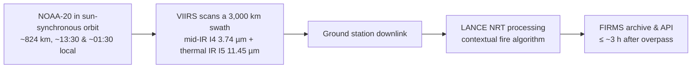

# 01 — NASA FIRMS Active Fire (VIIRS NOAA-20)

## 1. Identity Card

| Attribute | Value |
| --- | --- |
| Bronze `_source` | `FIRMS` |
| Provider | NASA **FIRMS** (Fire Information for Resource Management System), part of NASA's Earth Science Data Systems; NRT processing by **LANCE** |
| Satellite / instrument | **NOAA-20** (JPSS-1) satellite, **VIIRS** (Visible Infrared Imaging Radiometer Suite) instrument, I-band 375 m fire product |
| Product code we request | `VIIRS_NOAA20_NRT` (configurable via `FIRMS_SOURCE`; see [`settings.py`](../../../ingestion/config/settings.py)) |
| Connector | [`ingestion/api/nasa_firms.py`](../../../ingestion/api/nasa_firms.py) |
| Schedule | `@hourly` ([`nasa_firms_ingest_dag.py`](../../../ingestion/batch/dags/nasa_firms_ingest_dag.py)) |
| Auth | Free `FIRMS_MAP_KEY` (email registration) |
| Licence | NASA open data, free reuse with attribution |
| Use cases | UC-15 wildfire detection & escalation; India crop-residue burning (regional tier) |

## 2. What It Is (Plain Language)

Each row is **one 375 m satellite pixel that looked anomalously hot** during an overpass. It is a
*thermal anomaly*, usually a fire, but sometimes a gas flare, volcano or hot industrial surface.
A large fire produces **many adjacent rows** from the same overpass.

## 3. How the Data Is Collected



- **Physics:** fire is much hotter than its surroundings, so it radiates strongly in the
  **mid-infrared** (I4). The algorithm compares each pixel's I4/I5 **brightness temperatures**
  with its neighbours (a *contextual* test) and flags outliers.
- **Fire Radiative Power (FRP):** the radiant energy released, in megawatts, estimated from the
  mid-IR signal. It is a proxy for fire intensity and biomass burned.
- **Coverage:** global, about twice per day per location (day pass + night pass).
- **Satellite change:** FIRMS ends VIIRS **S-NPP** NRT on 2026-11-02, so the platform switched to
  **NOAA-20**, which has identical VIIRS I-band fields (rationale in `settings.py`).

## 4. Why We Access It

| Reason | Detail |
| --- | --- |
| Primary wildfire signal | Fastest free global fire detection (NRT ≤ ~3 h) |
| Event-level grain | Point detections support daily per-AOI counts, peak FRP and escalation features |
| Validated against EMS | Detections are corroborated with Copernicus EMS footprints (UC-27) |
| Regional relevance | UAE-GULF (oil/gas region, date-palm fires) and INDIA (stubble burning in Punjab/Haryana) |

## 5. How We Access It

| Item | Value |
| --- | --- |
| Endpoint | `GET https://firms.modaps.eosdis.nasa.gov/api/area/csv/{MAP_KEY}/{SOURCE}/{west,south,east,north}/{DAY_RANGE}[/{DATE}]` |
| Areas requested | `mena` = `30,10,60,40` (covers UAE-GULF) · `med` = `-10,30,40,46` (outside every analysis region; detections stay unattributed) · INDIA AOIs `IN-PB-HR`, `IN-DEL-NCR`, `IN-THAR`, `IN-GUJ-COAST`, `IN-ASSAM` |
| Window | `days=1` (FIRMS allows 1–5); optional `date` for backfill |
| Caps | `max_records = 10000` per request; if exceeded, the most recent detections are kept and a **coverage note** is recorded (never silent) |
| Rate limit | Connector self-limits to 2 calls/s; FIRMS allows a fixed transaction budget per 10 minutes per key |
| Failure semantics | A body without a `latitude` CSV header (e.g., an invalid key message) **fails the run**. A header-only CSV is a genuine "zero detections" result |

## 6. Format at Source

CSV with a header row:

```csv
latitude,longitude,bright_ti4,scan,track,acq_date,acq_time,satellite,instrument,confidence,version,bright_ti5,frp,daynight
26.11804,92.08217,326.74,0.56,0.43,2026-11-14,646,N20,VIIRS,n,2.0NRT,297.07,3.04,D
```

## 7. What We Store in Bronze (and Why)

The connector parses the CSV into one dict per row (stdlib `csv.DictReader`) and wraps each row in
the envelope. **Values remain strings**, exactly as received. `_format = "csv"` records the
origin, and `_event_ts` is built from `acq_date` + `acq_time`.

Real record (`s3://bronze/FIRMS/ingest_date=2026-11-14/FIRMS-20261114T190017Z-b9967d0f/part-0000.jsonl`):

```json
{"_source": "FIRMS", "_format": "csv", "_event_ts": "2026-11-14T06:46:00Z",
 "payload": {"latitude": "26.11804", "longitude": "92.08217", "bright_ti4": "326.74",
   "scan": "0.56", "track": "0.43", "acq_date": "2026-11-14", "acq_time": "646",
   "satellite": "N20", "instrument": "VIIRS", "confidence": "n", "version": "2.0NRT",
   "bright_ti5": "297.07", "frp": "3.04", "daynight": "D"}}
```

| Decision | Why | Alternative | Trade-off |
| --- | --- | --- | --- |
| Row-per-record JSONL instead of the raw CSV file | Uniform envelope; per-detection `_event_ts` and checksum | Land the CSV verbatim | Strings instead of numbers (Silver casts) |
| Keep strings, no casting at ingest | Bronze must be lossless; `"0.56"` vs `0.56000001` float drift avoided | Cast in the connector | Every reader must cast |

## 8. Field Dictionary

| Field | Type (after cast) | Unit | Meaning | Notes |
| --- | --- | --- | --- | --- |
| `latitude`, `longitude` | double | degrees (WGS 84) | **Centre** of the hot pixel | Not the fire's exact location; ±~200 m |
| `bright_ti4` | double | Kelvin | Brightness temperature, I4 band (3.74 µm, mid-IR) | Saturates ~367 K for intense fires |
| `bright_ti5` | double | Kelvin | Brightness temperature, I5 band (11.45 µm, thermal IR) | Background reference |
| `scan`, `track` | double | km | Actual pixel width along-scan / along-track | 0.375 at nadir, up to ~0.8 at swath edge; larger pixel = coarser location |
| `acq_date` | date | UTC | Overpass date | — |
| `acq_time` | `HHMM` string | UTC | Overpass time; **leading zeros dropped** (`646` = 06:46) | Zero-pad before parsing |
| `satellite` | string | — | `N20` = NOAA-20 (`N` = S-NPP, `N21` = NOAA-21) | Part of the Silver `fire_key` |
| `instrument` | string | — | `VIIRS` | — |
| `confidence` | `l` / `n` / `h` | — | Low / nominal / high detection confidence | Silver maps to 33 / 66 / 99 |
| `version` | string | — | Algorithm collection; `NRT` suffix = near real-time | Later science-quality versions may differ |
| `frp` | double | **MW** | Fire Radiative Power | Sum per AOI/day for intensity; heavy-tailed distribution |
| `daynight` | `D` / `N` | — | Day or night overpass | Night detections are less affected by sun-heated surfaces |

## 9. How to Read & Interpret

```sql
-- Daily detections and peak FRP by satellite (DuckDB; see README §6 for the MinIO secret)
SELECT payload.acq_date AS day, payload.satellite,
       count(*) AS detections, max(payload.frp::DOUBLE) AS peak_frp_mw
FROM read_json_auto('s3://bronze/FIRMS/ingest_date=*/*/*.jsonl')
GROUP BY ALL ORDER BY day DESC;
```

| Question | Correct reading |
| --- | --- |
| "How many fires?" | Count **detections**, not fires. Cluster adjacent pixels from the same overpass to approximate fire events |
| "How intense?" | Use FRP (MW). Sum per AOI-day; peak FRP highlights the strongest pixel |
| "Was there no fire?" | Zero detections can also mean cloud cover, no overpass, or smoke; it is **not** proof of absence |

## 10. Quality, Limitations & Gotchas

| Gotcha | Explanation | Mitigation |
| --- | --- | --- |
| **Gas flares** | Persistent oil/gas flares in Iraq, Iran and the Gulf appear as daily "fires" | Static-source masking (persistent location over many days) before wildfire KPIs |
| Sun-heated desert / glint | Daytime hot surfaces trigger low-confidence detections | Weight by `confidence`; compare `daynight` |
| Clouds and thick smoke | Hide fires completely | Treat gaps as unknown |
| Duplicate detections | Overlapping swaths at high latitude; hourly re-pull of a 1-day window | Silver dedupes by `fire_key` = hash(lat, lon, ts, satellite) |
| One sensor per day | Mixing S-NPP and NOAA-20 would double-count | Platform uses one sensor; `satellite` is part of the key |
| String values | `"frp": "3.04"` | Cast explicitly |
| Record cap | > 10,000 detections in a request are truncated | Check run `coverage_notes` |

## 11. Downstream Lineage

`Bronze FIRMS` → `silver_fire` (`obs_fire`: typed, confidence 0–100, `brightness` from
`bright_ti4`, `geo_key` grid cell) → Gold `fact_fire_detection`, `kpi_wildfire_aoi_daily` →
serving `serving_wildfire_daily` → Superset Earth-Observation and Executive dashboards.

## 12. Design Decision Record

| | |
| --- | --- |
| **Chosen** | VIIRS 375 m NRT via the FIRMS area API |
| **Alternatives** | MODIS 1 km fire product (`MODIS_NRT`): coarser and nearing end of mission · GOES/Meteosat geostationary fire: every 10–15 min but 2 km, heavy raster · Sentinel-3 SLSTR FRP: less mature free API |
| **Trade-off** | Good spatial detail and free NRT, but only ~2 looks per day; small or short fires between overpasses are missed |

## 13. References

- FIRMS API documentation: https://firms.modaps.eosdis.nasa.gov/api/area/
- VIIRS I-band active-fire attributes: https://www.earthdata.nasa.gov/data/tools/firms/faq
- Schroeder et al. (2014), *The New VIIRS 375 m active fire detection data product*, Remote Sensing of Environment
