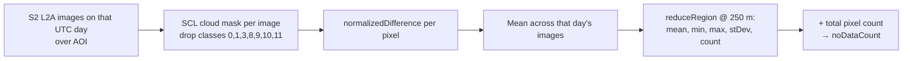

# 03 — Sentinel-2 Spectral Indices: NDVI, NDWI, NBR (via Google Earth Engine)

> ⚠️ **Read first:** the current GEE backend produces these indices with the **opposite sign**
> (README [SG-01](./README.md#7-known-issues-register-found-while-writing-these-guides)). Until it is
> fixed, multiply Bronze/Silver means by −1 (and swap min/max) to obtain conventional values.

## 1. Identity Card

| Attribute | Value |
| --- | --- |
| Bronze `_source` | `SENTINELHUB_STATS` *(historical name; real backend is GEE)* |
| Data owner | ESA / Copernicus (Sentinel-2 L2A surface reflectance) |
| Access backend | GEE `COPERNICUS/S2_SR_HARMONIZED`, computed server-side with `reduceRegion` |
| Connector | [`GeeSentinel2IndexConnector`](../../../ingestion/api/gee_sentinel2.py) (base: [`EarthEngineStatsConnector`](../../../ingestion/api/gee.py)) |
| Schedule | `@daily`, 14-day look-back |
| Indices landed | `NDVI` and `NDWI` over `AOI-DXB` (full run); `NBR` is supported |
| Auth / licence | As doc 02 |
| Use cases | UC-14 vegetation change · UC-15 burn severity (NBR) · UC-16 water and flood extent (NDWI) · climate track vegetation health (UC-C1) |

## 2. What It Is (Plain Language)

For each **UTC day** with a Sentinel-2 overpass over the AOI, one number summarises "how green"
(NDVI) or "how wet" (NDWI) the AOI is, plus min, max, spread and how many pixels were cloud-free.

## 3. How the Data Is Collected and Computed



| Step | Detail |
| --- | --- |
| Cloud mask | SCL classes removed: 0 no-data, 1 saturated, 3 cloud shadow, 8 cloud medium, 9 cloud high, 10 thin cirrus, 11 snow. **Water (6), vegetation (4), bare soil (5) are kept** |
| Index formula (intended) | NDVI = (B8 − B4)/(B8 + B4) · NDWI = (B3 − B8)/(B3 + B8) · NBR = (B8 − B12)/(B8 + B12) |
| Index formula (as coded) | `normalizedDifference(["B8","B4"])` etc. since formula v2 (2026-11-14). Earlier GEE records were negated (SG-01, resolved); Silver quarantines them as `superseded:gee_index_sign_v1` |
| Scale | 250 m sampling (native 10–20 m) to keep the computation within free quota |
| No-data days | Days with no image over the AOI produce **no record** (gaps are visible, not zero-filled) |

## 4. Why We Access It

Indices compress gigabytes of imagery into a few bytes per AOI-day, which is what makes
vegetation, water and burn monitoring feasible on a laptop. NDWI is the core flood signal for
UC-16; NDVI underpins vegetation-health and desertification indicators.

## 5. How We Access It

GEE SDK, one `reduceRegion` call per index per UTC day per AOI (plus one count call). Bbox
`AOI-DXB` = `[54.9, 24.8, 55.6, 25.4]`. Sampling at 250 m gives ~84,000 pixels for this AOI.

## 6. Format at Source

GEE `reduceRegion` returns a flat dict, such as
`{"index_mean": …, "index_min": …, "index_max": …, "index_stdDev": …, "index_count": …}`. The
connector converts it into the **Sentinel Hub Statistical API bucket shape** (primer §6).

## 7. What We Store in Bronze (and Why)

Real record (`s3://bronze/SENTINELHUB_STATS/ingest_date=2026-11-14/…`):

```json
{"_source": "SENTINELHUB_STATS", "_event_ts": "2026-11-01T00:00:00Z",
 "payload": {"interval": {"from": "2026-11-01T00:00:00Z", "to": "2026-11-02T00:00:00Z"},
   "outputs": {"index": {"bands": {"B0": {"stats": {"mean": -0.4164, "min": -0.5423, "max": -0.2444,
       "stDev": 0.0464, "sampleCount": 1212, "noDataCount": 81825}}}}},
   "index": "NDWI", "bbox": [54.9, 24.8, 55.6, 25.4], "collection": "COPERNICUS/S2_SR_HARMONIZED"}}
```

*Interpretation:* only 1.4 % of the AOI was valid that day (tile edge or cloud), so this record
should not drive a KPI.

| Decision | Why | Alternative | Trade-off |
| --- | --- | --- | --- |
| Server-side statistics, not pixels | 16 GB RAM budget; ~300 bytes per record | Download COG tiles and compute locally | No sub-AOI spatial detail |
| Mimic the Sentinel Hub bucket shape | Backend swap without touching Silver/Gold | New Silver cleaner per backend | Slightly odd nesting (`outputs.index.bands.B0`) |

## 8. Field Dictionary

| Field | Type | Meaning |
| --- | --- | --- |
| `interval.from` / `interval.to` | ISO UTC | UTC day the statistics cover |
| `outputs.index.bands.B0.stats.mean` | double, −1…+1 | AOI mean of the index (**sign-inverted today**) |
| `…stats.min` / `max` | double | Extreme pixel values (cloud edges and water bodies often reach ±1) |
| `…stats.stDev` | double | Spatial spread inside the AOI |
| `…stats.sampleCount` | int | Valid (unmasked) pixels at 250 m |
| `…stats.noDataCount` | int | Masked or uncovered pixels |
| `index` | `NDVI` / `NDWI` / `NBR` | Which index |
| `bbox` | lon/lat array | AOI requested |
| `collection` | string | GEE asset used |

## 9. How to Read & Interpret

| Index | Conventional reading (after correcting the sign) |
| --- | --- |
| NDVI | < 0 water · 0–0.15 bare desert/urban · 0.2–0.4 sparse vegetation and parks · > 0.5 dense crops/forest |
| NDWI | > 0 open water · < 0 land. Rising mean NDWI after rain = flooding signal |
| NBR | Compare pre-fire vs post-fire: dNBR = NBR_pre − NBR_post; > 0.27 ≈ moderate-to-high burn severity |

**Mixed AOIs:** `AOI-DXB` is roughly one-third Gulf water. Its mean blends sea, city and desert, so
day-to-day changes in which part is cloud-free (`valid_pixel_fraction`) shift the mean even if
nothing on the ground changed. Always read the mean together with the valid fraction.

## 10. Quality, Limitations & Gotchas

| Gotcha | Mitigation |
| --- | --- |
| **SG-01 sign inversion** | Negate; fix in connector and reprocess |
| Low valid fraction (tile edge, cloud) | Filter `valid_pixel_fraction ≥ 0.5` |
| Haze/dust over the Gulf lowers NDVI | Cross-check MODIS AOD (doc 05) |
| Daily mean of multiple images | Overlapping tiles on the same day are averaged |
| SCL misclassification (bright desert as cloud) | Known Sen2Cor limitation over arid areas |

## 11. Downstream Lineage

`Bronze SENTINELHUB_STATS` → `silver_index` (`obs_index`: one row per geo_key/index/date,
`valid_pixel_fraction`) → Gold `fact_flood_extent`, `kpi_flood_aoi_daily`,
`fact_vegetation_health_daily`, `fact_climate_indicator_daily` (all affected by SG-01) →
`serving_flood_daily`, `serving_vegetation_health_daily`, `serving_climate_indicator_daily` →
dashboards; feature view *Spectral index*
(blocked until validated; see [doc 15](../15-data-analysis-readiness-implementation-plan.md)).

## 12. References

- GEE `normalizedDifference`: https://developers.google.com/earth-engine/apidocs/ee-image-normalizeddifference
- Sentinel-2 SCL classes: https://sentiwiki.copernicus.eu/web/s2-processing
- Index formulas: https://custom-scripts.sentinel-hub.com
