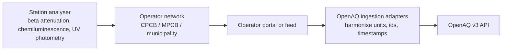

# 06 — OpenAQ Ground-Station Air Quality (API v3)

## 1. Identity Card

| Attribute | Value |
| --- | --- |
| Bronze `_source` | `OPENAQ` |
| Provider | **OpenAQ**, a non-profit **aggregator**. It does not measure; it harmonises data from government reference monitors (e.g., India CPCB/state boards such as MPCB) and some low-cost sensor networks |
| Access | REST API v3, `https://api.openaq.org/v3` |
| Connector | [`OpenAqConnector`](../../../ingestion/api/openaq.py) |
| Schedule | `@daily`, 1-day window ([`openaq_ingest_dag.py`](../../../ingestion/batch/dags/openaq_ingest_dag.py)); full run 14 days |
| AOIs × pollutants | UAE: `AOI-DXB`, `AOI-AUH`, `AOI-UAE-NAT` × {pm25, pm10, o3, no2, co, so2} · INDIA: `IN-DEL-NCR`, `IN-MUM` × {pm25, pm10} only (dense networks) |
| Auth | Free API key, sent as `X-API-Key` header (`OPENAQ_API_KEY`) |
| Licence | Per originating provider (mostly open government data); OpenAQ requires attribution to the original source |
| Use cases | UC-C3 air quality (**ground truth**); calibration target for satellite AOD/NO₂ |

## 2. What It Is (Plain Language)

Readings from **physical monitoring stations on the ground**: "At Colaba, Mumbai, PM₁₀ was
83 µg/m³ between 00:00 and 00:15 UTC on 15 Oct 2026." This is what people actually breathe, and it
is the reference against which satellite columns are judged.

## 3. How the Data Is Collected



| Pollutant | Typical measurement technique (reference-grade) |
| --- | --- |
| PM₂.₅ / PM₁₀ | Beta-attenuation monitor (BAM) or TEOM: mass of particles ≤ 2.5 / 10 µm |
| NO₂ | Chemiluminescence |
| O₃ | UV photometry |
| SO₂ | UV fluorescence |
| CO | Non-dispersive infrared |

Averaging intervals depend on the operator: **15 minutes** (sample below) or **1 hour**.

## 4. Why We Access It

| Reason | Detail |
| --- | --- |
| Health-relevant metric | Surface µg/m³ maps directly to AQI and WHO guidelines |
| Calibration and validation | Needed to turn satellite AOD/NO₂ into estimated surface concentrations |
| Free, global, one API | Avoids building one integration per national network |

## 5. How We Access It

OpenAQ v3 has **no flat "measurements in a bbox" endpoint**, so the connector makes two kinds of
call:

| Step | Call | Purpose |
| --- | --- | --- |
| 1 | `GET /v3/locations?bbox=<min_lon,min_lat,max_lon,max_lat>&limit=100&page=N` | Stations inside the AOI, each with its `sensors[]` list |
| 2 | `GET /v3/sensors/{sensor_id}/measurements?datetime_from=…&datetime_to=…&limit=…&page=…` | One call per matching sensor (station × pollutant) |

| Guardrail | Value | Why |
| --- | --- | --- |
| `max_locations` | 100 | Bound station fan-out per AOI |
| `max_pages` × `limit` | 5 × 200 (full run) | Some sensors **ignore the date window** and return full history; caps protect the 16 GB budget |
| Coverage notes | Recorded when caps are hit | Truncation is never silent |
| Rate limit | 2 calls/s (connector) | Stay below OpenAQ per-key limits |

## 6. Format at Source

JSON: `{"meta": {...}, "results": [ <measurement>, … ]}`. Each measurement is nested (see §8).

## 7. What We Store in Bronze (and Why)

One envelope per measurement, **enriched with station and request context** (marked ➕ below)
because the per-sensor endpoint does not repeat it.

Real record:

```json
{"_source": "OPENAQ", "_event_ts": "2026-10-15T00:00:00Z",
 "payload": {"value": 83.0, "flagInfo": {"hasFlags": false},
   "parameter": {"id": 1, "name": "pm10", "units": "µg/m³", "displayName": null},
   "period": {"label": "raw", "interval": "00:15:00",
     "datetimeFrom": {"utc": "2026-10-15T00:00:00Z", "local": "2026-10-15T05:30:00+05:30"},
     "datetimeTo":   {"utc": "2026-10-15T00:15:00Z", "local": "2026-10-15T05:45:00+05:30"}},
   "coordinates": {"latitude": 18.91, "longitude": 72.82}, "summary": null,
   "coverage": {"expectedCount": 1, "expectedInterval": "00:15:00", "observedCount": 1,
     "observedInterval": "00:15:00", "percentComplete": 100.0, "percentCoverage": 100.0, "…": "…"},
   "locationId": 6927, "sensorsId": 12235925, "station_name": "Colaba, Mumbai - MPCB",
   "aoi_id": "IN-MUM", "bbox": [72.75, 18.85, 73.2, 19.35]}}
```

| Decision | Why | Alternative | Trade-off |
| --- | --- | --- | --- |
| Enrich each measurement with station id/name/coords and AOI | Silver can key and tag rows without re-calling the API | Land locations and measurements as separate Bronze sources | Station attributes repeated on every row (largest Bronze source, ~22 MB per batch) |
| Keep native units | Lossless; conversion is versioned in Silver | Convert at ingest | Readers must not assume µg/m³ |

## 8. Field Dictionary

| Field | Type | Meaning | Notes |
| --- | --- | --- | --- |
| `value` | double | Measured concentration | In `parameter.units` |
| `parameter.name` | string | `pm25`, `pm10`, `no2`, `o3`, `so2`, `co` | Canonicalised in Silver (`PM25`, …) |
| `parameter.units` | string | `µg/m³` or `ppm` / `ppb` | **Varies by operator** |
| `period.label` | string | `raw` (as reported) or aggregate label | — |
| `period.interval` | `HH:MM:SS` | Averaging period | 15 min or 1 h |
| `period.datetimeFrom.utc` | ISO UTC | **Start** of the averaging interval → `_event_ts` | Use UTC for joins |
| `period.datetimeFrom.local` | ISO with offset | Station local time | For display only |
| `coordinates` | lat/lon | Measurement location; ➕ backfilled from the station when null | — |
| `coverage.percentComplete` | % | Share of expected sub-samples present | < 75 % = weak average |
| `flagInfo.hasFlags` | bool | Provider flagged this value | Investigate before use |
| `summary` | object/null | Statistical summary (aggregated endpoints only) | Null for raw |
| ➕ `locationId` / `sensorsId` | int | OpenAQ station / sensor ids | `sensorsId` = station × pollutant |
| ➕ `station_name` | string | Human-readable station | — |
| ➕ `aoi_id` / `bbox` | string / array | Request context | — |

## 9. How to Read & Interpret

| Pollutant | WHO 2021 24-h guideline | India NAAQS 24-h | Reading |
| --- | --- | --- | --- |
| PM₂.₅ | 15 µg/m³ | 60 µg/m³ | Main health metric |
| PM₁₀ | 45 µg/m³ | 100 µg/m³ | Dominated by **dust** in the Gulf |
| NO₂ | 25 µg/m³ | 80 µg/m³ | Traffic |

- Aggregate 15-minute or hourly values to **daily means per station** before comparing with
  24-hour standards; require ≥ 75 % coverage (≥ 18 of 24 hours).
- Each analysis region uses its own AQI standard (settings `aoi_regions`); never mix UAE and India
  rollups.

## 10. Quality, Limitations & Gotchas

| Gotcha | Mitigation |
| --- | --- |
| **Sparse UAE coverage**: few public stations | Satellite AOD/NO₂ fill gaps; state the station count with every KPI |
| Mixed units (ppm vs µg/m³) | Silver converts at 25 °C / 1 atm (24.45 L/mol), else flags `suspect` |
| Date window not always honoured | Page caps plus Silver dedup on station/pollutant/time |
| Negative or implausible values (instrument drift, low-cost sensors) | Silver range checks → quarantine |
| Interval start vs end | `_event_ts` = **start**; an hourly value stamped 10:00 covers 10:00–11:00 |
| Reference vs low-cost sensors | Prefer government monitors for compliance KPIs |

## 11. Downstream Lineage

`Bronze OPENAQ` → `silver_air_quality` (`obs_air_quality`: canonical pollutant codes, `value_std`,
`value_raw`/`unit_raw`, `quality_flag`) → Gold `fact_air_quality_daily` →
`serving_air_quality_daily` → Air-Quality dashboard; feature view *Air quality*.

## 12. References

- OpenAQ API v3 docs: https://docs.openaq.org
- WHO Global Air Quality Guidelines (2021): https://www.who.int/publications/i/item/9789240034228
- Unit conversion logic: [`units.py`](../../../transformation/cleaning/climate/units.py)
