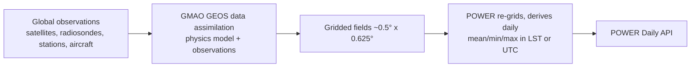

# 07 — NASA POWER Daily Weather

## 1. Identity Card

| Attribute | Value |
| --- | --- |
| Bronze `_source` | `POWER` |
| Provider | **NASA Langley Research Center**, POWER project (Prediction Of Worldwide Energy Resources) |
| Underlying data | Meteorology from **NASA GMAO GEOS-IT** model assimilation (response `header.sources = ["GEOSIT","POWER"]`, verified 2026-11-14); solar parameters from CERES/FLASHFlux (not requested) |
| Access | REST `https://power.larc.nasa.gov/api/temporal/daily/point`, **anonymous** |
| Connector | [`PowerConnector`](../../../ingestion/api/nasa_power.py) |
| Schedule | `@daily`, 7-day window ([`nasa_power_ingest_dag.py`](../../../ingestion/batch/dags/nasa_power_ingest_dag.py)); full run: one request per configured AOI centroid (15 AOIs) |
| Parameters | `T2M`, `RH2M`, `WS2M`, `WD2M`, `PRECTOTCORR` (community `RE`) |
| Licence | NASA open data |
| Use cases | Wind context for dust transport (UC-C2); heat/precipitation context for climate indicators (UC-C1) |

## 2. What It Is (Plain Language)

Daily weather values (temperature, humidity, wind, rain) for **the model grid cell containing a
point**. It is **not a weather station**: it is a physically consistent model "best estimate"
built from satellite and station observations, available everywhere on Earth.

## 3. How the Data Is Collected



| Aspect | Detail |
| --- | --- |
| Method | **Reanalysis / assimilation (L4)**: a weather model is continuously corrected by observations |
| Resolution | ~50 km grid; one value per cell, so city-scale effects (sea breeze, urban heat) are smoothed out |
| Latency | Near real-time values for recent days are **provisional** and may be revised |
| Day definition | Default **Local Solar Time** (`header.time_standard = "LST"`) |

## 4. Why We Access It

| Reason | Detail |
| --- | --- |
| Wind for dust | Dust-event logic needs wind speed and direction per AOI-day (`silver_wind` → `fact_dust_event_daily`) |
| Gap-free | Unlike stations, every AOI gets a value every day |
| Zero friction | Anonymous, stable, small JSON |

## 5. How We Access It

| Item | Value |
| --- | --- |
| Request | `?parameters=T2M,RH2M,WS2M,WD2M,PRECTOTCORR&community=RE&latitude=<lat>&longitude=<lon>&start=YYYYMMDD&end=YYYYMMDD&format=JSON` |
| Point choice | **Centroid of each AOI bbox** (e.g., `AOI-GULF` → 27.25, 52.5, which is over the sea) |
| Limits | ≤ 20 parameters per point request; POWER warns against repeatedly hammering the same cell |
| Not set | `time-standard` (so LST applies; README SG-04) |

## 6. Format at Source (verified live)

GeoJSON `Feature`. Values are nested **parameter → date → value**; metadata sits beside them:

```json
{"type": "Feature", "geometry": {"type": "Point", "coordinates": [55.25, 25.1, 20.89]},
 "properties": {"parameter": {"T2M": {"20261101": 30.56, "20261102": 30.53},
                              "WD2M": {"20261101": 25.3, "20261102": 293.3}, "…": {}}},
 "header": {"sources": ["GEOSIT", "POWER"], "fill_value": -999.0, "time_standard": "LST", "…": "…"},
 "parameters": {"T2M": {"units": "C", "longname": "Temperature at 2 Meters"}, "…": {}}}
```

The third geometry coordinate (20.89) is the **grid-cell elevation in metres**.

## 7. What We Store in Bronze (and Why)

The connector **flattens** the nested structure into **one record per (date, parameter)**:

```json
{"_source": "POWER", "_event_ts": "2026-11-06T00:00:00Z",
 "payload": {"date": "20261106", "parameter": "T2M", "value": 28.42,
             "latitude": 27.25, "longitude": 52.5, "aoi_id": "AOI-GULF"}}
```

| Decision | Why | Alternative | Trade-off |
| --- | --- | --- | --- |
| Long/narrow flattening | Uniform `(date, parameter, value)` rows are easy to union, dedupe and pivot; each row gets its own `_event_ts` | Store the whole Feature as one record | ⚠️ `header` (fill value, time standard, sources) and `parameters` (units) are **dropped**; units are fixed by convention (§8) |
| AOI centroid point | One cheap request per AOI | Regional API (0.5° grid, one parameter per request) | A single cell may not represent a large AOI (`AOI-ARABIA`) |

## 8. Field Dictionary

| `parameter` | Long name | Unit | Valid range / notes |
| --- | --- | --- | --- |
| `T2M` | Temperature at 2 m | °C | Daily mean; UAE summer 35–40 |
| `RH2M` | Relative humidity at 2 m | % | 0–100 |
| `WS2M` | Wind speed at 2 m | m/s | ≥ 0; Silver accepts 0–150. Dust lifting typically needs > ~6–8 m/s at 10 m |
| `WD2M` | Wind direction at 2 m | degrees | 0–360, **meteorological convention: direction the wind blows FROM** (0/360 = from north; 293° ≈ from WNW, the Shamal) |
| `PRECTOTCORR` | Precipitation (bias-corrected) | mm/day | ≥ 0 |
| `value = -999` | Fill value | — | Missing; **never average** |

Other payload fields: `date` (YYYYMMDD, LST day), `latitude`/`longitude` (requested point),
`aoi_id`.

## 9. How to Read & Interpret

- **Do not average wind direction arithmetically** (the mean of 350° and 10° is 0°, not 180°).
  Use vector averaging with the u/v components.
- A 2 m wind is lower than the standard 10 m meteorological wind.
- Treat the last 3–7 days as provisional.

## 10. Quality, Limitations & Gotchas

| Gotcha | Mitigation |
| --- | --- |
| LST day vs UTC `_event_ts` (SG-04) | Add `time-standard=UTC` to the request, or document the offset |
| ~50 km cells smooth coastlines | Use for regional context, not street-level conditions |
| Units not persisted in Bronze | This guide and the Silver `unit_std` are the contract |
| Overlapping 7-day windows each day | Silver dedupes; the latest revision wins |

## 11. Downstream Lineage

`Bronze POWER` → `silver_wind` (`WS2M`/`WD2M` only; range-checked) → `fact_dust_event_daily` (wind
context) → `serving_dust_event_daily`. `T2M`, `RH2M` and `PRECTOTCORR` are retained in Bronze for
future climate indicators (currently not consumed by Silver).

## 12. References

- POWER Daily API: https://power.larc.nasa.gov/docs/services/api/temporal/daily/
- POWER parameter dictionary: https://power.larc.nasa.gov/parameters/
