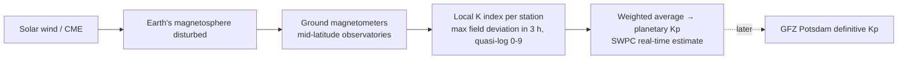

# 08 — NOAA SWPC Planetary K-index (Kp)

## 1. Identity Card

| Attribute | Value |
| --- | --- |
| Bronze `_source` | `SWPC` |
| Provider | **NOAA Space Weather Prediction Center** (US National Weather Service), Boulder, CO |
| Product | `noaa-planetary-k-index.json`: estimated 3-hourly planetary Kp, rolling ~7 days |
| Access | `GET https://services.swpc.noaa.gov/products/noaa-planetary-k-index.json`, **anonymous** |
| Connector | [`SwpcConnector`](../../../ingestion/api/noaa_swpc.py) |
| Schedule | `*/15 * * * *` (every 15 min) ([`noaa_swpc_ingest_dag.py`](../../../ingestion/batch/dags/noaa_swpc_ingest_dag.py)) |
| Licence | US Government public domain |
| Track | Simulation track (ADR-09): **real** space-weather data correlated with **synthetic** telemetry |
| Use cases | Space-weather impact on satellite health (`fact_weather_impact`); storm alerts |

## 2. What It Is (Plain Language)

**Kp is a 0–9 "storm meter" for Earth's magnetic field**, issued for every 3-hour block of the
day. Quiet = 0–2; geomagnetic storm = 5 or more. Storms are driven by solar eruptions and fast
solar wind hitting Earth's magnetosphere.

## 3. How the Data Is Collected



| Aspect | Detail |
| --- | --- |
| Measurement | Horizontal magnetic-field disturbance measured by ground observatories |
| Scale | Quasi-logarithmic, reported in thirds: 0, 0.33, 0.67, 1, …, 9 (`2.33` = "2+") |
| Real-time vs definitive | SWPC's value is an **estimate** from a subset of stations (`station_count = 8`); GFZ Potsdam publishes definitive Kp later, and the values can differ |

## 4. Why We Access It

| Satellite effect of geomagnetic storms | Platform relevance |
| --- | --- |
| Increased atmospheric **drag** on LEO satellites (orbit decay) | Orbit-stability features |
| Surface **charging** and single-event upsets | Telemetry anomaly correlation |
| GNSS and HF radio degradation | Ground-segment operations context |

## 5. How We Access It

A single GET with no parameters; the product always returns the **last ~7 days** (62 rows observed
on 2026-11-14). Every 15-minute pull re-lands the whole window (README SG-06).

## 6. Format at Source (verified live)

Array of objects (older versions returned an array of arrays with a header row; the connector
supports both):

```json
[{"time_tag": "2026-11-07T00:00:00", "Kp": 3.00, "a_running": 15, "station_count": 8},
 {"time_tag": "2026-11-07T03:00:00", "Kp": 2.33, "a_running": 9,  "station_count": 8}]
```

## 7. What We Store in Bronze (and Why)

Each row is kept and **normalised additively**: original keys are preserved, and `timestamp`
(ISO with `Z`) and `kp_index` are added so Silver works with either upstream shape.

```json
{"_source": "SWPC", "_event_ts": "2026-11-07T00:00:00Z",
 "payload": {"time_tag": "2026-11-07T00:00:00", "Kp": 3.0, "a_running": 15, "station_count": 8,
             "timestamp": "2026-11-07T00:00:00Z", "kp_index": 3.0}}
```

| Decision | Why | Alternative | Trade-off |
| --- | --- | --- | --- |
| Additive normalisation | Tolerates the array-of-arrays ↔ array-of-objects format change | Strict schema | Duplicate fields (`Kp` and `kp_index`) |
| Pull every 15 min | Detect a new 3-hour value quickly | Pull every 3 h | ~95 % duplicate rows in Bronze |

## 8. Field Dictionary

| Field | Type | Unit | Meaning |
| --- | --- | --- | --- |
| `time_tag` | timestamp (no zone; UTC) | — | **Start** of the 3-hour interval (00, 03, …, 21 UTC) |
| `Kp` / `kp_index` | double | Kp units (0–9) | Planetary K-index |
| `a_running` | int | ≈ 2 nT | Linear-scale equivalent (*ap*) of Kp; averages are meaningful on this scale |
| `station_count` | int | — | Magnetometers used in the estimate |
| `timestamp` | ISO UTC | — | Added by the connector (`time_tag` + `Z`) |

## 9. How to Read & Interpret

| Kp | NOAA G-scale | Meaning |
| --- | --- | --- |
| 0–3 | — | Quiet to unsettled |
| 4 | — | Active |
| 5 | G1 Minor | Weak power-grid fluctuations; aurora at high latitudes |
| 6 | G2 Moderate | Satellite drag increases |
| 7 | G3 Strong | Surface charging; GNSS issues |
| 8 | G4 Severe | Widespread satellite and navigation effects |
| 9 | G5 Extreme | Rare (e.g., May 2024) |

- Daily summaries should use **max Kp** (storm detection) and **mean ap** (activity level). Do not
  average Kp: the scale is non-linear.

## 10. Quality, Limitations & Gotchas

| Gotcha | Mitigation |
| --- | --- |
| Heavy duplication | Silver dedupes on `timestamp` |
| Estimated values may be revised | Prefer the latest ingest per `time_tag` |
| `time_tag` lacks a `Z` | Treat as UTC (the connector appends `Z`) |
| Kp is global | It does not localise storm effects by region or orbit |
| Real and synthetic Kp share `silver_space_weather` | Filter `_source = 'SWPC'` for real data (see [doc 13](./13-simulation-sources.md)) |

## 11. Downstream Lineage

`Bronze SWPC` (unioned with synthetic `space_weather`) → `silver_space_weather` →
`fact_weather_impact` → `serving_weather_impact` → Space-Weather and Simulation dashboards.

## 12. References

- SWPC products: https://services.swpc.noaa.gov/products/
- Planetary K-index: https://www.swpc.noaa.gov/products/planetary-k-index
- NOAA Space Weather Scales: https://www.swpc.noaa.gov/noaa-scales-explanation
