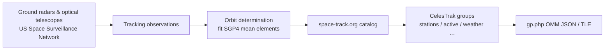

# 09 — CelesTrak Orbital Elements (GP / OMM)

## 1. Identity Card

| Attribute | Value |
| --- | --- |
| Bronze `_source` | `CELESTRAK` |
| Provider | **CelesTrak**, a long-running public orbital-data service (Dr T.S. Kelso) |
| Original data owner | **US Space Force** space-surveillance network (published via space-track.org); CelesTrak redistributes it with no login |
| Product | **General Perturbations (GP)** element sets in **OMM** (CCSDS Orbit Mean-Elements Message) JSON |
| Access | `GET https://celestrak.org/NORAD/elements/gp.php?GROUP=<group>&FORMAT=json`, **anonymous** |
| Connector | [`CelestrakConnector`](../../../ingestion/api/celestrak.py) |
| Schedule | `0 */6 * * *` for groups `stations`, `active`, `weather` ([`celestrak_tle_ingest_dag.py`](../../../ingestion/batch/dags/celestrak_tle_ingest_dag.py)) |
| Licence | Free public use; respect CelesTrak fair-use limits |
| Track | Simulation track (real data) |
| Status | Landed but **not yet consumed** downstream (README SG-07) |

## 2. What It Is (Plain Language)

Each record is a **compact mathematical description of one object's orbit** at a reference time
(the *epoch*). It does **not** contain positions. To find where the satellite is at any moment, you
**propagate** the elements with the **SGP4** model. It is like knowing a car's speed and heading at
noon and computing where it will be at 12:05.

## 3. How the Data Is Collected



| Aspect | Detail |
| --- | --- |
| Sensors | Radar (e.g., phased arrays) and optical telescopes track ~47,000 objects |
| Element type | **SGP4 mean elements**: valid only with the SGP4/SDP4 propagator, not as true (osculating) Keplerian elements |
| Update cadence | Typically 1–3 new element sets per object per day for LEO |
| Accuracy | ~1 km at epoch; errors grow by **km per day** away from epoch (faster for low, high-drag orbits) |

## 4. Why We Access It

| Reason | Detail |
| --- | --- |
| Real orbits for the simulation track | Ground tracks, revisit and pass prediction over UAE ground stations |
| Catalogue context | Count active satellites by orbit regime, operator and launch year |
| Orbit-decay features | `BSTAR` and `MEAN_MOTION_DOT` trends correlate with space weather (Kp) |

## 5. How We Access It

| Group | Content | Approx. size |
| --- | --- | --- |
| `stations` | ISS, Tiangong, and visiting vehicles | Tens of objects |
| `active` | All active satellites | > 10,000 objects (most of the ~13.7 MB batch) |
| `weather` | Meteorological satellites | Tens of objects |

The connector self-limits to 1 call/s. CelesTrak blocks clients that re-download unchanged data too
often; a 6-hour schedule is compliant.

## 6–7. Format at Source and What We Store

The provider returns a JSON array of OMM objects. Each object becomes one Bronze record,
**unchanged**; `_event_ts = EPOCH + "Z"`.

```json
{"_source": "CELESTRAK", "_event_ts": "2026-11-14T07:43:27.172992Z",
 "payload": {"OBJECT_NAME": "CALSPHERE 1", "OBJECT_ID": "1964-063C", "EPOCH": "2026-11-14T07:43:27.172992",
   "MEAN_MOTION": 13.76765124, "ECCENTRICITY": 0.0026599, "INCLINATION": 90.2238,
   "RA_OF_ASC_NODE": 75.2561, "ARG_OF_PERICENTER": 194.5149, "MEAN_ANOMALY": 197.2136,
   "EPHEMERIS_TYPE": 0, "CLASSIFICATION_TYPE": "U", "NORAD_CAT_ID": 900, "ELEMENT_SET_NO": 999,
   "REV_AT_EPOCH": 9208, "BSTAR": 0.00066629, "MEAN_MOTION_DOT": 6.66e-06, "MEAN_MOTION_DDOT": 0}}
```

| Decision | Why | Alternative | Trade-off |
| --- | --- | --- | --- |
| OMM JSON instead of classic 3-line TLE text | Self-describing keys; supports catalog numbers above 99,999 (TLE's 5-digit limit is nearly exhausted) | TLE text | Must rebuild TLE lines for libraries that only accept TLEs (`sgp4` has `Satrec.sgp4init` / `omm` helpers) |
| CelesTrak instead of Space-Track | No account, simpler | Space-Track API (login, strict throttling) | Depends on a third-party mirror |

## 8. Field Dictionary

| Field | Unit | Meaning |
| --- | --- | --- |
| `OBJECT_NAME` | — | Common name |
| `OBJECT_ID` | — | **COSPAR international designator**: launch year – launch number – piece (`1964-063C`) |
| `NORAD_CAT_ID` | — | US catalogue number (ISS = 25544) |
| `EPOCH` | UTC (no `Z`) | Reference time of the elements |
| `MEAN_MOTION` | rev/day | Orbits per day; period (min) = 1440 / n |
| `ECCENTRICITY` | — | 0 = circular, < 1 = ellipse |
| `INCLINATION` | deg | Orbit tilt vs the equator (≈ 98° = sun-synchronous; 51.6° = ISS) |
| `RA_OF_ASC_NODE` | deg | Right ascension of the ascending node: where the orbit crosses the equator northbound |
| `ARG_OF_PERICENTER` | deg | Orientation of the closest-approach point within the orbit plane |
| `MEAN_ANOMALY` | deg | Position along the orbit at epoch |
| `BSTAR` | 1/Earth radii | SGP4 drag term; higher = more drag (low or large-area objects) |
| `MEAN_MOTION_DOT` | rev/day² | First derivative of mean motion (TLE convention: ½·ṅ); > 0 = decaying orbit |
| `MEAN_MOTION_DDOT` | rev/day³ | Second derivative (usually 0) |
| `EPHEMERIS_TYPE` | — | 0 = SGP4 |
| `CLASSIFICATION_TYPE` | — | `U` = unclassified |
| `ELEMENT_SET_NO`, `REV_AT_EPOCH` | — | Element-set counter; revolution number at epoch |

## 9. How to Read & Interpret

**Altitude from mean motion** (worked example: CALSPHERE 1, n = 13.7677 rev/day):

```text
period   = 1440 / 13.7677                     ≈ 104.6 min
a        = (μ / (2π·n/86400)²)^(1/3), μ = 398600.4418 km³/s²   ≈ 7,354 km
altitude ≈ a − 6,378 km                         ≈ 975 km  (LEO)
```

```python
# Positions require SGP4 propagation (pip install sgp4)
from sgp4.api import Satrec, jday
from sgp4 import omm
sat = Satrec(); omm.initialize(sat, record)            # record = Bronze payload dict
jd, fr = jday(2026, 11, 14, 12, 0, 0)
err, r_km, v_kms = sat.sgp4(jd, fr)                    # TEME-frame position/velocity
```

| Orbit regime | Mean motion | Altitude |
| --- | --- | --- |
| LEO | > 11.25 rev/day | < ~2,000 km |
| MEO (GNSS) | ~2 rev/day | ~20,200 km |
| GEO | ~1.0027 rev/day | 35,786 km |

## 10. Quality, Limitations & Gotchas

| Gotcha | Mitigation |
| --- | --- |
| Elements are useless without SGP4 | Never treat them as positions |
| Accuracy decays away from epoch | Always use the **latest** epoch per `NORAD_CAT_ID`; seed the simulator from Bronze (SG-07) |
| SGP4 outputs TEME coordinates | Convert to Earth-fixed/geodetic with a proper GMST/IERS transform for precise work |
| The same object appears in several groups | Dedupe on (`NORAD_CAT_ID`, `EPOCH`) |
| `EPOCH` lacks a timezone | It is UTC |

## 11. Downstream Lineage

`Bronze CELESTRAK` → *(no Silver consumer yet)*. The intended path is to seed
[`OrbitSimulator`](../../../ingestion/simulation/orbit_simulator.py) → `orbit_position` →
`silver_orbit` → `orbit_trajectory`.

## 12. References

- CelesTrak GP data formats: https://celestrak.org/NORAD/documentation/gp-data-formats.php
- CCSDS OMM standard (502.0-B): https://public.ccsds.org
- Vallado et al., *Revisiting Spacetrack Report #3* (SGP4 reference)
- `sgp4` Python package: https://pypi.org/project/sgp4/
