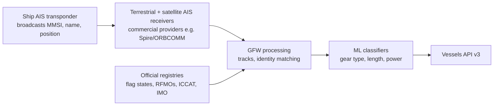

# 10 — Global Fishing Watch: Vessel Identity (API v3)

> ⚠️ **Scope reality check (README SG-05):** the current ingestion is a **vessel name search**
> (`query="Maria"`, 20 results, worldwide), not regional AIS traffic. The latest batch returned 20
> different vessels named "MARIA" flagged to CAN, PER, NLD, IND, NOR, DEU, USA, RUS, ESP, SVK and
> others. Treat the data as a **schema and pipeline demonstrator** for maritime identity, not as Gulf
> traffic.

## 1. Identity Card

| Attribute | Value |
| --- | --- |
| Bronze `_source` | `GFW` |
| Provider | **Global Fishing Watch**, a non-profit founded by Oceana, SkyTruth and Google |
| Dataset | `public-global-vessel-identity` (observed `v5.0`) |
| Access | `GET https://gateway.api.globalfishingwatch.org/v3/vessels/search?query=…&datasets[0]=…&limit=20` |
| Connector | [`GfwConnector`](../../../ingestion/api/gfw.py) |
| Schedule | No dedicated DAG; runs in the full batch ([`run_full_batch_ingest.py`](../../../ingestion/scripts/run_full_batch_ingest.py)) |
| Auth | Free API token (`GFW_API_TOKEN`, Bearer header), non-commercial terms |
| Licence | CC BY-NC 4.0 (non-commercial, attribution) |
| Use cases | UC-18 maritime domain awareness: identity screening, suspicious-identity triage |

## 2. What It Is (Plain Language)

A **"who is this ship?" registry record**. It merges what the ship *says* about itself over radio
(AIS) with what **official registries** say, and with GFW's **machine-learning classification** of
vessel type and size from movement patterns.

## 3. How the Data Is Collected



| Information block | Origin | Reliability |
| --- | --- | --- |
| `selfReportedInfo` | AIS messages broadcast by the vessel | Can be wrong, spoofed or switched off |
| `registryInfo` | Official authorisation lists and registries | Authoritative but may lag |
| `combinedSourcesInfo` | GFW models fusing both (e.g., `SECONDARY_CLASSIFIER_MODEL`) | Probabilistic, with a score |

**Satellite angle:** AIS signals far from shore are picked up by **LEO satellites carrying AIS
receivers**. This is how space infrastructure enables global maritime monitoring.

## 4. Why We Access It

| Reason | Detail |
| --- | --- |
| Identity anomalies | Mismatched flag/name between AIS and registry, missing IMO, MMSI reuse: classic illegal, unreported and unregulated (IUU) fishing or sanctions-evasion indicators |
| Free curated fusion | Building AIS + registry fusion in-house is infeasible |

## 5. How We Access It

| Parameter | Value |
| --- | --- |
| `query` | Free-text name/MMSI/IMO (default `"Maria"`) |
| `datasets[0]` | `public-global-vessel-identity:latest` |
| `limit` | 20 |
| Rate | Connector 2 calls/s; GFW enforces per-token quotas |

**Recommended evolution (not implemented):** use the GFW **Events API** (fishing, encounters,
loitering, AIS gaps) filtered to a Gulf polygon for real regional activity.

## 6–7. Format at Source and What We Store

The response is `{"entries": [ … ], "total": …}`. Each entry is landed **unchanged**.
`_event_ts` = first available of `registryInfo[0].transmissionDateTo` → `selfReportedInfo[0]…`.

Real record (abridged; full records are ~2.5 KB):

```json
{"_source": "GFW", "payload": {
  "dataset": "public-global-vessel-identity:v5.0",
  "registryInfo": [{"ssvid": "316037247", "flag": "CAN", "shipname": "MARIA", "callsign": "MARIA",
      "imo": null, "transmissionDateFrom": "2020-06-05T16:42:31Z", "transmissionDateTo": "2026-09-11T18:13:17Z",
      "tonnageGt": 7, "lengthM": null, "sourceCode": ["CAN"], "latestVesselInfo": true}],
  "combinedSourcesInfo": [{"vesselId": "13d7345f2-235e-…", "shiptypes": [{"name": "PASSENGER",
      "source": "SECONDARY_CLASSIFIER_MODEL", "yearFrom": 2020, "yearTo": 2026}],
      "bestLengthM": [{"value": 12.52}], "maxSpeedKn": [{"value": 12.0}], "…": "…"}],
  "selfReportedInfo": [{"ssvid": "316037247", "shipname": "MARIA", "flag": "CAN",
      "messagesCounter": 390441, "positionsCounter": 80184,
      "transmissionDateFrom": "2020-06-05T16:43:27Z", "transmissionDateTo": "2026-11-08T18:29:49Z"}],
  "registryOwners": []}}
```

| Decision | Why | Alternative | Trade-off |
| --- | --- | --- | --- |
| Land the full nested entry | Identity analysis needs all three blocks; the schema evolves (`v5.0`) | Flatten at ingest | Most complex Bronze payload (5 levels) |

## 8. Field Dictionary (key fields)

| Path | Meaning | Notes |
| --- | --- | --- |
| `registryInfo[].ssvid` / `selfReportedInfo[].ssvid` | **MMSI** (9 digits); first 3 = MID country code (316 = Canada) | Silver `vessel_key` |
| `…flag` | ISO-3 flag state | Landlocked flags (e.g., SVK) can indicate registry quirks or open registries |
| `…shipname` / `nShipname` | Name / normalised name | — |
| `…callsign` | Radio call sign | — |
| `…imo` | IMO number | **Often null** for small and fishing vessels |
| `…transmissionDateFrom/To` | First/last AIS transmission matched to this identity | Registry block can lag the self-reported block by months (2026-09-11 vs 2026-11-08 above) |
| `registryInfo[].tonnageGt`, `lengthM` | Registered gross tonnage / length | — |
| `registryInfo[].sourceCode` | Which registries list it | — |
| `combinedSourcesInfo[].shiptypes` / `geartypes` | Classified type (e.g., `PASSENGER`, `TRAWLERS`) | `source` shows registry vs model |
| `…atomicClassScoreSc[].value` | Classifier confidence (0–1) | — |
| `…bestLengthM`, `bestTonnageGt`, `bestEnginePowerKw`, `maxSpeedKn` | Best-estimate physical attributes | Model-derived |
| `selfReportedInfo[].messagesCounter`, `positionsCounter` | AIS messages and positions received | Activity volume proxy |
| `registryOwners[]` | Owner/operator records | Often empty |

## 9. How to Read & Interpret

- **Identity ≠ activity.** These records say *who*; they contain no positions or tracks.
- Compare blocks: a flag or name in `selfReportedInfo` that differs from `registryInfo` is a
  screening signal, not proof of wrongdoing.
- Search queries are **fuzzy**: "Maria" also returns "ANN MARIA" and "VROUWE LOUISE MARIA".

## 10. Quality, Limitations & Gotchas

| Gotcha | Mitigation |
| --- | --- |
| Name search ≠ regional coverage (SG-05) | Switch to AOI-filtered Events/4Wings APIs for UC-18 |
| MMSI reuse and spoofing | Combine MMSI with name, flag and IMO before asserting identity |
| Silver takes the **first** block only (`registryInfo` before `selfReportedInfo`) | Mismatch detection requires reading both blocks |
| Non-commercial licence | Portfolio use is fine; commercial use requires agreement |

## 11. Downstream Lineage

`Bronze GFW` → `silver_vessel` (`obs_vessel`: MMSI, IMO, upper-cased name/flag, first/last
transmission) → Gold `dim_vessel`, `fact_vessel_activity`, `kpi_fishing_daily` →
`serving_vessel_activity` (RLS-protected) → Earth-Observation dashboard.

## 12. References

- GFW API documentation: https://globalfishingwatch.org/our-apis/documentation
- AIS and MMSI basics (ITU-R M.585): https://www.itu.int/rec/R-REC-M.585
