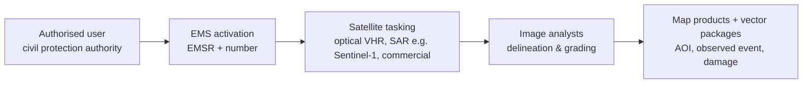

# 11 — Copernicus EMS & AOI Reference Footprints

> **What actually feeds the platform today (README SG-08):** Gold builds its AOI dimension from the
> repository seed [`transformation/seeds/aoi_reference.geojson`](../../../transformation/seeds/aoi_reference.geojson),
> which contains 2 **EMS-style** event footprints and 15 platform monitoring AOIs. The documented
> Bronze upload path (`file_loader --source EMS`) does **not** currently reach Silver.

## 1. Identity Card

| Attribute | Value |
| --- | --- |
| Bronze `_source` | `EMS` (manual file upload; no objects at sampling time) |
| Real-world provider | **Copernicus Emergency Management Service (CEMS) Rapid Mapping**, operated for the European Commission (JRC) |
| Seed file | [`aoi_reference.geojson`](../../../transformation/seeds/aoi_reference.geojson) (8.4 KB, 17 Features), loaded by [`load_aoi_reference`](../../../transformation/batch/gold_lakehouse.py) (`AOI_SEED_PATH` overrides) |
| Upload tool | `python -m ingestion.file.file_loader <path> --source EMS` ([`file_loader.py`](../../../ingestion/file/file_loader.py)) |
| Auth / licence | EMS products are free and open (Copernicus licence, attribution) |
| Use cases | UC-27 independent validation (ground truth) of wildfire (UC-15) and flood (UC-16) detections; AOI attribution for all spatial marts |

## 2. What It Is (Plain Language)

When a disaster strikes, a national authority can **activate** Copernicus EMS. Analysts then map
the affected area from satellite images within hours to days. The output includes **polygons**:
the area of interest, the observed flood extent or burnt area, and damage grades. On this platform
such polygons serve as **"answer keys"**: if FIRMS detects fires inside an EMS wildfire footprint,
the detection is *corroborated*.

## 3. How the Data Is Collected (Real EMS)



Vector layers are typically delivered as Shapefile or GeoJSON in EPSG:4326, one package per AOI
and per product (first estimate, delineation, grading).

## 4. Why We Access It

| Reason | Detail |
| --- | --- |
| Independent ground truth | Analyst-verified polygons from a different pipeline than FIRMS/NDWI |
| AOI geometry | Point-in-polygon attribution of detections to named areas |
| Event semantics | Event type (flood/fire) and date for corroboration windows |

## 5. How We Access It

| Path | Status |
| --- | --- |
| **Seed file** read directly by Gold (`load_aoi_reference`) | ✅ Active |
| Manual upload to `s3://bronze/EMS/ingest_date=…/<batch>/<file>` (raw bytes, no envelope) | ⚠️ Lands, but Spark Silver quarantines it (SG-08) |
| EMS website / API download | Manual; no automated connector |

## 6. Format at Source

GeoJSON `FeatureCollection` of `Polygon` / `MultiPolygon` features, coordinates in
`[lon, lat]`, plus a `properties` block.

## 7. What We Store (Seed Contents)

| Group | Count | Examples (`properties.id`) | `category` / role |
| --- | --- | --- | --- |
| EMS-style event footprints | 2 | `EMSR-CA-FIRE-2025` (California fire, US-LEGACY region), `EMSR-AE-FLOOD-2024` (Dubai coastal flood, event date 2024-04-16) | `Wildfire` / `Flood` |
| Platform climate AOIs (UAE-GULF) | 10 | `AOI-AUH`, `AOI-DXB`, `AOI-COAST`, `AOI-NEM`, `AOI-DESERT`, `AOI-ARABIA`, `AOI-ARABIA-E`, `AOI-IRAQ`, `AOI-IRAN`, `AOI-GULF` (non-overlapping reporting partition, ADR-12) | `monitored` / `dust_corridor` |
| Platform climate AOIs (INDIA) | 6 | `IN-DEL-NCR`, `IN-MUM`, `IN-PB-HR`, `IN-THAR`, `IN-GUJ-COAST`, `IN-ASSAM` | `monitored` / `dust_corridor` |

> The two event ids follow the EMS naming *style* but are **curated placeholders**. Official EMS
> activation codes are `EMSR` followed by digits (e.g., `EMSR700`). Replace them with downloaded
> official footprints for real validation.

Example feature properties (real seed):

```json
{"id": "EMSR-AE-FLOOD-2024", "region": "UAE-GULF", "name": "Dubai Coastal Flood Monitoring",
 "eventType": "Flood", "hazard": "flood", "category": "Flood",
 "eventDate": "2024-04-16T00:00:00+00:00", "country": "United Arab Emirates",
 "activation": "EMSR-AE-FLOOD-2024"}
```

## 8. Field Dictionary (as used by [`clean_ems_aoi`](../../../transformation/batch/bronze_to_silver.py))

| Silver field | Derived from | Meaning |
| --- | --- | --- |
| `aoi_key` | `properties.id` → `aoiId` → `name` → `aoiName` → feature `id` | Stable AOI identifier |
| `aoi_name` | `name` / `aoiName` | Display name |
| `event_type` | Keyword match over `eventType`, `hazard`, `type`, `category`, `name`, `aoiName` | `flood` (flood/inundation/water) · `fire` (fire/wildfire/burn) · `other` |
| `region` | `properties.region` | `UAE-GULF`, `INDIA`, `US-LEGACY`; regions are never mixed in rollups |
| `event_date` | `eventDate` → `event_time` → `date` | Event reference date (UTC) |
| `polygons` | `geometry` (Polygon/MultiPolygon, outer + inner rings) | Used for point-in-polygon tests |
| `bbox` | Min/max of outer-ring coordinates | `[min_lon, min_lat, max_lon, max_lat]` |
| `area_km2` | Planar shoelace area in degree², scaled by km-per-degree at the mean latitude ([`polygon_area_km2`](../../../transformation/geospatial/spatial_transform.py)) | Approximate; adequate for AOI-scale sizing, not cadastral accuracy |
| `geo_key` | Grid cell of the bbox centre | Spatial join key |

Seed-only properties: `tier` (`primary`/`secondary`), `aoi_role` (`monitored`, `dust_corridor`),
`note`, `country`, `activation`.

## 9. How to Read & Interpret

- **Corroboration logic:** a detection counts as corroborated when it falls inside a footprint of
  matching `event_type` within the evidence window (`kpi_aoi_validation`).
- **Ring order:** GeoJSON outer rings are counter-clockwise and holes clockwise (RFC 7946); always
  `[lon, lat]`.
- **Monitoring AOIs ≠ events:** climate AOIs carry `category = climate` and classify as
  `event_type = other`.

## 10. Quality, Limitations & Gotchas

| Gotcha | Mitigation |
| --- | --- |
| Upload path quarantined (SG-08) | Wrap uploaded GeoJSON in an envelope, or read raw EMS objects without `unwrap_bronze` |
| Placeholder event ids | Replace with official EMS packages and record the activation code |
| Keyword-based `event_type` | Explicit `eventType` reduces misclassification |
| EMS covers activations only | Absence of a footprint is not absence of an event |

## 11. Downstream Lineage

Seed → in-memory `ref_aoi` rows → Gold `ref_aoi`, `kpi_aoi_validation` (and point-in-polygon AOI
attribution for wildfire/flood marts) → serving `dim_aoi`, `serving_aoi_validation` → Executive
dashboard.

## 12. References

- Copernicus EMS Rapid Mapping: https://mapping.emergency.copernicus.eu/
- RFC 7946 GeoJSON: https://datatracker.ietf.org/doc/html/rfc7946
- File ingestion design: [docs/ingestion/05-file-ingestion.md](../../ingestion/05-file-ingestion.md)
