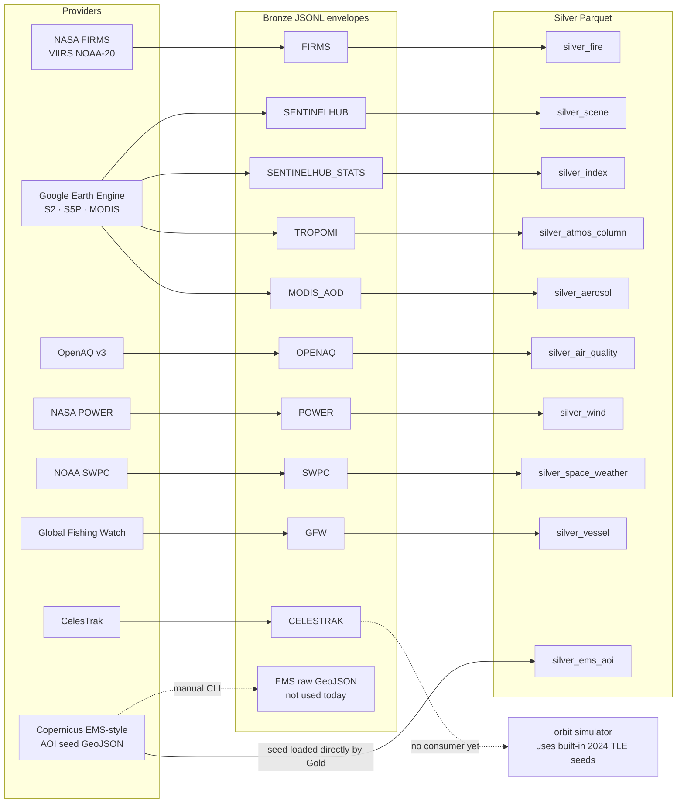

# Source Field Guides — Understanding Every Data Source We Ingest

> **Phase 5 supplement.** Docs 01–14 in this folder's parent describe the *candidate catalogue*:
> 45 datasets compared in tables for planning. These guides cover the **sources the platform
> actually ingests today**. They are grounded in the connector code under
> [`ingestion/api/`](../../../ingestion/api/) and in **real Bronze records sampled from MinIO on
> 2026-11-14**.
>
> They are written for an engineer **new to geospatial and space data**. Each guide answers:
> *who produces the data, how it is physically collected, why we use it, how we access it,
> what it looks like on the wire, what we store and why, what every field means, and how to read
> it correctly.*

---

## 1. Why This Supplement Exists

| Gap in the original Phase 5 docs | Why it matters | Addressed by |
| --- | --- | --- |
| Catalogue covers 45 *candidate* datasets; only ~12 are implemented | Readers cannot tell which analysis applies to live data | Per-source guides (§3) |
| No explanation of *how* the data is physically collected (sensor, orbit, retrieval) | Without it, fields such as `frp`, `bright_ti4` or `mol/m²` are opaque, and their limits (cloud gaps, overpass times) are invisible | "How the data is collected" section in every guide |
| No raw-vs-stored format comparison | Engineers cannot trace a Bronze payload back to the provider response | "Format at source" and "What we store" sections |
| No field-level data dictionary for the payload | Misinterpretation risk (units, scale factors, time standards) | "Field dictionary" section |
| No "how to read it" guidance | Every analyst re-discovers the same traps | "How to read and interpret" and "Gotchas" sections |
| Backend substitutions (Sentinel Hub → Google Earth Engine) are documented only in code | The Bronze `_source` code no longer names the real provider | Identity card in each guide |

---

## 2. Reading Order

1. **[00 — Geospatial & Space-Data Primer](./00-geospatial-and-space-data-primer.md)**: read this first.
   It explains coordinates, rasters versus vectors, orbits, processing levels, scale factors and
   time standards in plain language.
2. **This README, §4–§7**: the conventions shared by *all* sources (Bronze envelope, storage
   formats, how to query, known issues).
3. **The source guide you need** (§3).
4. **[14 — Glossary](./14-glossary.md)**: look up terms as you go.

---

## 3. Source Guide Index

| # | Guide | Bronze `_source` | Real provider / access backend | Data type | Cadence | Track |
| --- | --- | --- | --- | --- | --- | --- |
| 01 | [NASA FIRMS — Active Fire](./01-nasa-firms-active-fire.md) | `FIRMS` | NASA LANCE / FIRMS area API | Point events (CSV) | `@hourly` | ⭐ MVP |
| 02 | [Sentinel-2 — Scene Catalog](./02-sentinel-2-scene-catalog.md) | `SENTINELHUB` | ESA Copernicus via **Google Earth Engine** | Scene metadata (STAC-like JSON) | `@daily` | ⭐ MVP |
| 03 | [Sentinel-2 — Spectral Indices](./03-sentinel-2-spectral-indices.md) | `SENTINELHUB_STATS` | ESA Copernicus via **Google Earth Engine** | AOI raster statistics | `@daily` | ⭐ MVP |
| 04 | [Sentinel-5P TROPOMI — Trace Gases](./04-sentinel-5p-tropomi.md) | `TROPOMI` | ESA Copernicus via **Google Earth Engine** | AOI raster statistics | `@daily` | 🌍 Climate |
| 05 | [MODIS MAIAC — Aerosol Optical Depth](./05-modis-maiac-aod.md) | `MODIS_AOD` | NASA via **Google Earth Engine** | AOI raster statistics | `@daily` | 🌍 Climate |
| 06 | [OpenAQ — Ground Air Quality](./06-openaq-ground-stations.md) | `OPENAQ` | OpenAQ v3 REST API | Station time series | `@daily` | 🌍 Climate |
| 07 | [NASA POWER — Daily Weather](./07-nasa-power-weather.md) | `POWER` | NASA LaRC POWER API | Gridded reanalysis at a point | `@daily` | ⭐ MVP / 🌍 |
| 08 | [NOAA SWPC — Planetary Kp](./08-noaa-swpc-kp-index.md) | `SWPC` | NOAA Space Weather Prediction Center | Index time series | every 15 min | 🔄 Sim track (real data) |
| 09 | [CelesTrak — Orbital Elements](./09-celestrak-orbital-elements.md) | `CELESTRAK` | CelesTrak (US Space Force catalogue) | Orbit element sets (OMM JSON) | every 6 h | 🔄 Sim track (real data) |
| 10 | [Global Fishing Watch — Vessel Identity](./10-global-fishing-watch-vessels.md) | `GFW` | Global Fishing Watch API v3 | Registry records (nested JSON) | manual / full run | ⭐ MVP |
| 11 | [Copernicus EMS & AOI Reference Footprints](./11-copernicus-ems-footprints.md) | `EMS` | Copernicus Emergency Management Service (format) · repo seed `aoi_reference.geojson` (actual Gold input) | Polygons (GeoJSON) | seed file / manual upload | ⭐ MVP |
| 12 | [Standby Imagery Connectors](./12-standby-imagery-connectors.md) | `LANDSAT`, `EARTHDATA`, (direct) `SENTINELHUB*` | USGS STAC, NASA CMR, Sentinel Hub | Scene metadata / stats | not scheduled | Implemented, inactive |
| 13 | [Simulation Sources](./13-simulation-sources.md) | `TELEMETRY`, `ORBIT`, `SPACE_WEATHER` | Synthetic generators (this repo) | Event streams | on demand / Kafka | 🔄 Sim |

> **Status legend:** ⭐ MVP = core real-data product; 🌍 Climate = Phase 5b–16b climate track;
> 🔄 Sim = simulation-track demonstrator (ADR-09). "Implemented, inactive" = connector and tests
> exist but no scheduled DAG calls it.

---

## 4. The Bronze Envelope — Common to Every Source

Every connector inherits [`ApiConnector`](../../../ingestion/api/base.py). It wraps **each raw
record**, unchanged, in a provenance envelope
([`envelope.py`](../../../ingestion/common/envelope.py)):

| Column | Type | Meaning | Example (real) |
| --- | --- | --- | --- |
| `_ingest_id` | UUID string | Unique id of this Bronze row | `941142b0-e438-…` |
| `_source` | string | Dataset code; also the top-level MinIO folder | `FIRMS` |
| `_ingest_ts` | ISO-8601 UTC | When **we** received the record | `2026-11-14T19:00:18.159982+00:00` |
| `_event_ts` | ISO-8601 UTC or null | When the **observed phenomenon** happened, extracted per source | `2026-11-14T06:46:00Z` |
| `_batch_id` | string | One connector run: `<SOURCE>-<UTC stamp>-<8 hex>` | `FIRMS-20261114T190017Z-b9967d0f` |
| `_format` | string | Format **at the provider** before wrapping | `csv` / `json` |
| `_checksum` | SHA-256 hex | Hash of the canonicalised payload, used for dedup and tamper evidence | `184d14d6…` |
| `_source_uri` | string or null | Reserved for the source URL (currently null for API sources; avoids persisting API keys embedded in URLs) | `null` |
| `payload` | object | **The provider's record, as returned** (with light, documented enrichment; see each guide) | `{…}` |

> **Key concept: `_ingest_ts` ≠ `_event_ts`.** A FIRMS fire observed at 06:46 UTC may be ingested at
> 19:00 UTC. Freshness KPIs use `_event_ts`; pipeline-latency KPIs use `_ingest_ts − _event_ts`.

### Object layout in MinIO

```text
s3://bronze/<SOURCE>/ingest_date=YYYY-MM-DD/<batch_id>/part-0000.jsonl     # API sources
s3://bronze/<SOURCE>/ingest_date=YYYY-MM-DD/<batch_id>/<original_name>     # file uploads (EMS)
```

`ingest_date` is the **UTC date we landed the data**, not the observation date. A batch landed on
2026-11-14 can contain observations from 2026-10-15 (OpenAQ and TROPOMI windows look back up to
14 days).

---

## 5. Storage-Format Decisions (Why JSONL in Bronze, Parquet Downstream)

### 5.1 Decision

| Layer | Format | Location | Written by |
| --- | --- | --- | --- |
| Bronze (API) | **JSON Lines** (one envelope per line), `application/x-ndjson` | `s3://bronze/<SOURCE>/…` | [`LandingZoneWriter.write_batch`](../../../ingestion/common/minio_io.py) |
| Bronze (files) | **Original bytes, verbatim** (GeoJSON, CSV, Parquet, …) | `s3://bronze/<SOURCE>/…` | [`file_loader.ingest_path`](../../../ingestion/file/file_loader.py) |
| Silver | **Apache Parquet** (explicit Spark schema per entity) | `s3a://silver/silver_<entity>` | [`bronze_to_silver.run_spark`](../../../transformation/batch/bronze_to_silver.py) |
| Gold | **Apache Parquet** | `s3a://gold/…` | [`gold_lakehouse.py`](../../../transformation/batch/gold_lakehouse.py) |

### 5.2 Why

| Requirement | How JSONL Bronze meets it |
| --- | --- |
| **Lossless replay**: Silver/Gold must be rebuildable from Bronze | The payload is stored as returned, so no information is dropped by an early schema decision |
| **Heterogeneous, nested payloads** (GFW has 5 nesting levels; GEE stats are deeply nested; FIRMS is flat) | JSON represents any shape; one envelope schema covers all sources |
| **Schema drift tolerance** (providers add fields without notice) | Schema-on-read: new fields simply appear; Silver cleaners decide what to use |
| **Append-only, streaming-friendly** | One record per line, so writers append and Spark/DuckDB split files by line |
| **Human inspectability** for a learning platform | Open any object in MinIO Console or a text editor |

### 5.3 Alternatives considered

| Alternative | Why not chosen for Bronze | Where it *is* used |
| --- | --- | --- |
| Parquet in Bronze | Needs a schema at write time; nested, drifting payloads cause write failures or force everything into a string column | Silver and Gold, where the schema is fixed and contract-tested |
| Avro + schema registry | Adds a registry service and schema governance overhead for ~12 small sources; excessive on a 16 GB laptop | Not used |
| Raw provider bytes for every source (e.g., FIRMS CSV as-is) | Loses the uniform envelope, so provenance would be per-format | Used only for file uploads (EMS) |
| NetCDF/GRIB/GeoTIFF raster landing | Multi-GB grids break the laptop budget; requires an xarray/GDAL stack | Explicitly deferred ([climate/09](../climate/09-climate-mvp-and-deferred.md)) |

### 5.4 Trade-offs accepted

| Trade-off | Mitigation |
| --- | --- |
| JSON is 3–10× larger than Parquet and slower to scan | Bronze volumes are small (largest: OpenAQ ~22 MB/batch); Silver converts to columnar Parquet |
| CSV sources become **all-string** JSON (`"frp": "3.04"`) | Silver casts and validates types explicitly; `_format: csv` records the origin |
| No predicate push-down on observation date (partition is `ingest_date`) | Silver is partitioned/keyed by event date; Bronze is read in bulk for rebuilds |

> **Why not store pixels at all?** Every satellite raster source is accessed as **AOI aggregate
> statistics** (one small JSON object per AOI per day), not imagery. This is the core design that
> keeps the platform within 16 GB of RAM. The cost is that **pixel-level questions cannot be
> answered from Bronze** (e.g., "where in the AOI is NO₂ highest?"). See the
> [primer §6](./00-geospatial-and-space-data-primer.md#6-how-we-avoid-downloading-imagery-aoi-statistics).

---

## 6. How to Read Bronze Data Yourself (Verified Recipe)

Verified on 2026-11-14 against the running `space-platform-minio-1` container, using the
ingestion virtual environment (`ingestion\.venv`, which includes `duckdb`).

```python
# Run from the repo root:  ingestion\.venv\Scripts\python.exe  (set PYTHONIOENCODING=utf-8 on Windows)
import duckdb
from ingestion.config.settings import settings          # loads infrastructure/env/.env (no hard-coded secrets)

con = duckdb.connect()
con.execute("INSTALL httpfs; LOAD httpfs; SET TimeZone = 'UTC';")   # keep timestamps in UTC!
con.execute(f"""
  CREATE SECRET minio (TYPE s3, KEY_ID '{settings.minio.access_key}', SECRET '{settings.minio.secret_key}',
                       ENDPOINT 'localhost:9000', URL_STYLE 'path', USE_SSL false, REGION 'us-east-1');
""")

# Flat source (FIRMS): payload fields are strings because the provider format is CSV -> cast them.
con.sql("""
  SELECT payload.acq_date, payload.acq_time,
         payload.latitude::DOUBLE AS lat, payload.longitude::DOUBLE AS lon,
         payload.frp::DOUBLE AS frp_mw, payload.confidence, payload.satellite
  FROM read_json_auto('s3://bronze/FIRMS/ingest_date=2026-11-14/*/*.jsonl')
  ORDER BY frp_mw DESC LIMIT 5
""").show()

# Statistics source (TROPOMI/MODIS_AOD/SENTINELHUB_STATS): navigate the nested bucket.
con.sql("""
  SELECT payload.product, payload.aoi_id, payload.interval."from" AS day,
         payload.outputs.index.bands.B0.stats.mean AS mean, payload.unit
  FROM read_json_auto('s3://bronze/TROPOMI/ingest_date=2026-11-14/*/*.jsonl', union_by_name = true)
  WHERE payload.product = 'NO2'
""").show()
```

| Tip | Why |
| --- | --- |
| Always `SET TimeZone = 'UTC'` | Without it, DuckDB displays timestamps in the laptop's zone (observed: `04:00:00+04` for a `00:00Z` bucket) |
| Use `union_by_name = true` across batches | Payload keys can differ between batches or backends |
| Prefer **Silver** for analysis | Bronze is raw: duplicates, strings, unvalidated values. Silver is typed, deduplicated and quality-flagged |
| Browse visually | MinIO Console → bucket `bronze` → `<SOURCE>/ingest_date=…/` → download a `.jsonl` |

For pandas users: `pd.json_normalize([json.loads(l) for l in text.splitlines()])` flattens nested
payloads into dotted columns (`payload.outputs.index.bands.B0.stats.mean`).

---

## 7. Known Issues Register (Found While Writing These Guides)

These are **observations, not fixes**. They are recorded here so readers interpret the data
correctly; remediation belongs to the owning phase.

| ID | Source | Issue | Evidence | Impact | Severity |
| --- | --- | --- | --- | --- | --- |
| SG-01 | `SENTINELHUB_STATS` (GEE backend) | **NDVI, NDWI and NBR are sign-inverted.** [`gee_sentinel2.py`](../../../ingestion/api/gee_sentinel2.py) unpacks `("B8","B4")` as `red_band, nir_band` and calls `normalizedDifference([nir_band, red_band])` = `(B4−B8)/(B4+B8)` = **−NDVI** (same pattern for NDWI and NBR). The Sentinel Hub evalscripts in [`sentinelhub_stats.py`](../../../ingestion/api/sentinelhub_stats.py) are correct. | Live GEE test on 2026-11-14 over **open sea** (bbox `54.80,25.40,54.95,25.50`): NDVI mean ≈ **+0.19**, NDWI mean ≈ **−0.40**. Physically, water has **negative** NDVI and **positive** NDWI. | Flood/water (UC-16), vegetation (UC-14), burn (UC-15) and climate-indicator marts (`kpi_flood_aoi_daily`, `fact_vegetation_health_daily`, `fact_climate_indicator_daily`) carry inverted meaning; downstream thresholds may misclassify. **Resolved 2026-11-14:** band order fixed, records stamped `formula_version = 2`, unversioned GEE records quarantined in Silver, windows 2026-10-15 → 11-14 re-ingested ([report](../../validation/2026-11-14-india-regional-e2e.md)) | **High → Resolved** |
| SG-02 | `SENTINELHUB` (GEE backend) | Scene `bbox` is the **requested AOI**, not the scene footprint. `eo:cloud_cover` is the **whole-tile** percentage, not cloud over the AOI | [`gee_sentinel2.py`](../../../ingestion/api/gee_sentinel2.py) sets `"bbox": bbox` | Spatial joins on scene footprint are approximate; a "2 % cloud" scene can still be cloudy over the AOI. **Decision 2026-11-15: documented, not fixed** - no product joins on the scene footprint (catalog display only) | Medium → Accepted |
| SG-03 | `MODIS_AOD` | No per-pixel QA mask (`AOD_QA`) is applied before averaging; `sensor="VIIRS"` would still query the MODIS collection | [`gee_aod.py`](../../../ingestion/api/gee_aod.py) | Cloud-edge or bright-desert retrievals can bias daily means; Silver flags only low valid fraction. **Resolved 2026-11-15:** MAIAC `AOD_QA` mask (cloud mask = clear, AOD QA = best); records stamped `qa_mask = maiac_clear_bestqa_v1`; Silver prefers masked records and flags legacy unmasked MAIAC rows `suspect`; Oct 15 → Nov 14 re-ingested. Live impact in dry November: 2–11 % of pixels removed, AOI means shift ≤ ~0.03, so high Punjab/Delhi AOD is real (smoke) aerosol. `sensor="VIIRS"` caveat remains | Medium → Resolved |
| SG-04 | `POWER` | Daily values use POWER's default **Local Solar Time (LST)** day, but `_event_ts` is stamped `T00:00:00Z` | Connector omits `time-standard`; [POWER docs](https://power.larc.nasa.gov/docs/services/api/temporal/daily/) state that the daily API defaults to LST | Day boundary is offset by about lon/15 hours (≈ +3.7 h over the UAE); same-day joins with UTC sources are slightly misaligned. **Resolved 2026-11-15:** requests `time-standard=UTC`; `silver_wind.time_standard` (`UTC` / legacy `LST`), UTC preferred on key collision; Oct 15 → Nov 14 re-ingested for all AOIs | Low → Resolved |
| SG-05 | `GFW` | Ingestion is a **name search** (default `query="Maria"`), not an AOI or AIS-track pull; records are vessel **identities**, not positions | [`gfw.py`](../../../ingestion/api/gfw.py); Bronze sample is a Canadian passenger vessel "MARIA" | `DATA-INVENTORY.md` describes GFW as "position, speed"; vessel KPIs reflect a sample, not regional traffic. **Resolved 2026-11-15:** new area-based `GFW_4WINGS` source ([`gfw_4wings.py`](../../../ingestion/api/gfw_4wings.py)): spatially aggregated daily fishing effort, AIS presence and SAR detections per maritime AOI → `silver_maritime_activity` → `fact_maritime_activity_daily` → `serving_maritime_activity_daily`. The identity-search product stays as a labelled demonstrator | Medium → Resolved |
| SG-06 | `SWPC`, `CELESTRAK`, `FIRMS` | Rolling-window products are re-pulled on every run (SWPC returns ~7 days every 15 min) | Bronze contains heavy duplication by design | Raw Bronze row counts overstate observations; always dedupe (Silver does) | Info |
| SG-07 | `CELESTRAK` | Landed (~13.7 MB per run, groups `stations`, `active`, `weather`) but **not consumed** by any Silver entity; the orbit simulator propagates hard-coded `SEED_TLES` with a **2024 epoch** | [`readiness.py`](../../../transformation/readiness.py) maps `CELESTRAK` to no Silver outputs; [`orbit_simulator.py`](../../../ingestion/simulation/orbit_simulator.py) `SEED_TLES` | SGP4 accuracy degrades by km per day after epoch, so simulated positions ~2 years from epoch are only illustrative. **Planned:** Phase 26 ([prompt](../../../.github/prompts/26-space-galactic-3d-analytics.prompt.md)) consumes this Bronze GP feed via SGP4 into a new `orbit_object` Silver entity; no change to the sim track | Medium → Planned (Phase 26) |
| SG-08 | `EMS` | (a) Gold `ref_aoi`/`dim_aoi` is built from the **repo seed** [`aoi_reference.geojson`](../../../transformation/seeds/aoi_reference.geojson) (17 features: 2 EMS-style event footprints + 15 platform AOIs), not from Bronze. (b) A raw GeoJSON landed by `file_loader` has **no envelope**, so the Spark Silver path (`unwrap_bronze` → `silver_ems_aoi`) quarantines it | Local test 2026-11-14: seed via `unwrap_bronze` → 0 rows, 1 quarantined (`null:aoi_id`, `null:geometry`); seed passed directly → 17 rows | Uploading real EMS activations via the documented CLI does not reach Silver; EMS-style seed ids (`EMSR-AE-FLOOD-2024`) are curated placeholders, not official activation codes. Also confirmed 2026-11-15: Spark `read.json` cannot infer a schema from a multi-line GeoJSON (`UNABLE_TO_INFER_SCHEMA`), and `ems_aoi` is not in the batch DAG's Silver entities. **Decision: deferred** until real activations are to be loaded; the AOI seed remains the reference | Medium → Deferred |

---

## 8. End-to-End Lineage of Real Sources



---

## 9. KPIs for Source Understanding and Health

| KPI | Definition | Target | Where to observe |
| --- | --- | --- | --- |
| Source freshness | `now − max(_event_ts)` per source | Within the source's native latency (see each guide) | Silver/Gold; `metadata.ingestion_run_detail` |
| Pipeline latency | `median(_ingest_ts − _event_ts)` | FIRMS < 6 h; daily stats < 48 h | Bronze |
| Quarantine rate | Rejected ÷ total rows in Silver cleaning | < 2 % per source | Silver quarantine output |
| Valid-pixel fraction | `sampleCount ÷ (sampleCount + noDataCount)` for stats sources | ≥ 0.5 for analysis use | `silver_index`, `silver_aerosol` |
| Coverage-cap events | Count of `coverage_notes` (FIRMS cap, OpenAQ page cap) | 0 in steady state | `ingestion_run_detail` |
| Field-dictionary coverage | Payload fields documented ÷ fields observed | 100 % for fields used downstream | These guides |

---

## 10. Risks

| Risk | Likelihood | Impact | Mitigation |
| --- | --- | --- | --- |
| Misinterpreting units or sign (e.g., SG-01, mol/m² vs µg/m³) | High for newcomers | Wrong analytics, wrong ML labels | Field dictionaries, gotcha sections, known-issues register |
| Silent backend substitution (`_source` ≠ real provider) | Medium | Wrong citations and licence assumptions | Identity card lists the backend; `payload.collection` records the GEE asset |
| Provider schema drift | Medium | Silver rejects rows | JSONL Bronze retains raw payload; quarantine reasons identify the field |
| Free-tier quota changes (GEE, FIRMS MAP_KEY, OpenAQ) | Medium | Gaps in daily series | Coverage notes; gaps remain visible (no zero-fill) |
| Guides drifting from code | Medium | Stale documentation | Each guide cites the connector file; update guides in the same PR as connector changes |

---

## 11. Assumptions

- Real-data samples reflect the Bronze bucket state on **2026-11-14** and the scheduled/full-run
  parameters in [`run_full_batch_ingest.py`](../../../ingestion/scripts/run_full_batch_ingest.py)
  and [`ingestion/batch/dags/`](../../../ingestion/batch/dags/).
- Provider facts (instrument physics, product definitions) are summarised from the official
  documentation linked in each guide; consult those pages for authoritative detail.
- `EMS`, `LANDSAT` and `EARTHDATA` had no objects in Bronze at sampling time; their guides rely
  on the connector code and the provider documentation.
