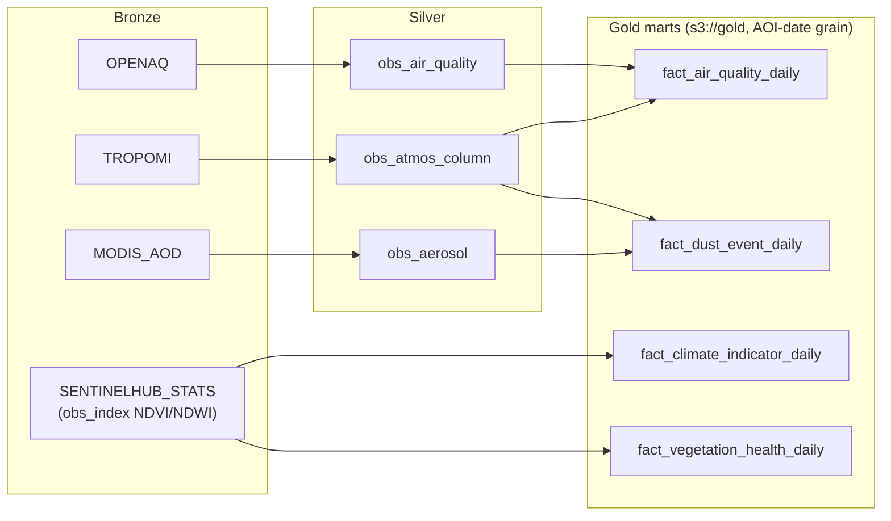

# Climate / Dust / Air-Quality Marts (Phase 9b)

> **Phase 9b - Data Transformation (Climate Extension)** · Implementation notes
>
> Extends Phase 9 [`04-silver-gold.md`](./04-silver-gold.md). Implements the
> Bronze → Silver → Gold contracts from Phase 6b
> ([`docs/data-modeling/climate/`](../data-modeling/climate/README.md)) for the
> atmospheric domain. Working, tested code — offline unit tests in
> [`transformation/tests/test_climate_*.py`](../../transformation/tests/).

## Purpose

Materialise business-ready climate, dust, and air-quality marts at the shared
**AOI-date grain** so fire + smoke + air-quality + climate fuse on a single
`aoi_key` + `date_key` (same bus as `kpi_wildfire_aoi_daily` / `kpi_flood_aoi_daily`).
Reuses the existing geospatial (point-in-polygon) and time-series engines — no
new frameworks.

## Data flow

## Silver entities (Bronze → Silver)

Cleaners are pure-Python + unit-tested; the Spark entrypoint reuses them
(`mapInPandas` parity). Code:
[`transformation/cleaning/climate/`](../../transformation/cleaning/climate/),
driver [`transformation/batch/climate_bronze_to_silver.py`](../../transformation/batch/climate_bronze_to_silver.py).

| Entity | Grain | Source | Key rules |
| --- | --- | --- | --- |
| `obs_air_quality` | station/pollutant/reading | OpenAQ | canonical `pollutant_code`, unit standardization (→ µg/m³, CO → mg/m³), quality-flag, dedup, **station → AOI point-in-polygon tagging** |
| `obs_aerosol` | AOI/sensor/day | MODIS/VIIRS AOD | AOD validity `[0,5]`, valid-fraction / bright-surface `suspect` flag |
| `obs_atmos_column` | AOI/gas/day | TROPOMI | column-density harmonization, `low_coverage` flag below valid-pixel threshold |

**Unit standardization** ([`units.py`](../../transformation/cleaning/climate/units.py)):
volumetric ppm/ppb → mass concentration via the ideal-gas relation at 25 °C /
1 atm (molar volume 24.45 L/mol); `value_raw` / `unit_raw` retained for audit;
non-defensible conversions flagged `suspect` rather than silently converted.

## Derived indicators (Task 2)

[`transformation/timeseries/climate_indicators.py`](../../transformation/timeseries/climate_indicators.py)
extends the time-series engine with the anomaly / trend / composite primitives:

- `same_doy_baseline` + `anomaly` — same-day-of-year seasonal baselines for LST/SST anomalies.
- `linear_trend` — OLS slope for the 30-day NDVI trend and the desertification NDVI term.
- `desertification_proxy` — composite of declining NDVI + positive LST anomaly, clipped to `[0,1]`.
- `velocity_of_change` — feature-friendly first-difference rate (Task 4).

All indicators derive from **already-ingested** sources (NDVI/NDWI from
`obs_index`; LST/SST where present) — **zero new connectors**. Where an upstream
source is not yet ingested (LST, SST, GFW tree-cover loss), the measure lands
`null` and its flag `false` — the path is fully wired and populates when the
source arrives (same convention as the flood/launch marts).

## Gold marts (Silver → Gold)

Code [`transformation/batch/climate_silver_to_gold.py`](../../transformation/batch/climate_silver_to_gold.py);
materialised to `s3://gold/<mart>/` by
[`gold_lakehouse.py`](../../transformation/batch/gold_lakehouse.py) (the serving source).

### `fact_air_quality_daily`
Surface PM/pollutants (AOI-tagged OpenAQ) + TROPOMI column means joined on
`aoi_id` + `stat_date`. KPIs: `aqi_pm25` / `aqi_pm10` (EPA piecewise-linear),
`aqi_band` (category of the worst pollutant), `exceedance_flag` (WHO 2021
guideline). AQI computed only where `station_count ≥ 1`.

### `fact_dust_event_daily`
AOD mean/max from `obs_aerosol`; UV aerosol index from the aerosol row or
denormalized from TROPOMI `AER_AI`. `dust_severity_band` (AOD bands),
`dust_flag` = AOD ≥ 0.5 **and** UV AI ≥ 1.0, `corridor_aod_max` = strongest AOD
over other AOIs same day (upwind source signal), `wind_*` / `transport_flag`
from NASA POWER when the wind join is supplied.

### `fact_climate_indicator_daily`
LST/SST + anomalies (same-DOY baseline), NDWI, desertification proxy.
`lst_anomaly_band`, `warming_flag`, `desertification_flag`.

### `fact_vegetation_health_daily`
NDVI/EVI over `obs_index`, `ndvi_trend_30d` (trailing OLS slope),
`ndvi_health_band`, `crop_stress_flag` (low NDVI **and** declining).

## KPI thresholds

Band/flag logic implements the Phase 6b registry
([`05-kpi-thresholds.md`](../data-modeling/climate/05-kpi-thresholds.md)) as
unit-tested pure functions in `climate_silver_to_gold.py`: EPA PM AQI
breakpoints, AOD dust-severity bands, LST anomaly bands, NDVI health bands, and
the WHO exceedance guideline.

## AOI attribution & dbt parity (ADR-SV-01)

`obs_air_quality` / `obs_aerosol` / `obs_atmos_column` carry `aoi_id` (OpenAQ
tagged at Silver by point-in-polygon; TROPOMI/AOD from the Bronze request), so
**`fact_air_quality_daily` and `fact_dust_event_daily` are expressible in dbt
SQL** — see
[`transformation/dbt/models/climate/`](../../transformation/dbt/models/climate/).
`fact_climate_indicator_daily` / `fact_vegetation_health_daily` attribute
`obs_index` buckets to AOIs by **bbox-centroid point-in-polygon** (like
`gold_flood_aoi`), which dbt SQL cannot express — those are produced by the
Spark/pure-Python gold writer only, consistent with the wildfire/flood pattern.

## dim_aoi extension

The 9 Phase 5b climate AOIs (UAE national/emirate + dust-corridor tiers) are
added to the shared reference seed
[`transformation/seeds/aoi_reference.geojson`](../../transformation/seeds/aoi_reference.geojson)
as additive rows (`tier`, `aoi_role`) — no dimension fork.

## Orchestration

[`transformation_pipeline_dag.py`](../../transformation/orchestration/dags/transformation_pipeline_dag.py)
adds `silver_{air_quality,aerosol,atmos_column}` tasks (SLA `SILVER_SLA`),
dependent on the Phase 8b ingestion DAGs (`openaq_ingest`, `tropomi_ingest`,
`modis_aod_ingest`), feeding the single `gold_lakehouse` task. Mirrored in
[`scripts/run_pipeline.sh`](../../transformation/scripts/run_pipeline.sh) and
[`scripts/run_climate_silver.py`](../../transformation/scripts/run_climate_silver.py).

## Tests

| Test module | Coverage |
| --- | --- |
| [`test_climate_cleaning.py`](../../transformation/tests/test_climate_cleaning.py) | unit conversions, cleaner conform/reject/dedup, AOI tagging, QA flags |
| [`test_climate_indicators.py`](../../transformation/tests/test_climate_indicators.py) | baseline, anomaly, OLS trend, velocity, desertification proxy |
| [`test_climate_gold.py`](../../transformation/tests/test_climate_gold.py) | mart grain, AQI/dust/LST/NDVI bands + flags, exceedance |

Run with `make test` (offline, no infra).
