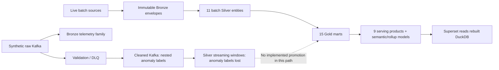

# End-to-End Data Platform Readiness Assessment

## 1. Decision and Scope

**Decision: do not advance to ML or other AI implementation yet.**

The batch platform executes from live source ingestion through persisted serving
and BI consumption. Gold and serving preserve their input metrics. However,
this does **not** establish that every published conclusion is correct:
live testing found lost anomaly labels, lost vessel timestamps, non-deterministic
revised aerosol selection, missing-input flags presented as negative results,
incomplete source coverage, and an expired fire freshness gate.

This assessment validates existing phases through data serving. It does not
implement ML, RAG, new APIs, feature materialization, or a new project phase.
Runtime defects are documented, not silently patched during the assessment.

**Observation window:** 2026-10-31 approximately 20:15-20:45 UTC
(2026-11-01 approximately 00:15-00:45 UTC+04:00).
Inventory snapshot: **20:38:21 UTC**; detailed reconciliation: **20:41:19 UTC**;
Kafka/smoke verification: **20:42:27 UTC**.
The platform continued scheduled ingestion: these are bounded scans, not an
atomic cross-layer transaction.

## 2. Execution and Verification

| Verification | Actual result | Interpretation |
|---|---|---|
| Existing ingestion/transformation/serving/pipeline regression suites | 257 tests passed in the existing Windows ingestion virtual environment. | Regression coverage passes; it did not catch the live defects below. |
| Canonical full batch ingestion driver | 42 source/AOI/product requests; 40 populated, one empty, one failed; 5,518 records landed. | Partial source success, not complete ingestion success. |
| Canonical serial Spark transformation | 11 Silver entities rebuilt; 15 Gold marts written, including a schema-only empty launch mart. | The actual laptop/container path executes successfully. |
| Transformation dbt demonstrator | Five models and 18 tests passed. | Separate demonstrator, not the source of the certified serving products. |
| Serving `dbt build` | 14 models, 58 tests, one hook; `PASS=72`, no failures. | Persisted Gold-backed serving database was rebuilt successfully. |
| Silver lineage and values | All natural-key sets/counts reconcile; two vessel rows lose a valid source timestamp. Aerosol revision choice depends on input ordering. | Not a complete Bronze-to-Silver correctness pass. |
| Silver-to-Gold comparison | All 15 marts match recomputation from persisted Silver. | Producer parity, not independent scientific validation. Empty launch remains empty. |
| Gold-to-serving comparison | All nine products match shared keys/measures; 505 product rows; no missing AOI dimension keys. | No measured serving join loss or aggregate drift. |
| Existing quality suites on actual data | 17 suites / 159 expectations: no critical failures, six suites warn. | Coverage warnings and unimplemented business gates still matter. |
| Kafka durability/routing | Cleared 120 existing raw-writer backlog records; 61 new smoke records landed; 60 valid records routed to cleaned and one invalid record to DLQ. Both raw-topic consumer groups ended at zero lag. | The tested delivery/routing path works, without proving crash-recovery semantics. |
| Streaming metric correctness | 60 known-anomalous records retain nested labels in raw and cleaned Kafka; first-wave windows contain 60 overlapping sample contributions but **zero** anomaly contributions instead of 60. | Reproduced correctness failure. |
| BI consumption | Superset read the rebuilt database: AQ 130, flood 35, scene 60 rows. API lists 15 datasets; metadata-refresh/existence checks succeed. | Data serving is reachable. This is not a dashboard render or cache invalidation certification. |
| Orchestration | Scheduler/triggerer heartbeats and scheduled ingestion succeed; DAG import errors are empty. Airflow webserver port 8080 is unreachable and container is unhealthy. | Scheduled execution is partially alive, but operational health fails. This run used the manual path, not a new master DAG run. |

The declared 45-entry catalog maps to 12 implemented and 11 populated entries in
the existing inventory mechanism. The observed lake has **14 Bronze families,
12 Silver families (including streaming), and 15 Gold families**. Supplemental
families and shared catalog paths mean these counts are not additive measures
of catalog completion. Not every candidate source is a current-phase requirement.

### Architecture exercised



## 3. Actual Data at Each Stage

Counts include historical accumulated Bronze and current rebuilt outputs, not
only this run's new records.

| Domain | Bronze rows | Silver rows | Gold / serving rows | Coverage or loss |
|---|---:|---:|---|---|
| Fire | 8,908 | 1,686 | Attribution 1,686; grid daily 464; AOI daily / serving 10 | 7,222 duplicates; zero rejects; four event dates. |
| Vessel identity | 385 | 88 | Vessel / serving 88 | 297 duplicates; two valid first-transmission timestamps lost. |
| Scene metadata | 360 | 60 | Scene / serving 60 | 300 duplicates; 12 observation dates. Metadata, not image pixels. |
| Spectral indices | 42 | 14 | Flood 35; vegetation 35; climate 35, each mirrored in serving | Seven NDVI and seven NDWI observations, seven dates from Oct 17-29, attributed to five overlapping footprints. |
| Air quality | 49,903 | 7,204 | AQ / serving 130 | 42,699 duplicates; 66 observation dates from Apr 2022 to Oct 2026, not a continuous recent panel. Gold also includes satellite-column-only dates. |
| Aerosol | 280 | 101 | Dust / serving 101 | 179 duplicates; 18 dates; revised duplicates can select different AOD values. |
| Atmospheric columns | 904 | 353 | Inputs to AQ/dust | 551 duplicates; 22 dates, including historical observations. |
| POWER wind | 1,226 | 216 | Inputs to dust | 825 non-wind parameters deliberately excluded; 185 rejected; 12 dates. |
| Space weather | 1,745 across SWPC and seed | 82 | Weather-impact 10 | 1,051 rejected historical noncanonical records; 612 duplicates. |
| Synthetic batch telemetry | 120 | 120 | Satellite-health 3 | June 1 simulation; not current spacecraft observations. |
| Orbit seed | 30 | 30 | No live orbit serving product in this path | Real CelesTrak Bronze has 34,340 rows but is not a source of this Silver orbit job. |
| Launch | No input in canonical batch Gold reader | No launch entity run | Launch Gold 0; no corresponding live serving dbt model | Explicitly incomplete demonstrator wiring, not successful launch analytics. |
| Streaming telemetry | 2,821 Bronze envelopes | 15 window rows at inventory time | No downstream Gold/serving integration | Includes historical runs; smoke-specific verification uses its distinct satellite key. |

For wind, conservation is:
`1,226 = 825 deliberately excluded + 185 rejected + 216 retained`.
For weather:
`1,745 = 1,051 rejected + 612 duplicate removals + 82 retained`.

### Current ingestion availability

- SWPC 62; CelesTrak 20; POWER 630 across nine AOIs; FIRMS 1,266;
  GFW 20; Sentinel-2 metadata 20; NDVI seven; NDWI seven;
  Dubai OpenAQ 3,204; TROPOMI 226; MODIS AOD 55.
- **OpenAQ Abu Dhabi returned zero** in the bounded recent request.
- **OpenAQ UAE-national failed with HTTP 429** after retries. Historical data
  remained available to downstream products; it is not evidence of a successful
  current national refresh.
- Historical failed Sentinel Hub requests are now bypassed by the existing GEE
  implementation: real scene and index ingestion succeeded in this run.
- This was a bounded representative ingest, not an exhaustive AOI backfill or
  provider completeness certification.

## 4. Are the Conclusions Supported?

### 4.1 Fire: bounded counts are supported; current hazard claims are not

Every unique fire detection is accounted for: **258 matched**, **1,428 unmatched**,
and **140 overlapping detections**. The 258 matched detections produce **472 AOI
assignments**. Summing AOI counts as distinct regional fires would double count.
The match rate is approximately **15.30%**; unmatched detections are retained,
not silently discarded.

Representative Oct 31 serving results:

| AOI | Detections | Mean FRP (MW) | Maximum FRP (MW) |
|---|---:|---:|---:|
| Gulf | 104 | 7.336 | 31.05 |
| Arabian Peninsula | 100 | 8.482 | 40.21 |
| Iraq | 85 | 10.872 | 68.73 |
| Iran | 84 | 9.185 | 31.05 |
| UAE national footprint | 27 | 7.519 | 24.30 |

These answer "thermal detections intersecting this configured footprint", not
unique fire incidents, burned area, damage, or verified country-level coverage.
Brightness, FRP, confidence, and ingestion/batch IDs are complete in Silver.
All nine non-freshness fire gates pass. However, the latest observation is
**14:20 UTC** and its age is **6.306 hours** at the inventory snapshot:
the existing six-hour gate **fails despite fresh Bronze landing**.
Domain approval also remains pending.

### 4.2 Air quality: concentrations are exploratory; official AQI is not certified

- PM2.5 is absent in **80/130** serving rows; PM10 in **89/130**; AQI category
  in **64/130**. Column-only rows are not ground-level clean-air measurements.
- There are 165 AOI/day/pollutant groups with **2-24 distinct observed hours**;
  94 have fewer than 18. This is a coverage observation, not a newly approved
  18-hour release rule. Per-station completeness and a reporting policy remain
  necessary before treating an aggregate as a representative daily AQI.
- A boundary repro finds five downward discontinuities in the PM2.5 AQI helper.
  For example, `12.0 -> 50`, `12.01 -> 0`, `12.1 -> 51`.
  PM10 `54.5 -> 0` also reproduces. **No such zero-gap PM2.5 output was found
  in the 50 populated live PM2.5 serving rows**; the defect is nonetheless real.
- The helper uses older EPA bands and omits concentration truncation. Against
  the [current EPA breakpoint table](https://aqs.epa.gov/aqsweb/documents/codetables/aqi_breakpoints.html),
  **26/50** numeric PM2.5 AQIs differ. Restricting to observations on/after
  May 6, 2024 gives **19/40** differences. Effective-date/policy versioning
  is required; old observations must not automatically be judged under a new
  standard. This comparison does not validate the spatial or temporal aggregation.
- Example: a July 28, 2024 observation group has PM2.5 mean 27.258333:
  platform AQI 83 versus current-reference 85.

Do not interpret missing AQI as "Good", infer regional population exposure from
these station samples, or equate satellite column density with surface concentration.

### 4.3 Dust: AOD summaries exist; absence and transport claims are unsupported

All **101 dust flags** and **101 transport flags** are false. However, UV aerosol
index is missing in **72/101** rows and both wind measures in **35/101**.
The current false flags combine observed negatives with missing evidence.
Other-AOI maximum AOD plus positive wind speed is only a heuristic:
it does not establish an upwind pathway, arrival time, or dust causality.

Aerosol revisions are also non-deterministic: reversing Bronze input order
changes **26 scientific fields**. Example AOD choices are **0.186204 versus
0.167705** for the same natural key. Both trace to real Bronze origins, so this
is revision-selection instability rather than invented data.

### 4.4 Flood and vegetation: populated does not mean validated events

- All 35 flood flags are false, but valid-pixel coverage is as low as **0.0099
  (0.99%)**. This is not evidence that an entire AOI is flood-free.
- A Dubai-sized index bbox is attributed by centroid to five overlapping
  footprints, including coastal, Gulf, national, and historical EMS footprints.
  Five output rows do not represent five independent spatial measurements.
- Vegetation has **25 crop-stress flags**. A low/declining NDVI over an urban,
  coastal, or desert footprint is not a verified crop-stress event without a
  vegetation/crop mask, valid coverage, and domain review.
- Five rows have no trend but serving labels them **flat**.
- The "30-day" slope uses the last 30 observations and observation-index spacing,
  not a strict 30-calendar-day series. Only seven irregular dates are present.

### 4.5 Climate, maritime, and simulation: naming exceeds evidence

- **35/35 climate rows** lack LST, SST, both temperature anomalies, and tree-cover
  loss, yet all warming flags are false. Supported: NDWI/NDVI-derived summaries.
  Unsupported: a conclusion of no warming or quantified tree-cover loss.
- **75/88 vessels** are flagged suspicious; IMO is missing in 75 and vessel type
  in all 88. Each activity row represents one retained identity record, not a
  counted series of AIS transmissions or independently verified illegal fishing.
- Curated rectangular AOIs are not independently verified EMS activations.
  Validation can associate evidence from unrelated dates with a seed footprint;
  the wildfire/flood products' date-specific EMS flags are false in this snapshot.
  Neither result should be called independent disaster confirmation.
- Synthetic June telemetry, seeded July orbit, and real current SWPC data do not
  establish operational spacecraft availability or weather-induced failures.

## 5. Missing or Incorrect Layer Behavior

| ID | Priority | Layer / evidence | Required remediation or acceptance |
|---|---|---|---|
| V01 | P1 | [Streaming parser](../../transformation/streaming/spark_streaming.py) reads root `label_anomaly`, but [generator](../../ingestion/simulation/telemetry_generator.py) publishes it under `metadata`. All 60 input labels survive validation; flushed anomaly contributions are 0/60. | Parse the producer contract correctly; regression-test actual raw -> cleaned -> window counts with known anomalies. |
| V02 | P1 | [Timestamp helper](../../transformation/cleaning/cleaning_rules.py) uses `datetime.fromisoformat`. Spark Python 3.10.12 rejects `.8Z` and `.25Z`; Airflow Python 3.12.4 accepts them. Two vessel first timestamps are consequently null. | Normalize supported ISO fractions consistently and test in the real Spark runtime, not only host Python. |
| V03 | P1 | [AQI helpers](../../transformation/batch/climate_silver_to_gold.py) reproduce concentration-gap zeros and use unversioned older breakpoints. | Approve/version the reporting standard, apply truncation, test all boundaries/monotonicity, and require appropriate daily completeness. |
| V04 | P1 | [Shared deduplication](../../transformation/cleaning/cleaning_rules.py) resolves equal event timestamps by last input order. Aerosol revised values change on reversed input. | Specify deterministic revision precedence, retain required provenance, and prove repeatable outputs under changed partition order. |
| V05 | P1 | [Climate Gold](../../transformation/batch/climate_silver_to_gold.py) and [vegetation serving](../../serving/dbt/models/climate/serving_vegetation_health_daily.sql) expose false/flat when supporting measurements are absent. | Separate observed-negative, unavailable, low-coverage, and not-evaluated states; propagate readiness to consuming rollups. |
| V06 | P1 | Full ingestion has one HTTP 429 and one zero-row source. [Batch DAG](../../pipelines/dags/batch_pipeline_dag.py) deliberately finishes ingestion SUCCESS despite failed units; historical SUCCESS run has three FAILED source units. | Define required versus optional sources and explicitly expose partial/failed readiness; do not infer completeness from stage SUCCESS. |
| V07 | P1 | [Spark Silver drivers](../../transformation/batch/bronze_to_silver.py) and [climate driver](../../transformation/batch/climate_bronze_to_silver.py) compute but do not persist rejected rows. Live replay identifies **1,236 rejects**; quarantine bucket contains zero objects. | Persist rejected envelopes/reasons and reconcile admitted, excluded, duplicate, and rejected counts for every entity. |
| V08 | P1 | Existing quality-suite checkpoints are not called by the canonical batch producer path. Manual audit exposes six warning-bearing suites; serving tests still pass. | Wire appropriate checkpoints into promotion and propagate coverage/freshness/lineage gates into serving publication. |
| V09 | P1 | Fresh FIRMS landing does not change the maximum event time; six-hour observation freshness fails. | Publish event-time freshness separately from last ingestion; define handling of provider latency and stale serving outputs. |
| V10 | P1 | Airflow UI unreachable/unhealthy; scheduler still heartbeats. Docker also reports `OOMKilled=true`, which alone does not date or prove the webserver failure cause. | Diagnose webserver logs/process lifecycle and verify recovery within the existing laptop budget. Then run a traced orchestrated acceptance test. |
| V11 | P2 | [Gold reader](../../transformation/batch/gold_lakehouse.py) consumes batch Silver only; streaming DAG ends at Silver. Batch telemetry reads `satellite_telemetry`, while the raw Kafka writer lands `telemetry`. Live CelesTrak is not connected to Silver orbit. | Either explicitly classify these as independent demonstrators or authorize and implement their missing downstream promotion; never imply current streaming/orbit data is served. |
| V12 | P2 | AOI centroid attribution, first-match station AOI assignment, identity-based vessel flags, and curated validation references are stronger-named than their evidence. | Approve grain/coverage/method contracts; limit labels to supported claims and require independent acceptance scenarios. |
| V13 | P2 | Three simulation Gold marts lack corresponding live serving dbt products; launch Gold is empty. BI metadata existence checks do not prove those simulated dataset queries work. | Keep demonstrators explicitly separate; validate their intended serving paths only if required by the accepted scope. |

The existing
[readiness remediation plan](../source-data-analysis/15-data-analysis-readiness-implementation-plan.md)
remains relevant. This assessment is evidence for prioritization, not approval
to change source requirements or expand into new datasets.

## 6. Acceptance Gates Before ML/AI

1. Fix V01-V04 and retain regression evidence from **actual container runtimes**.
2. Demonstrate deterministic Bronze-to-Silver lineage/value reconciliation for
   every required source, including documented historical-schema treatment.
3. Persist and account for rejected data; execute required quality checkpoints
   before Gold/serving publication.
4. Publish source coverage, event-time freshness, measurement completeness,
   analytical grain, and evaluated/not-evaluated states with each required product.
5. Repeat a bounded required-source run with failures/empty sources surfaced
   accurately; resolve or explicitly accept provider latency and access limits.
6. Restore operational health and execute an orchestrated run with linked
   ingestion/transformation/serving metadata. Do not treat this manual run as that evidence.
7. Obtain domain acceptance for at least one supported slice with a representative
   query and independent expectations. Keep synthetic and exploratory products labeled.

**Not a prerequisite:** ingesting all 45 candidate datasets, adding paid
services, or building a new AI phase to work around these data problems.

## 7. Method, Reproduction, and Trade-offs

- Ran the existing ingestion driver in Airflow and the existing serial pipeline
  in Spark. Serving was rebuilt in the bind-mounted database used by Superset.
- Full read-only object scans decoded JSON/JSONL/Parquet. Object ETags were checked
  after reads; no Bronze/Silver/Gold family was deleted or manually fabricated.
- Silver comparisons checked natural keys and referenced Bronze envelopes.
  Sensor-name arrays were compared as sets; their ordering difference is not
  counted as data loss. Aerosol input-order tests explicitly distinguish
  valid-origin selection from deterministic revision selection.
- Gold comparisons reuse producer rules with persisted Silver; serving comparisons
  use shared keys/measures. Numeric comparison uses absolute tolerance `1e-6`
  and relative tolerance `1e-9`. Independent anomaly, parser, and AQI probes
  complement producer parity.
- The bounded stream used the existing generator with all anomalies enabled,
  a distinct smoke satellite, and a first wave timestamped five minutes earlier
  to advance event time without a long wall-clock wait. This is synthetic test
  data, not a genuine operational anomaly event.
- Streaming queries stopped gracefully after a bounded interval. No checkpoint
  or old sink was cleared. Second-wave windows are pending until a later watermark.
- A temporary Python 3.11 helper used the existing pinned ingestion requirements
  for the smoke. It was stopped and removed. The existing Airflow DAG's Kafka
  Python-3.12 compatibility shim was separately verified to work; standalone
  CLI imports without that shim fail, but the DAG import path is not classified
  as broken on that evidence.
- Existing dirty worktree changes were preserved. No runtime code was changed;
  outputs, data, and this assessment are persistent.

Canonical commands, from the repository root:

```powershell
docker exec space-platform-airflow-1 python -m ingestion.scripts.run_full_batch_ingest
docker exec -u root space-platform-spark-master-1 bash /opt/spark/work-dir/transformation/scripts/run_pipeline.sh
docker exec -u root `
  -e DBT_PROFILES_DIR=/opt/spark/work-dir/serving/dbt `
  -e SERVING_DUCKDB_PATH=/opt/spark/work-dir/serving/dbt/serving.duckdb `
  -w /opt/spark/work-dir/serving/dbt space-platform-spark-master-1 dbt build
docker exec space-platform-airflow-1 python -m transformation.scripts.readiness_snapshot `
  --output /tmp/readiness-review.json
.\ingestion\.venv\Scripts\python.exe -m pytest `
  ingestion\tests transformation\tests serving\tests pipelines\tests -q --tb=short
```

The snapshot command intentionally exits nonzero for blocked technical fire
readiness while still writing evidence. Its output must not be discarded as a
mere command failure.

Chosen approach: reuse the deployed stack and bounded workloads to check real
data while preserving the 16-GB constraint. Alternatives were unit-only testing,
destructive clean-slate reseeding, and immediately patching all findings.
Unit-only tests missed runtime/coverage defects; reseeding would erase important
historical schema/revision evidence; immediate patching would change the system
under assessment and require decisions about source and metric policy.

Residual risks: concurrent scheduled arrivals, sampled provider access,
uneven historical coverage, heuristic hazard labels, no load/endurance test,
no crash-recovery proof, and no independent scientific certification.

## 8. Evidence and Glossary

[Machine-readable assessment summary](./2026-11-01-evidence.json).
Full credential-free inventory, all-layer comparison, and streaming smoke
evidence are supplied as persistent session artifacts. Existing historical
readiness documents/snapshots were not overwritten.

| Term | Meaning in this assessment |
|---|---|
| Producer parity | Persisted values agree with the current implementation; not proof that its domain rules are correct. |
| Observation freshness | Age of the latest actual event, distinct from last object modification or successful landing. |
| Partial ingestion | Some requested units succeed while others fail or return no observations. |
| Revision precedence | Deterministic choice among records with the same natural key/event time. |
| Not evaluated | Inputs are insufficient to make a positive or negative analytical conclusion. |
| AOI assignment | A detection intersects one configured footprint; overlapping assignments are non-additive. |
| Analysis-ready | Source, grain, coverage, quality, semantics, and domain acceptance support the stated question. |
