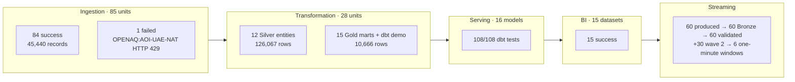

# Full End-to-End Run and Domain-Level Data Analysis (2026-11-15)

An orchestrated run of the whole platform, followed by a domain-by-domain analysis of every
serving product. The analysis checks whether the published numbers are **analytically
correct**, not only whether pipelines and contracts pass.

> **Scope.** One `platform_master_pipeline` run (batch then streaming) on the live Docker
> stack, then SQL analysis of the rebuilt serving warehouse (`serving/dbt/serving.duckdb`)
> plus targeted Silver/Bronze drill-downs. **No code was changed.** Findings are new
> `D-xx` items; earlier open items (L1–L9, V06) are referenced, not repeated.
>
> **Headline.** All 149 orchestrated units except one known rate-limited source (148/149) and all 126 dbt contract tests passed. The
> analysis still found **3 high-severity domain defects** that the tests cannot see:
> overlapping-AOI double counting in the executive rollup, a page cap that drops the most
> recent Delhi PM2.5 days at the height of the smog season, and gas flaring published as
> wildfire in UAE-GULF.

---

## 1. Run Summary

| Item | Value |
|---|---|
| Master run | `manual__2026-11-15_full_e2e_domain`: ✅ `SUCCESS`, 39.6 min |
| Batch child | `manual__2026-11-15_full_e2e_domain__batch`: ✅ `SUCCESS`, 33.2 min, 183,959 rows |
| Streaming child | `manual__2026-11-15_full_e2e_domain__streaming`: ✅ `SUCCESS` |
| Trigger | `airflow dags trigger platform_master_pipeline -r manual__2026-11-15_full_e2e_domain` |
| Evidence | `metadata.*_run_detail` (PostgreSQL), Airflow task logs, DuckDB queries listed in §12 |



### 1.1 Stage Metrics

| Stage | Units | Rows | Notes |
|---|---:|---:|---|
| Ingestion | 84 ✅ · 1 ❌ | 45,440 | OpenAQ 34,247 · GFW 4Wings 9,456 · POWER 1,050 · TROPOMI 355 · MODIS AOD 108 · FIRMS 77 · SWPC 57 · Sentinel Hub 53 · GFW identity 20 · CelesTrak 17. `OPENAQ:AOI-UAE-NAT` HTTP 429 (open item V06). |
| Silver | 12 ✅ | 126,067 | `silver_air_quality` 75,364 · `silver_fire` 38,502 · `silver_maritime` 9,456 · `silver_atmos_column` 940 · `silver_wind` 900 · `silver_aerosol` 305 · `silver_space_weather` 172 · `silver_telemetry` 120 · `silver_vessel` 111 · `silver_scene` 93 · `silver_index` 74 · `silver_orbit` 30 |
| Gold | 15 ✅ + dbt demo | 10,666 | `kpi_launch_monthly` 0 rows (source unavailable, reported as such) |
| Serving dbt | 16 models | 1,786 | `dbt build --no-partial-parse`: **PASS=108 WARN=0 ERROR=0**, 16/16 models |
| Gold dbt demonstrator | 5 models | — | **PASS=18**, 5/5 models |
| BI refresh | 15 ✅ | — | All Superset datasets refreshed |
| Streaming | 5 ✅ | 216 | Bounded demo; second wave advanced the watermark |

### 1.2 Zero-Row and Capped Units (correctly labelled, not failures)

| Unit | Rows | Recorded state | Root cause |
|---|---:|---|---|
| `FIRMS:IN-*` (5 AOIs) | 0 | `data_availability = unavailable` | See **D-04**: the daily request covers the current UTC day only. |
| `OPENAQ:AOI-AUH` | 0 | `unavailable` | No PM stations returned for the AOI. |
| `OPENAQ:IN-DEL-NCR` | 14,400 | `coverage = capped` | 3 pages per sensor; see **D-02**. |
| `OPENAQ:IN-MUM` | 16,793 | `coverage = capped` | Same cap, but the window still completed to 2026-11-14. |

---

## 2. Serving Inventory and Coverage

| Product | Rows | Date span | AOIs / keys |
|---|---:|---|---:|
| `serving_wildfire_daily` | 261 | 2026-07-01 → 2026-11-14 | 16 |
| `serving_air_quality_daily` | 283 | 2022-04-11 → 2026-11-15 | 7 |
| `serving_dust_event_daily` | 305 | 2024-06-01 → 2026-11-12 | 10 |
| `serving_climate_indicator_daily` | 113 | 2026-10-15 → 2026-11-14 | 7 |
| `serving_vegetation_health_daily` | 86 | 2026-10-15 → 2026-11-14 | 6 |
| `serving_flood_daily` | 92 | 2026-10-15 → 2026-11-14 | 6 |
| `serving_maritime_activity_daily` | 108 | 2026-10-16 → 2026-11-11 | 4 |
| `serving_scene_catalog` | 93 | 2024-01-23 → 2026-11-13 | 1 collection |
| `serving_vessel_activity` (demonstrator) | 111 | 2013-02-09 → 2026-11-12 | 111 vessels |

| Region | AOIs | Area (km²) |
|---|---:|---:|
| UAE-GULF | 10 | 3,832,921 (AOIs overlap; sum ≠ footprint) |
| INDIA | 6 | 741,432 |
| US-LEGACY | 1 | 942,424 |

---

## 3. Wildfire (UC-15)

### 3.1 Freshness Gate

| Region | Latest observation (UTC) | Age (h) | Objective (h) | Distinct detections | Status |
|---|---|---:|---:|---:|---|
| INDIA | 2026-11-14 08:30 | 20.4 | 6 | 10,519 | `stale` / `blocked` |
| UAE-GULF | 2026-11-14 10:13 | 18.7 | 6 | 10,778 | `stale` / `blocked` |
| US-LEGACY | 2026-10-31 09:44 | 355.2 | 6 | 45 | `stale` / `blocked` |

Ages worsened from 10–12 h on 2026-11-14 to 19–20 h. This is a request-window defect (**D-04**),
not a gap in the source data.

### 3.2 Activity by AOI (2026-10-15 → 2026-11-14)

| Region | AOI | Active days | Detections | Detections / active day | Mean FRP (MW) | Peak FRP (MW) | Modal severity |
|---|---|---:|---:|---:|---:|---:|---|
| INDIA | IN-PB-HR | 31 | 6,451 | 208.1 | 5.2 | 64.9 | high |
| INDIA | IN-THAR | 31 | 1,894 | 61.1 | 3.4 | 250.0 | low |
| INDIA | IN-GUJ-COAST | 31 | 1,570 | 50.6 | 3.8 | 114.5 | moderate |
| INDIA | IN-ASSAM | 30 | 521 | 17.4 | 3.5 | 57.2 | low |
| INDIA | IN-DEL-NCR | 24 | 83 | 3.5 | 1.1 | 6.7 | low |
| UAE-GULF | AOI-IRAN | 13 | 4,904 | 377.2 | 7.0 | 234.2 | high |
| UAE-GULF | AOI-IRAQ | 13 | 4,167 | 320.5 | 7.9 | 143.5 | high |
| UAE-GULF | AOI-GULF | 13 | 4,035 | 310.4 | 4.9 | 141.6 | high |
| UAE-GULF | AOI-ARABIA | 13 | 3,780 | 290.8 | 5.3 | 86.5 | high |
| UAE-GULF | AOI-UAE-NAT | 13 | 1,367 | 105.2 | 6.7 | 141.6 | moderate |
| UAE-GULF | AOI-COAST | 13 | 946 | 72.8 | 7.3 | 141.6 | moderate |
| UAE-GULF | AOI-DESERT | 13 | 289 | 22.2 | 5.5 | 33.8 | moderate |
| UAE-GULF | AOI-AUH | 11 | 102 | 9.3 | 5.9 | 42.1 | moderate |

**INDIA crop-residue season:** weekly INDIA detections were 957 → 1,475 → 2,473 → **3,426**
(week of Nov 2) → 2,188 (Nov 9–14, 6 days). Punjab–Haryana accounts for 61 % of INDIA
detections. Three AOI-days reached `extreme` severity (785 detections).

### 3.3 Fire Signature Test: Biomass Burning vs Gas Flaring

| Test | UAE-GULF envelope | Punjab–Haryana | Interpretation |
|---|---:|---:|---|
| Night share of detections (since Oct 31) | **72.7 %** (7,838 / 10,778) | 11.3 % (697 / 6,163, INDIA envelope) | Crop fires burn in the afternoon. Flares burn continuously and are easier to detect at night. |
| Detections in 0.01° cells active ≥ 5 days | **70.8 %** (187 persistent cells, AOI-GULF box) | 1.2 % | Agricultural fires move every day. Flares are fixed infrastructure. |
| Same-day fire vs AOD correlation (r) | −0.03 … −0.68 | +0.39 | Biomass smoke raises AOD. Flares do not. |

**Conclusion (D-03).** Most UAE-GULF "wildfire" detections are **persistent industrial
heat sources**: gas flares in the Iraq/Iran oil provinces and on offshore Gulf platforms.
They are not vegetation fires, so the UAE-GULF wildfire severity and counts are not
fit for UC-15 as published.

### 3.4 Executive Rollup Double Counting (D-01)

| Measure | UAE-GULF | INDIA |
|---|---:|---:|
| `mv_kpi_platform_daily.fire_detections` (sum over AOIs) | **19,604** | 10,519 |
| Distinct detections in the region envelope (Silver) | **10,778** | 10,519 |
| Inflation | **1.82×** | 1.00× |

UAE-GULF AOIs are nested and overlapping bounding boxes (for example, the national box
contains the Dubai and Abu Dhabi boxes, and AOI-GULF overlaps AOI-COAST). One detection counts once per containing AOI, and the
rollup sums those counts. The platform also contradicts itself:
`serving_wildfire_freshness.detections_total` reports 10,778 for the same window. INDIA
AOIs do not overlap, so INDIA is unaffected. The same fan-out multiplies UAE flood and
crop-stress days by 5 (§6, §7).

---

## 4. Air Quality

### 4.1 Particulate Matter by AOI

| Region | AOI | Standard | AOI-days | PM days | PM2.5 mean (µg/m³) | PM2.5 peak | PM10 mean | Mean PM2.5 AQI | Max stations |
|---|---|---|---:|---:|---:|---:|---:|---:|---:|
| INDIA | IN-DEL-NCR | IN_CPCB_NAQI_2014 | 31 | 23 | **156.4** | 992.0 ⚠ | 255.9 | 276 | 12 |
| INDIA | IN-MUM | IN_CPCB_NAQI_2014 | 32 | 32 | 59.7 | 982.0 ⚠ | 105.8 | 106 | 15 |
| INDIA | IN-PB-HR | IN_CPCB_NAQI_2014 | 31 | 0 | — | — | — | — | 0 |
| UAE-GULF | EMSR-AE-FLOOD-2024 | US_EPA_PRE2024 | 55 | 55 | 36.3 | 138.6 | 38.7 | 103 | 9 |
| UAE-GULF | AOI-UAE-NAT | US_EPA_PRE2024 | 62 | 12 | 37.9 | 114.0 | 59.2 | 104 | 3 |
| UAE-GULF | AOI-AUH / AOI-DXB | US_EPA_PRE2024 | 36 each | 0 | — | — | — | — | 0 |

- **WHO 24 h PM2.5 guideline (15 µg/m³):** exceeded on 100 % of Delhi and Mumbai PM days
  and on 91 % of evaluated UAE AOI-days.
- **INDIA NAQI bands (57 PM-evaluated AOI-days):** Moderate 24 · Satisfactory 11 ·
  Very Poor 10 · Poor 7 · Severe 5.
- **UAE-GULF EPA bands (83):** Moderate 39 · Unhealthy for Sensitive Groups 23 · Good 12 · Unhealthy 9.
- **Evidence states:** UAE-GULF has 106 `not_evaluated` vs 75 `positive`; INDIA has 37
  `not_evaluated` vs 57 `positive`. Overall, 56.9 % of AQ rows have no surface PM; they come
  from TROPOMI only and are correctly not called "Good". UAE surface PM comes almost entirely
  from the Dubai stations attributed to `EMSR-AE-FLOOD-2024`. AOI-DXB has no attributed PM.

### 4.2 Delhi Smog Trajectory and Recency Loss (D-02)

| Day | PM2.5 measurements | Mean | Median | Max |
|---|---:|---:|---:|---:|
| 2026-11-01 | 1,087 | 166.5 | 162.0 | 429 |
| 2026-11-03 | 277 | 233.2 | 234.9 | 481 |
| 2026-11-05 | 1,093 | 257.3 | 254.2 | 534 |
| 2026-11-07 | 1,074 | 281.8 | 239.9 | 962.9 |
| 2026-11-08 | 600 | 251.7 | 198.0 | 881 |
| 2026-11-09 | **10** | 487.5 | 401.7 | 958.4 |
| 2026-11-10 → 11-14 | **0** | — | — | — |

Today's Delhi request covered **Nov 1–14**, but Bronze stops at **Nov 11 17:30** (PM10) and
**Nov 9** (PM2.5). The connector pages each sensor **oldest-first** and stops after 3 pages, so
the cap discards the **newest** days first. Mumbai stays under the cap and is complete to Nov 14.
For an air-quality alerting product, this drops exactly the days that matter most.
The unit is recorded as `capped`, but nothing records that the loss is concentrated at the
recent end.

### 4.3 Sensor Plausibility (D-09)

| Location | Value (µg/m³) | Repeats | Span | Assessment |
|---|---:|---:|---|---|
| 50 | 593 | 29 | 2026-11-07 14:15 → 22:15 (consecutive 15-min) | Stuck sensor |
| 5598 | 794 | 12 | 2026-11-08 15:00 → 17:45 | Stuck sensor |
| 17 | 345 / 356 | 12 / 12 | 2026-11-04 → 11-08 | Probable flat-line |

All 75,364 `silver_air_quality` rows have `quality_flag = valid`. Silver applies no
flat-line, rate-of-change, or upper-plausibility checks, so the 982–992 µg/m³ peaks and
stuck values reach AQI calculation.

### 4.4 Trace-Gas Columns (TROPOMI, AOI means)

| Region | AOI | Days | NO₂ (µmol/m²) | SO₂ (µmol/m²) | CO (mmol/m²) | O₃ (mol/m²) |
|---|---|---:|---:|---:|---:|---:|
| UAE-GULF | AOI-DXB | 35 | **176.3** | **217.4** | 34.7 | 0.122 |
| INDIA | IN-DEL-NCR | 25 | 83.4 | 60.9 | **46.8** | 0.122 |
| INDIA | IN-PB-HR | 29 | 43.6 | 44.1 | 40.1 | 0.125 |
| UAE-GULF | AOI-AUH | 35 | 35.9 | 136.2 | 32.7 | 0.122 |
| UAE-GULF | AOI-UAE-NAT | 35 | 32.7 | 159.2 | 32.4 | 0.122 |

Dubai has the highest NO₂ column (traffic, port, and power generation in a small AOI). The
UAE SO₂ columns are high and consistent with refinery, shipping, and flaring sources. Delhi has
the highest CO, consistent with combustion and biomass smoke. Single-pixel TROPOMI SO₂ is noisy;
treat these values as relative, not absolute.

---

## 5. Dust and Aerosol

| Region | AOI | Days | AOD mean | AOD peak | UVAI mean | Wind (m/s) | Corridor AOD peak | Valid fraction |
|---|---|---:|---:|---:|---:|---:|---:|---:|
| INDIA | IN-DEL-NCR | 27 | **1.102** | **3.940** | 0.61 | 1.19 | 1.595 | 0.88 |
| INDIA | IN-PB-HR | 29 | 0.743 | 1.595 | 0.33 | 1.29 | 3.940 | 0.77 |
| INDIA | IN-THAR | 29 | 0.521 | 0.719 | — | 1.66 | 3.940 | 0.91 |
| INDIA | IN-GUJ-COAST | 29 | 0.445 | 0.629 | — | 1.53 | 3.940 | 0.68 |
| UAE-GULF | AOI-DXB | 11 | 0.216 | 0.333 | 0.27 | 2.09 | 0.296 | 0.73 |
| UAE-GULF | AOI-UAE-NAT | 36 | 0.181 | 0.254 | 0.44 | 3.36 | 0.337 | 0.72 |
| UAE-GULF | AOI-IRAQ / IRAN / ARABIA / DESERT | 36 each | 0.13–0.17 | ≤ 0.337 | — | 1.0–2.1 | 0.337 | 0.58–0.89 |

**Interpretation**

- **UAE-GULF:** no dust events in 191 evaluated AOI-days (145 Clear, 46 Hazy; peak AOD 0.337).
  This fits a post-shamal November. The UAE UV aerosol index correlates with wind speed
  (r = +0.34), the expected sign for wind-lifted mineral dust. AOD does not (r = −0.06).
- **INDIA:** high aerosol load driven by **smoke and stagnation**, not dust. Mean wind speed is
  1.2–1.7 m/s. Days with **north-westerly** wind (from Punjab toward Delhi) have the highest mean
  AOD (**1.14**, 18 days) against 0.51 on easterly days (30 days), consistent with transport of
  crop-burning smoke.
- **Evidence states (INDIA, 114 rows):** 7 `positive`, 26 `inconclusive`, 81 `negative`.

| Defect | Evidence |
|---|---|
| **D-07** Severity label contradicts status | 13 INDIA rows are labelled "Heavy dust" or "Severe" (AOD-only band) but have `dust_status = negative`, because the UV aerosol index did not corroborate. The label is really aerosol load, not dust. |
| **D-06** Transport flag is not directional | `transport_flag` = corridor AOD ≥ 0.5 **and** wind speed > 0, with no wind-direction or upwind-geometry test. INDIA shows 108 / 114 `positive`: Delhi/Punjab smoke marks Assam, Gujarat, and Thar as "receiving transport" regardless of wind. |

---

## 6. Climate Indicators and Vegetation

| Region | AOI | Days | NDVI mean | NDVI min → max | Trend | Health | Valid pixels | Crop-stress positives |
|---|---|---:|---:|---|---|---|---:|---:|
| INDIA | IN-PB-HR | 21 | 0.391 | 0.168 → 0.522 | declining | Moderate | 0.38 | 4 |
| UAE-GULF | AOI-COAST / DXB / GULF / UAE-NAT / EMSR-AE-FLOOD-2024 | 13 each | −0.074 | −0.175 → 0.003 | declining | Bare / water | 0.52 | 7 each (35 total) |

| Indicator | State | Evidence |
|---|---|---|
| Warming (LST / SST) | 100 % `not_evaluated` | No LST or SST statistics are ingested, so the anomaly bands are all `unknown`. |
| Desertification | INDIA 19 `positive`; UAE-GULF 10 `positive` / 50 `negative` | **D-05**: the proxy uses the NDVI trend alone when LST is missing. Punjab's Oct–Nov **paddy harvest** (NDVI 0.52 → 0.17) scores 0.87 and is flagged as desertification. |
| Crop stress | 35 UAE-GULF `positive` | **D-08**: NDVI < 0.3 and declining is evaluated over sea and desert (NDVI ≈ −0.07). One Dubai index box is copied to 5 overlapping AOIs (as in L1), so one signal becomes 35 "crop-stress days" in `mv_kpi_climate_daily`. |
| Tree-cover loss | null | GFW annual allocation is not ingested (by design). |

**Domain reading:** the Punjab NDVI decline is the expected kharif harvest. It matches the fire
peak (§3.2), because residue burning follows harvest. Combined with the fire, AOD, and PM2.5
evidence (§9), this is the strongest analytical result in the platform.

---

## 7. Flood and Surface Water

| Region | AOI | Days | NDWI mean | NDWI peak | Flood days | Valid pixels | EMS-corroborated days |
|---|---|---:|---:|---:|---:|---:|---:|
| INDIA | IN-ASSAM | 27 | −0.603 | −0.000 | 0 | 0.25 | 0 |
| UAE-GULF | 5 overlapping AOIs | 13 each | +0.153 | 0.416 | 13 each (65) | 0.52 | 13 (AOI-GULF, EMSR) |

- UAE flood flags are permanent sea water (open item **L1**, unchanged). The same false signal
  also makes `serving_aoi_validation` mark **AOI-GULF as a "corroborated" flood** (**D-12**).
- Assam has no flood signal in the post-monsoon dry season, which is correct. The valid-pixel
  fraction is low (0.25, cloud), so absence is weakly evidenced.

---

## 8. Maritime Activity (GFW 4Wings)

| Region | AOI | Days | Fishing h/day | Fishing vessels/day | AIS vessels/day | SAR detections/day | SAR unmatched/day | Unmatched share |
|---|---|---:|---:|---:|---:|---:|---:|---:|
| UAE-GULF | AOI-GULF | 27 | **5,586** | 408 | 5,490 | 849 | 443 | 0.52 |
| UAE-GULF | AOI-COAST | 27 | 113 | 11 | 2,288 | 257 | 105 | 0.41 |
| INDIA | IN-GUJ-COAST | 27 | 7.3 | 1.3 | 763 | 51 | 24 | 0.47 |
| INDIA | IN-MUM | 27 | 4.1 | 0.4 | 368 | 3 | 0.6 | 0.21 |

| Ratio | AOI-GULF | AOI-COAST | IN-MUM | IN-GUJ-COAST |
|---|---:|---:|---:|---:|
| Fishing hours per 100 AIS vessels present | 101.8 | 4.9 | 1.1 | 1.0 |
| Hours per AIS fishing vessel per day | 13.7 | 10.4 | 10.1 | 5.5 |

**Interpretation**

- The Gulf has an industrial-scale AIS fishing fleet. The Indian coasts show heavy AIS
  traffic (ports, cargo, tankers) but almost no AIS-identified fishing, because India's
  fishing fleet is mostly small craft without AIS. GFW fishing effort therefore
  **under-represents Indian fishing by design**. Do not compare the regions as fishing intensity.
- **Recency artefact (D-10):** the last partial week (Nov 9–11) shows fishing hours collapsing
  (AOI-GULF 1,456 against 26,000–51,000 in earlier weeks; AOI-COAST 4 against 535–1,198). AIS
  presence falls only modestly, and the unmatched share rises to 0.65. This matches GFW
  fishing-classification and SAR-matching latency, not a real activity drop. The product has
  no `provisional` marker for these trailing days.
- Sentinel-1 revisit gaps leave weeks with zero SAR detections at IN-MUM and IN-GUJ-COAST.
  Those are acquisition gaps, not "no vessels".

---

## 9. Cross-Domain Analysis (INDIA Smoke Season)

| Relationship | n | Pearson r | Reading |
|---|---:|---:|---|
| Punjab–Haryana fires → Delhi PM2.5, same day | 23 | **0.64** | Strong co-movement |
| … lag 1 day | 23 | **0.65** | Peaks at a 1-day lag, consistent with regional NW→SE transport and overnight accumulation |
| … lag 2 days | 23 | 0.56 | Decays |
| Delhi PM2.5 ↔ Delhi AOD | 21 | 0.50 | Satellite column and surface agree moderately (boundary-layer effects) |
| Punjab fires ↔ Punjab AOD | 29 | 0.39 | Local smoke signal |
| UAE fires ↔ AOD | 11 per AOI | −0.03 … −0.68 | No biomass signal (supports D-03) |

| Week | Punjab–Haryana fires | Delhi PM2.5 weekly mean |
|---|---:|---:|
| 2026-10-12 | 393 | 76.4 |
| 2026-10-19 | 770 | 110.2 |
| 2026-10-26 | 1,532 | 93.5 |
| 2026-11-02 | 2,423 | 241.6 |
| 2026-11-09 | 1,333 | ⚠ 487.5 (**10 measurements, Nov 9 only**, see D-02) |

These correlations come from 23 days and do not control for meteorology (boundary-layer
height, temperature inversions). They support, but do not prove, a fire → Delhi PM pathway.

---

## 10. Imagery Catalog, EMS Validation, Executive Rollups, Simulation Track

| Area | Finding |
|---|---|
| Scene catalog | 93 Sentinel-2 L2A scenes: 53 GEE (Oct 24–Nov 13, mean cloud 12.4 %) and 40 Sentinel Hub (2024, mean cloud 35.4 %). **100 % fall in `quality_band = gold`** and completeness is 1.0, so the band does not discriminate (**D-11**). |
| EMS validation | Genuine EMS AOIs are corroborated (EMSR-AE-FLOOD-2024: 13 days; EMSR-CA-FIRE-2025: 3). Non-EMS AOIs are also labelled `corroborated` from their own signals: AOI-GULF flood (false, L1) and IN-PB-HR fire (true, but not EMS-backed) (**D-12**). |
| `mv_kpi_platform_daily` | 0 duplicate `(date, region)` keys. UAE-GULF fire total is inflated 1.82× (D-01). Vessel demonstrator days are under `GLOBAL`. |
| `mv_kpi_climate_daily` | INDIA mean PM2.5 AQI 178.1 (57/57 evaluated exceedances). UAE-GULF 104.3 (75/77). UAE crop-stress days (35) are inflated (D-08). No warming is evaluated. |
| Vessel demonstrator | 111 identity-search vessels. Nordic and European flags dominate and almost all are "suspicious" with null vessel type. Use it for demonstration only (SG-05, unchanged). |
| Satellite health (synthetic) | 3 satellites on one day: health 0.926–0.963, anomaly density 0.025–0.050. |
| Weather impact | 22 days: max Kp 6.0, mean Kp 1.96, 3 storm events, 4 anomalies in 120 telemetry samples. The Kp–anomaly correlation is not computable because the anomaly rate is constant. |
| Launch | `kpi_launch_monthly` 0 rows, reported as unavailable (expected). |

---

## 11. Findings Register

| ID | Severity | Domain | Finding | Impact | Recommended remediation |
|---|---|---|---|---|---|
| **D-01** | 🔴 High | Wildfire / executive | Region rollups sum overlapping-AOI counts. UAE-GULF fire total is 19,604 against 10,778 distinct (1.82×); flood and crop-stress days are 5×. | Executive KPI overstated; it contradicts `serving_wildfire_freshness`. | Compute region totals from distinct detections in the region envelope (as the freshness model already does), or tag AOIs `primary_for_rollup` and sum non-overlapping AOIs only. Add a dbt test: region total = distinct envelope count. |
| **D-02** | 🔴 High | Air quality | OpenAQ pagination is oldest-first under a 3-page cap, so Delhi loses Nov 10–14 (PM2.5) during peak smog. | The most recent, most critical days are missing; the AQI KPI is biased to the past. | Page newest-first or shorten the window to the cap budget; include the latest-captured timestamp in `coverage_notes`; add a per-AOI recency SLA test (max `stat_date` ≥ D-1). |
| **D-03** | 🔴 High | Wildfire | UAE-GULF detections are dominated by persistent industrial heat sources: 72.7 % at night, 70.8 % in cells active ≥ 5 days. | UC-15 wildfire counts and severity are not fit for purpose in UAE-GULF. | Add a static-source mask (persistent-cell rule over a rolling window and/or the VIIRS Nightfire / World Bank GGFR flare catalogue); publish `heat_source_class` and exclude flares from wildfire KPIs. |
| **D-04** | 🟠 Medium | Wildfire freshness | The daily FIRMS request uses `day_range=1` (current UTC day). Early-UTC runs get 0 rows and miss the previous day's late passes. | INDIA 0 rows today; freshness 18–20 h (from 10–12 h). | Request `day_range=2` daily (the Silver key deduplicates overlap); log the latest acquisition time per AOI. |
| **D-05** | 🟠 Medium | Climate | The desertification proxy runs on the NDVI trend alone when LST is missing, so harvest reads as degradation. | 19 false INDIA positives (Punjab paddy harvest). | Return `not_evaluated` unless both drivers are present; require multi-season baselines; exclude cropland AOIs or use a phenology-aware baseline. |
| **D-06** | 🟠 Medium | Dust | `transport_flag` ignores wind direction and upwind geometry. | 108 / 114 INDIA rows `positive`; the flag carries little information. | Require the source AOI to be upwind (bearing within ±45° of the dominant wind) and within a distance/time budget. |
| **D-07** | 🟠 Medium | Dust | `dust_severity_label` ("Heavy dust", "Severe") is AOD-only and contradicts `dust_status = negative` on 13 rows. | BI users read smoke as dust. | Rename to `aerosol_load_label` (Clear/Hazy/High/Very high/Extreme); keep "dust" wording only when `dust_status = positive`. Longer term: MAIAC aerosol-type bits (L5). |
| **D-08** | 🟠 Medium | Vegetation | Crop stress is evaluated over non-vegetated AOIs (NDVI ≈ −0.07) and fanned out to 5 overlapping AOIs. | 35 false UAE crop-stress days in the climate rollup. | Gate on a land-cover / cropland mask (e.g. ESA WorldCover) or NDVI-baseline ≥ 0.2; `not_evaluated` otherwise. |
| **D-09** | 🟠 Medium | Air quality | No plausibility or flat-line QA in Silver AQ; stuck values (593 × 29 over 8 h) and 982–992 µg/m³ spikes are `valid`. | AQI peaks and Severe-band counts are inflated. | Add flat-line (≥ 4 identical consecutive readings), rate-of-change, and upper-bound rules → `suspect`; use medians for daily AOI aggregates. |
| **D-10** | 🟡 Low | Maritime | Trailing ~3–5 days of GFW fishing and SAR matching are incomplete. | Apparent activity collapse in the latest week. | Add `is_provisional` for `date_key > max_date − 5`; exclude provisional days from trend KPIs. |
| **D-11** | 🟡 Low | Imagery | `quality_band` is `gold` for 100 % of scenes. | The band carries no information. | Recalibrate on cloud cover (for example gold ≤ 10 %, silver ≤ 30 %). |
| **D-12** | 🟡 Low | EMS validation | Non-EMS AOIs are marked `corroborated` from their own signals. | Self-corroboration inflates trust (AOI-GULF flood). | Reserve `corroborated` for EMS-backed AOIs; use `signal_present` otherwise. |

**Still open from earlier reports:** L1 (permanent-water baseline), L2 (6 h freshness objective
with one polar sensor), L5 (smoke/dust separation), V06 (OpenAQ HTTP 429 for AOI-UAE-NAT),
SG-05 (vessel identity demonstrator).

---

## 12. Data Product Fitness (after this analysis)

| Product | Region | Fitness | Blocking items |
|---|---|---|---|
| Wildfire daily | INDIA | 🟢 Analytically sound; freshness-blocked | D-04, L2 |
| Wildfire daily | UAE-GULF | 🔴 Not fit | D-03, D-01 |
| Air quality daily | INDIA | 🟠 Usable with caveats | D-02, D-09 |
| Air quality daily | UAE-GULF | 🟠 Sparse (Dubai stations only) | V06, AOI attribution |
| Dust event daily | UAE-GULF | 🟢 Sound (no events, as expected) | — |
| Dust event daily | INDIA | 🟠 Status sound; labels and transport misleading | D-06, D-07, L5 |
| Climate indicators | All | 🔴 Not fit (no LST/SST; proxy misfires) | D-05 |
| Vegetation health | INDIA | 🟢 Sound (harvest signal) | — |
| Vegetation health | UAE-GULF | 🔴 Not fit | D-08 |
| Flood daily | UAE-GULF | 🔴 Not fit | L1 |
| Maritime activity | Both | 🟢 Sound, excluding the trailing days | D-10 |
| Executive rollups | UAE-GULF | 🔴 Not fit | D-01 |

### 12.1 KPIs for This Assessment

| KPI | Target | Measured |
|---|---|---|
| Orchestrated unit success rate | ≥ 99 % | 148 / 149 = 99.3 % |
| dbt contract tests passing | 100 % | 126 / 126 |
| Product-region pairs rated fit (🟢) | 12 / 12 | 4 / 12 |
| Region rollup reconciliation (sum vs distinct) | 1.00× | UAE-GULF 1.82× · INDIA 1.00× |
| Wildfire event-time freshness | ≤ 6 h | 18.7–20.4 h |
| AQ recency (max PM2.5 date ≥ D-1) | all AOIs with stations | Mumbai ✅ · Dubai ✅ · **Delhi ❌ (last PM2.5 2026-11-09)** |

---

## 13. Release Decision

**Hold ML/AI advancement (unchanged).** The platform is operationally healthy end to end.
D-01, D-02, and D-03 block certification of the UAE-GULF wildfire product, the INDIA
air-quality product, and the executive rollup, which are the likely ML training inputs
(wildfire escalation, AQ forecasting). Contract tests pass because they check shape and
grain, not domain semantics. Each remediation in §11 should add a test that reconciles
against an **independent** count, as the D-01 check in this report does.

### Trade-offs Considered

| Decision | Chosen | Alternative | Rationale |
|---|---|---|---|
| Report vs fix | Report only, no code changes | Fix D-01..D-04 in this pass | This pass is an assessment; the fixes change KPI semantics and need domain sign-off. |
| Flare detection method | Persistence + night-share heuristic (evidence) | Flare catalogue join | The heuristic needs no new source and is enough to show the defect; production should use a catalogue. |
| Correlation evidence | Pearson on 23 days, lags 0–2 | Meteorology-controlled regression | No boundary-layer data is ingested; the result is presented as supporting, not causal. |

---

## 14. Reproduction

```powershell
Set-Location infrastructure\docker   # with $ALL defined as in OPERATIONS.md §1
docker compose @ALL exec airflow airflow dags trigger platform_master_pipeline -r <run_id>
docker compose @ALL exec -T postgres psql -U platform -d platform -c `
  "select unit_name,status,rows,details from metadata.ingestion_run_detail where run_id='<run_id>__batch';"
```

Domain queries ran with DuckDB (httpfs to MinIO) against `serving/dbt/serving.duckdb` (read-only;
the catalog and schema are both named `serving`, so qualify as `"serving"."serving".<table>`) and
against `s3://silver/*` and `s3://bronze/OPENAQ/*` for the drill-downs. The full query suite and
its raw output are kept as session artifacts.

## 15. Glossary

| Term | Definition |
|---|---|
| Overlapping-AOI fan-out | One observation attributed to every AOI that contains it; summing across AOIs then counts it more than once. |
| Persistent cell | A 0.01° grid cell with fire detections on ≥ 5 distinct days in the window; indicates a fixed heat source. |
| Gas flaring | Burning of associated gas at oil/gas facilities; seen by VIIRS as persistent, often night-detected hotspots. |
| Oldest-first truncation | Loss of the newest records when a page-capped API returns results in ascending time order. |
| Flat-line (stuck) sensor | A sensor reporting the same value across consecutive intervals; a classic AQ QA failure. |
| Provisional window | Trailing days whose upstream processing (e.g. GFW classification, SAR matching) is not yet complete. |
| Kharif harvest | India's monsoon-crop (paddy) harvest, Oct–Nov; followed by residue burning in Punjab–Haryana. |

---

## 16. Remediation and Re-validation (2026-11-15, same day)

Domain decisions taken after this report: **(1)** fire freshness objective 24 h; **(2)** flood
flags use a permanent-water baseline; **(3)** redraw UAE-GULF AOIs so they do not overlap
(industry practice checked: UN GSGF / FAO GAUL / GFW / FIRMS report on mutually exclusive units
and keep event footprints as non-summed overlays — [ADR-12](../data-modeling/17-adr.md));
**(4)** separate smoke from dust with MAIAC aerosol-model information. All D-01…D-12 findings
were remediated in code, then re-validated with a live orchestrated run.

### 16.1 What Changed

| Finding / decision | Change | Where |
|---|---|---|
| D-01, decision 3 | Non-overlapping UAE-GULF reporting partition (rectangles; `AOI-UAE-NAT` retired, `AOI-NEM` and `AOI-ARABIA-E` added); `EMSR-AE-FLOOD-2024` is a `rollup_eligible: false` overlay. A point is attributed to ≤ 1 reporting AOI plus overlays (`reporting_aoi_key`); rollups sum reporting AOIs only; request-based Silver quarantines retired/redrawn geometry | Seed, `settings.py`, `spatial_transform.py`, `aoi_geometry.py`, rollups |
| Decision 1 | `wildfire_max_observation_age_hours` 6 → 24 (dbt, Python, raw DDL, BI query-time gate, readiness) | Serving, BI |
| Decision 2 / L1 | NDWI flood statistics mask permanent water = JRC GSW v1.4 `seasonality ≥ 10` (UN-SPIDER) **∪ ESA WorldCover v200 class 80**; `flood_flag` = new water ≥ 2 % with ≥ 10 % valid pixels; legacy unmasked rows `not_evaluated` | `gee_sentinel2.py`, Gold flood |
| Decision 4 / D-07 / L5 | MAIAC `AOD_QA` bits 13–14 → `smoke_fraction`, `dust_fraction`, `aerosol_type`; dust needs dust-model share ≥ 0.5 (UV index only without model info); `aerosol_load_label` for any aerosol, dust wording only on positive rows | `gee_aod.py`, Gold/serving dust |
| D-02 | OpenAQ newest-first 3-day windows with a per-sensor request budget; coverage note records the oldest complete day | `openaq.py` |
| V06 (found again) | OpenAQ throttled to 55 req/min and 1,900 req/h (free-key limits 60/min, 2,000/h) with long Retry-After-aware backoff | `openaq.py` |
| D-03 | `heat_source_class`: same 0.01° cell on ≥ 5 days within ±15 days = persistent industrial; excluded from wildfire KPIs, reported as `persistent_detections` | Gold wildfire |
| D-04 | Daily FIRMS `day_range` 1 → 2 (driver, region plan, hourly DAG) | Ingestion |
| D-05 / D-06 / D-08 | Desertification proxy needs both drivers; transport counts only upwind same-region AOIs (±45° of wind); crop stress only on `cropland` AOIs | Gold climate |
| D-09 | Silver AQ plausibility: out-of-range, flat line (≥ 8), full-scale saturation plateau (≥ 3 at ≥ 900), jump (≥ 500 in one interval), two-sided spike → `suspect` + `qa_reason` | `air_quality.py` |
| D-10 / D-11 / D-12 | `is_provisional` (last 5 published days); scene band by cloud cover; only EMS activations can be `corroborated` (others `signal_only` / `no_signal`) | Gold/serving |

**Backfills (30 days):** UAE-GULF MODIS AOD (6 AOIs, new geometry + aerosol type), masked NDWI,
GFW 4Wings (new boxes), OpenAQ; INDIA MODIS AOD and masked NDWI; NASA POWER for all 16 AOIs.

### 16.2 Issues Found During Re-validation

| # | Issue | Evidence | Resolution |
|---|---|---|---|
| R-1 | A GSW-only mask treats open sea as non-permanent water | Live GEE: Dubai partial-tile days with only sea valid → `waterFraction = 1.0` | Union with ESA WorldCover class 80 (masks 32.4 % of the Dubai box vs 25.7 % GSW-only) |
| R-2 | OpenAQ HTTP 429 after newest-first paging | Backfill: `OPENAQ:AOI-DXB`/`AOI-AUH` 429; ingest stalled 2 h 13 min on Delhi once the hourly quota was spent | Minute + hour limiter (above); retry run: 0 errors |
| R-3 | `silver_air_quality` killed (exit 137) in the 2 GiB `spark-master` | OpenAQ Bronze grew to ~289 k raw rows; the job `collect()`ed all of it | Climate Silver now streams Bronze (`toLocalIterator`) and deduplicates incrementally (same semantics); peak RSS 1.45 GiB; task resumed in place |
| R-4 | Stuck/saturated readings survived the first QA rules | Delhi station 5598: 25 → 992 ×4 → 82; station 5586: 0.06 → 1000 → 556 | Saturation-plateau and jump rules; a smooth real rise (station 5613: 877 → 994 → 1000 → 977) is kept |

### 16.3 Run Evidence (`manual__2026-11-15_remediation_e2e`)

| Stage | Result |
|---|---|
| Ingestion | 81 / 81 units ✅ (71,530 records; no OpenAQ errors). Capped: `OPENAQ:IN-DEL-NCR`, `OPENAQ:IN-MUM` (newest-first; recent days complete) |
| Transformation | 28 / 28 ✅ after resuming `silver_air_quality` (R-3) |
| Serving dbt | 16 / 16 models, **128 / 128 tests** (incl. `assert_reporting_aois_do_not_overlap`, `assert_rollup_fire_reconciles_with_attribution`) |
| Gold dbt demonstrator | 5 models, 18 / 18 tests |
| BI | 15 / 15 datasets refreshed; bundle re-imported (`{"message":"OK"}`); all 16 certified dataset SQLs execute against the rebuilt warehouse |
| Streaming | ✅ 60 → 60 → 60, +30 wave 2 → 6 one-minute windows |
| Unit tests | All suites green (transformation, serving, ingestion, pipelines, quality) |

### 16.4 Before / After

| ID | Before | After |
|---|---|---|
| D-01 | UAE-GULF rollup fire 19,604 vs 10,778 distinct (1.82×) | Rollup = ledger: UAE-GULF **3,012** vegetation fires (+ 7,571 persistent), INDIA **9,626** (+ 959); 0 overlapping reporting AOIs |
| D-02 | Delhi PM2.5 ends 2026-11-09 | Delhi, Mumbai, Dubai, NEM current to 2026-11-14/15 |
| D-03 | UAE "wildfire" = flaring | UAE-GULF since Oct 15: 8,195 persistent vs 3,329 vegetation. Punjab–Haryana 0.8 % persistent (crop fires untouched) |
| D-04 / decision 1 | Age 18.7–20.4 h, `blocked` | INDIA 12.9 h, UAE-GULF 11.2 h → `current` / `exploratory` |
| L1 / decision 2 | 65 UAE flood AOI-days (sea) | 0 flood flags. Dubai 7 negative / 6 not evaluated (sea-only tiles); Assam 20 negative / 7 not evaluated (< 10 % valid). Dry baselines: Dubai 0.4 %, Assam 0.5 % new water |
| Decision 4 / D-07 | 13 rows labelled "Heavy dust"/"Severe" but negative; 7 INDIA dust positives | 17 INDIA rows typed `smoke` → negative; 0 dust events (November); dust wording only on positive rows |
| D-05 | 29 desertification positives (harvest) | 0 (all `not_evaluated`: no LST source) |
| D-06 | INDIA transport positive 108 / 114 | 51 positive, 18 negative, 45 inconclusive |
| D-08 | 35 UAE crop-stress days | 0 (UAE not cropland); Punjab 4 positive kept |
| D-09 | All 75,364 readings `valid`; peaks 982–992 | 927 `suspect` (871 flat line, 37 saturation, 10 jump, 9 spike); Mumbai peak 982 → 913. Delhi peak 1,000 kept: a smooth full-scale reading (censored, true value ≥ 1,000) |
| D-10 | Apparent last-week collapse | Last 5 days `is_provisional`; non-provisional Gulf weekly fishing 21–50 k h, no collapse |
| D-11 | 100 % `gold` | gold 60 · silver 9 · bronze 24 |
| D-12 | AOI-GULF "corroborated" flood | Only `EMSR-CA-FIRE-2025` corroborated; `EMSR-AE-FLOOD-2024` unconfirmed (2024 event); `IN-PB-HR` `signal_only` |

### 16.5 Revised Analytical Findings

- **Fire → Delhi PM2.5 is weaker than first reported.** With complete Delhi data through Nov 14,
  r = 0.44 (same day), 0.37 (lag 1), 0.52 (lag 2), n = 28 (was 0.64/0.65 on truncated data ending
  Nov 9). Delhi PM2.5 stayed high (weekly 246 → 224 µg/m³) while Punjab fires fell (2,411 → 1,345),
  so stagnant winter meteorology (mean wind ~1.2 m/s) dominates after the fire peak. §9 is
  superseded on this point.
- **Persistent heat sources in INDIA are plausible industry, not errors:** Gujarat coast 37.5 %
  (refinery/port complex), Delhi NCR 34.9 % (landfill and industrial burning), Assam 22.9 % (oil
  and gas fields), Thar 8.2 % (oil fields). Needs domain review before the class is certified.
- **UAE-GULF air quality now has four station AOIs** (Dubai 55 PM days, NEM 18, Eastern Arabia 10,
  Abu Dhabi PM10 only). The EMS overlay no longer absorbs Dubai stations.

### 16.6 Product Fitness and Release Decision

| Product | Region | Before | After | Residual |
|---|---|---|---|---|
| Wildfire daily | INDIA | 🟢 (freshness-blocked) | 🟢 publishable (exploratory) | Persistent-class domain review |
| Wildfire daily | UAE-GULF | 🔴 | 🟢 | Same; flare rule is a heuristic, not a catalogue |
| Air quality daily | INDIA | 🟠 | 🟢 | Full-scale censoring at 1,000 µg/m³ |
| Air quality daily | UAE-GULF | 🟠 | 🟢 | Abu Dhabi has PM10 only |
| Dust event daily | Both | 🟢 / 🟠 | 🟢 | Upwind sector is a ±45° heuristic |
| Climate indicators | All | 🔴 | ⚪ honest `not_evaluated` | Needs an LST source |
| Vegetation health | INDIA / UAE-GULF | 🟢 / 🔴 | 🟢 / ⚪ not applicable | — |
| Flood daily | Both | 🔴 | 🟢 | Threshold calibrated in the dry season only |
| Maritime activity | Both | 🟢 | 🟢 | Pre-2026-11-15 AOI-COAST/GULF series not comparable |
| Executive rollups | All | 🔴 | 🟢 | — |

**Release decision:** the three blocking defects (D-01, D-02, D-03) are closed with reconciling
tests. **Phase 14 may start on the INDIA wildfire, INDIA air-quality and maritime products**,
subject to domain sign-off on the persistent-heat-source class and the NAQI "Severe" ceiling.
Climate indicators stay out of ML scope until an LST source exists.

**Sequencing decision (2026-11-15):** Phase 13b runs before Phase 14, because the feature-store
readiness gate (as of 2026-11-14) still blocks every operational view. 13b re-reviews the gate
with the evidence above, applies the dust/aerosol freshness objective of **96 hours**, and
backfills **12 months** of training history ([decision log](../feature-store/03-readiness-and-blockers.md#domain-decisions-for-phase-13b-2026-11-15)).

**Remaining limitations:** the partition is not collectively exhaustive (e.g. Al Ain, Gulf of
Oman are counted only in region-level freshness); the flare rule cannot catch flares active on
fewer than 5 days; MAIAC AOD is land-only (no AOD for AOI-GULF/AOI-COAST water); GEE MODIS data
lags ~3 days; the full-run OpenAQ step is quota-bound (2,000 req/h) and was the slowest stage
in this run because the backfills had spent the hourly quota.
